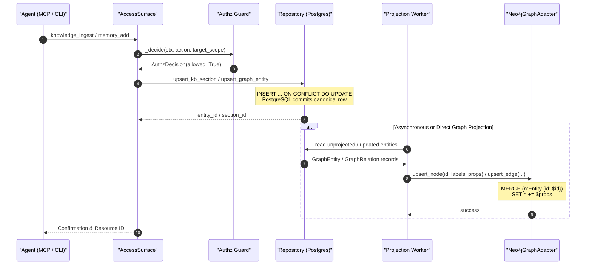
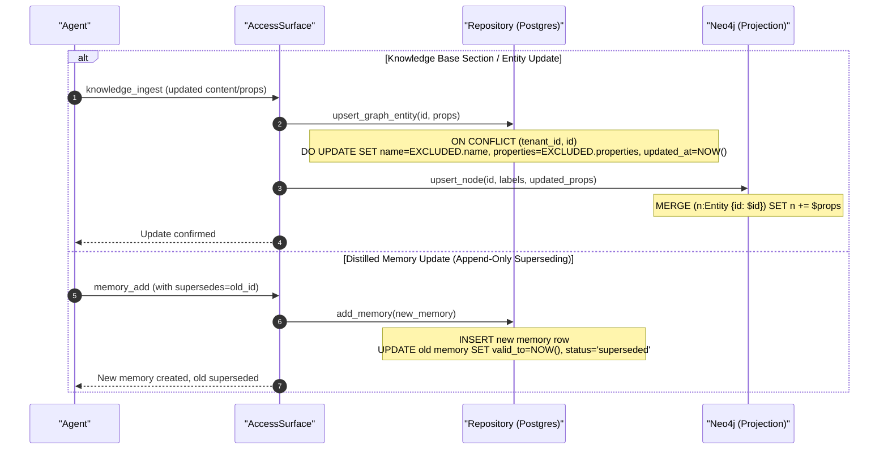
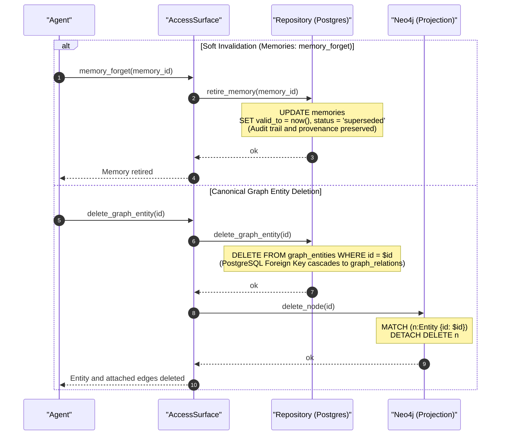
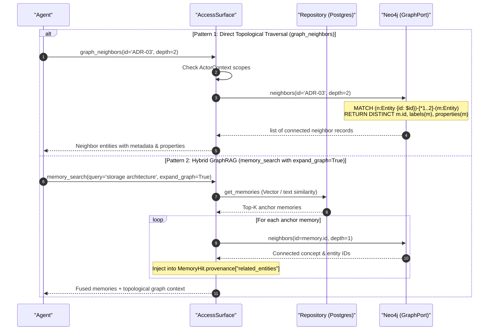

# Data Flow, Lifecycle & Graph Retrieval Architecture

## 1. Architectural Foundation & Topology

Engramory separates persistent state and relational graph traversal according to **ADR-01** (PostgreSQL Spine), **ADR-02** (Ports & Adapters), and **ADR-05** (Rebuildable Projections).

```text
 ┌────────────────────────┐
 │   Agent / Caller       │
 │   (MCP Gateway / CLI)  │
 └───────────┬────────────┘
             │
             ▼
 ┌────────────────────────┐
 │     AccessSurface      │
 │  (Authz, Token Budget) │
 └─────┬────────────┬─────┘
       │            │
       │ (1. Read/  │ (2. Graph Traversal /
       │  Write)    │     Projection)
       ▼            ▼
┌─────────────┐  ┌─────────────┐
│ PostgreSQL  │  │    Neo4j    │
│  (Canonical │  │ (Rebuildable│
│    Spine)   │  │ Projection) │
└─────────────┘  └─────────────┘
```

- **PostgreSQL is the Single Source of Truth:** All entities, relationships, lineage, episodes, and knowledge sections are permanently committed to PostgreSQL.
- **Neo4j is an Unprivileged Projection:** Neo4j stores derived graphs optimized for multi-hop graph traversals. Neo4j is never the independent source of truth. If Neo4j is lost or restarted, running `engramory graph reproject` reconstructs 100% of the graph from PostgreSQL.

---

## 2. Tool & Capability Inventory: Insert, Update, Delete & Retrieve

| Surface / Layer | Insertion / Add | Update / Modify | Deletion / Retire | Retrieval / Query |
|---|---|---|---|---|
| **Agent Face (MCP / SPEC-01)** | `memory_add`<br>`knowledge_ingest` | Append new version with `supersedes`<br>`knowledge_ingest` (upsert) | `memory_forget` (soft retire; sets `valid_to=now()`) | `memory_search`<br>`graph_neighbors`<br>`agent_profile_get` |
| **Access Surface (`AccessSurface`)** | `memory_add(...)`<br>`knowledge_ingest(...)` | `knowledge_ingest(...)`<br>Superseding append | `memory_forget(...)` (soft delete) | `memory_search(..., expand_graph=True)`<br>`graph_neighbors(id, depth)` |
| **Canonical Repo (`Repository`)** | `add_episode`<br>`add_memory`<br>`upsert_kb_section`<br>`upsert_graph_entity`<br>`upsert_graph_relation` | `upsert_kb_section` (`ON CONFLICT DO UPDATE`)<br>`upsert_graph_entity` (`ON CONFLICT DO UPDATE`)<br>`upsert_graph_relation` (`ON CONFLICT DO UPDATE`) | `retire_memory` (soft: `status='superseded'`)<br>`delete_graph_entity` (hard: cascading FKs)<br>`delete_graph_relation` (hard) | `get_memories`<br>`get_kb_sections`<br>`get_graph_entity`<br>`get_graph_entities`<br>`get_graph_relations` |
| **Graph Adapter (`Neo4jGraphAdapter`)** | `upsert_node`<br>`upsert_edge` | `upsert_node` (`MERGE ... SET +=`)<br>`upsert_edge` (`MERGE ... SET +=`) | `delete_node` (`DETACH DELETE n`)<br>`delete_edge` (`MATCH ()-[r]->() DELETE r`) | `neighbors(id, rel, depth)` (1..5 hops) |

---

## 3. Sequential Data Flow Diagrams

### 3.1 Document & Knowledge Insertion Sequence



---

### 3.2 Document & Memory Update Sequence (Immutability & Upsert)



---

### 3.3 Deletion & Invalidation Sequence



---

### 3.4 Agent Graph Retrieval & Hybrid Retrieval Sequence



---

## 4. Disaster Recovery & Projection Rebuild

Because Neo4j is strictly an unprivileged projection, disaster recovery requires zero tape or external database snapshots:

```bash
# 1. Wipe or redeploy Neo4j container
docker rm -f engramory-neo4j
docker compose up -d neo4j

# 2. Replay all entities and relationships from canonical PostgreSQL
uv run engramory graph reproject
```

Output:

```text
Re-projecting entities and relations from Postgres to Neo4j...
Projected 10 entities to Neo4j.
Projected 20 relations to Neo4j.
Graph re-projection complete: 10 entities, 20 relations.
```
