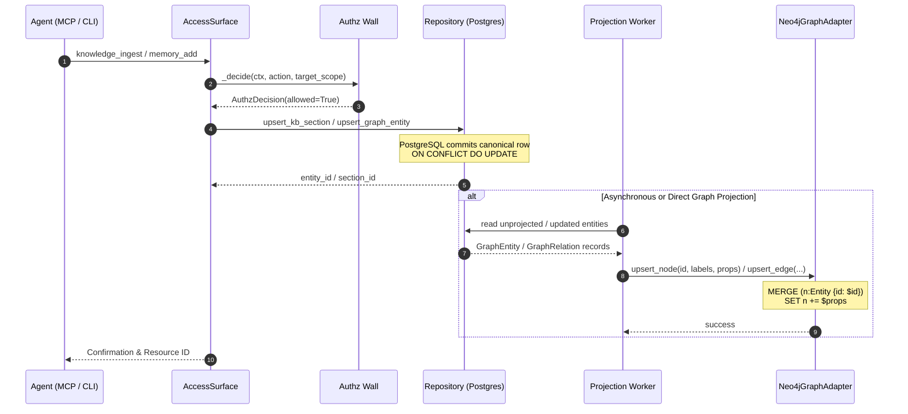
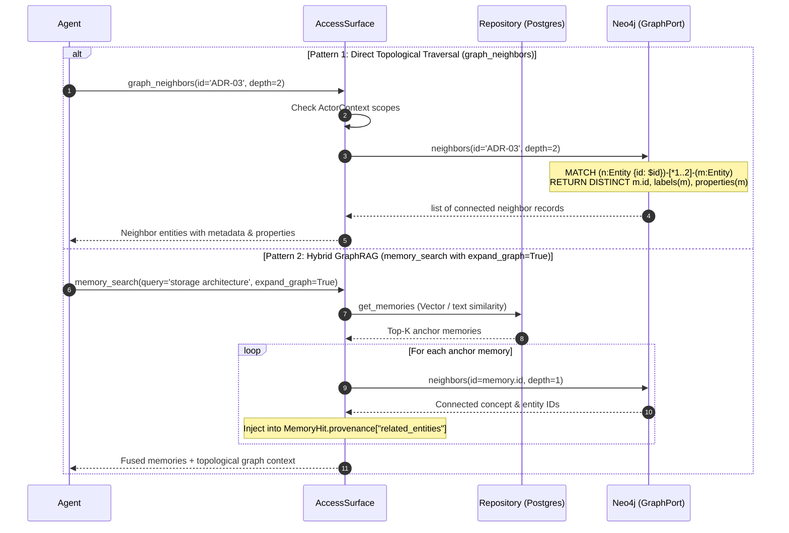
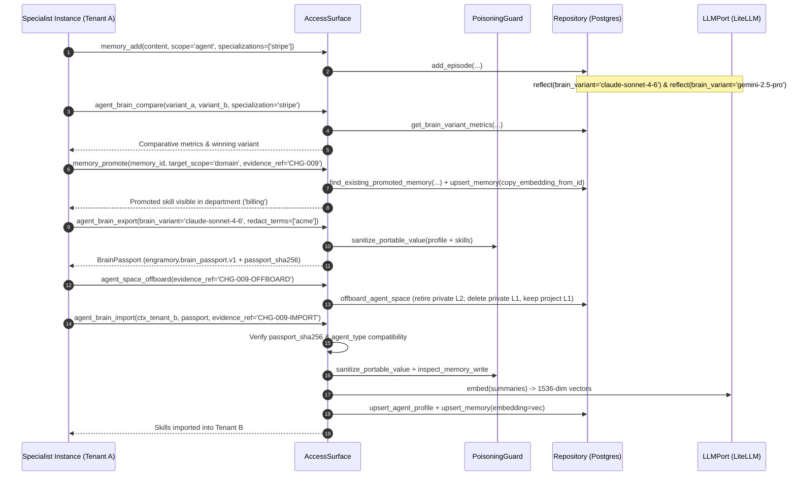

# Data Flow, Lifecycle & Graph Retrieval Architecture

## 1. Architectural Foundation & Topology

Engramory separates persistent canonical state and relational graph traversal according to **ADR-01** (PostgreSQL Spine), **ADR-02** (Ports & Adapters), and **ADR-05** (Rebuildable Projections).

```text
 ┌────────────────────────┐
 │   Agent / Caller       │
 │   (MCP Gateway / CLI)  │
 └───────────┬────────────┘
             │
             ▼
 ┌────────────────────────┐
 │     AccessSurface      │
 │  (Authz, Token Budget) │
 └─────┬────────────┬─────┘
       │            │
       │ (1. Read/  │ (2. Graph Traversal /
       │  Write)    │     Projection)
       ▼            ▼
┌─────────────┐  ┌─────────────┐
│ PostgreSQL  │  │    Neo4j    │
│  (Canonical │  │ (Rebuildable│
│    Spine)   │  │ Projection) │
└─────────────┘  └─────────────┘
```

### Core Invariants

1. **PostgreSQL is the Single Source of Truth:** All entities, relationships, lineage, episodes, and knowledge sections are permanently committed to PostgreSQL tables (`graph_entities`, `graph_relations`, `memories`, `kb_sections`).
2. **Neo4j is an Unprivileged Projection:** Neo4j stores derived property graphs optimized for multi-hop graph traversals, shortest path calculations, and topological neighborhood discovery. Neo4j is never the independent source of truth. If Neo4j is lost or restarted, running `engramory graph reproject` reconstructs 100% of the graph from PostgreSQL.
3. **Ports & Adapters Isolation:** Core business logic and workers only import `GraphPort` from `engramory.ports`. The vendor `neo4j` Python driver is restricted exclusively to `engramory.adapters.dev.graph_neo4j`.

---

## 2. Tool & Capability Inventory: Insert, Update, Delete & Retrieve

> [!NOTE]
> For the complete architecture, real-world scale evaluation (1,180 files in `b-local-privy`), layer taxonomy, and sequence diagrams across all 10 SDD layers (`01_BRD` to `10_EVAL`), see [SDD Knowledge Graph Architecture](SDD_KNOWLEDGE_GRAPH_ARCHITECTURE.md).

| Surface / Layer | Insertion / Add | Update / Modify | Deletion / Retire | Retrieval / Query |
|---|---|---|---|---|
| **Agent Face (MCP / CLI / SPEC-01)** | `memory_add`<br>`memory_promote`<br>`memory_ingest_event`<br>`agent_profile_upsert`<br>`agent_brain_import`<br>`knowledge_ingest`<br>`knowledge_ingest_media`<br>`sdd_ingest` | Append new version with `supersedes`<br>`agent_profile_upsert`<br>`memory_feedback`<br>`knowledge_ingest` (upsert) | `memory_forget` (soft retire; sets `valid_to=now()`)<br>`agent_space_offboard` (retire private L2 + purge private L1 + delete L3 profile) | `memory_search` (`include_knowledge`, `expand_graph`, `brain_variant`, `specialization`)<br>`knowledge_search`<br>`agent_profile_get`<br>`agent_roster_list`<br>`agent_brain_export`<br>`agent_brain_compare`<br>`memory_learning_health`<br>`graph_neighbors` · `context_slice` · `blast_radius` |
| **Access Surface (`AccessSurface`)** | `memory_add(...)`<br>`memory_promote(...)`<br>`agent_profile_upsert(...)`<br>`agent_brain_import(...)`<br>`knowledge_ingest(...)`<br>`knowledge_ingest_media(...)` | `knowledge_ingest(...)`<br>`agent_profile_upsert(...)`<br>`memory_feedback(...)`<br>Superseding append | `memory_forget(...)` (soft delete)<br>`agent_space_offboard(...)` (transactional tenant cleanup) | `memory_search(..., include_knowledge=True, expand_graph=True, brain_variant=..., specialization=...)`<br>`knowledge_search(...)`<br>`agent_roster_list(...)`<br>`agent_brain_export(...)`<br>`agent_brain_compare(...)`<br>`graph_neighbors(id, depth)` · `context_slice(task_id, depth)` · `blast_radius(doc_id, depth)` |
| **Canonical Repo (`Repository`)** | `add_episode`<br>`upsert_memory` (with `embedding` / `copy_embedding_from_id`)<br>`upsert_agent_profile`<br>`upsert_kb_section`<br>`upsert_graph_entity`<br>`upsert_graph_relation` | `upsert_agent_profile` (`ON CONFLICT DO UPDATE`)<br>`upsert_kb_section` (`ON CONFLICT DO UPDATE`)<br>`upsert_graph_entity` (`ON CONFLICT DO UPDATE`)<br>`record_feedback` | `retire_memory` (soft: `status='superseded'`)<br>`offboard_agent_space` (transactional)<br>`delete_graph_entity` (hard: cascading FKs)<br>`delete_graph_relation` (hard) | `get_memories` (`brain_variant`, `specialization`)<br>`find_existing_promoted_memory`<br>`list_agent_profiles` (ranked by confidence & skill count)<br>`get_brain_variant_metrics`<br>`search_kb_sections` (3-leg RRF)<br>`get_graph_entity` · `get_graph_entities` · `get_graph_relations` |
| **Graph Adapter (`Neo4jGraphAdapter`)** | `upsert_node`<br>`upsert_edge` | `upsert_node` (`MERGE ... SET +=`)<br>`upsert_edge` (`MERGE ... SET +=`) | `delete_node` (`DETACH DELETE n`)<br>`delete_edge` (`MATCH ()-[r]->() DELETE r`) | `neighbors(id, rel, depth)`<br>`ancestors(id, rel, depth)`<br>`descendants(id, rel, depth)` |

---

## 3. Sequential Data Flow Diagrams & Explanations

### 3.1 Document & Knowledge Insertion Sequence



#### Detailed Step-by-Step Explanation

1. **Invocation:** An agent or worker calls `knowledge_ingest` or `memory_add` via the MCP gateway or CLI face, providing content, scope, and metadata.
2. **Authorization Enforcement:** `AccessSurface` invokes `_decide(ctx, action, target_scope)`. The authorization guard evaluates the caller's verified claims (`ActorContext`) against `KNOWN_ACTIONS` and the visibility ladder (`agent → project → domain → space`), enforcing a default-deny, fail-closed posture.
3. **Authorization Grant:** If the actor has sufficient grants for the requested scope and tenant, an `AuthzDecision(allowed=True)` is issued.
4. **Canonical Ingestion in PostgreSQL:** `Repository.upsert_graph_entity()` executes an atomic parameterized `INSERT INTO graph_entities (...) ON CONFLICT (tenant_id, id) DO UPDATE`. PostgreSQL guarantees ACID durability and issues a row write with audit timestamps.
5. **Ingestion Confirmation:** The database transaction commits, and `Repository` returns the confirmed resource identifier.
6. **Projection Trigger:** Either inline during sync or asynchronously via `GraphProjectionWorker`, the unprojected or updated entities and relationships are retrieved from PostgreSQL.
7. **Entity Read:** The projection worker receives typed `GraphEntity` and `GraphRelation` instances containing structured properties and tenant tags.
8. **Projection to Neo4j:** The worker invokes `Neo4jGraphAdapter.upsert_node()` and `upsert_edge()` via `GraphPort`.
9. **Cypher Idempotent Upsert:** Neo4j executes parameterized Cypher:

   ```cypher
   MERGE (n:Entity {id: $id})
   SET n:ADR, n += $props
   ```

   Schema unique constraints ensure fast lookup and eliminate duplicate nodes.
10. **Projection Success:** Neo4j acknowledges the graph mutation.
11. **Agent Response:** The agent receives a successful confirmation payload containing the resource ID, token cost, and audit verification.

---

### 3.2 Document & Memory Update Sequence (Immutability vs Upsert)


#### Detailed Step-by-Step Explanation

- **Branch A: Governed Technical Knowledge Base & Graph Entities (In-Place Upsert):**
  1. An agent submits an updated specification or ADR through `knowledge_ingest`.
  2. `Repository.upsert_graph_entity()` executes an upsert query in PostgreSQL:

     ```sql
     INSERT INTO graph_entities (id, entity_type, name, tenant_id, domain_id, properties)
     VALUES (%s, %s, %s, %s, %s, %s)
     ON CONFLICT (tenant_id, id)
     DO UPDATE SET name = EXCLUDED.name, properties = EXCLUDED.properties, updated_at = NOW();
     ```

  3. The updated entity properties are propagated to Neo4j via `GraphPort.upsert_node()`, which applies `SET n += $props` to the existing node record without altering existing edges.
  4. Confirmation is returned to the agent.

- **Branch B: Cognitive Distillation & Episodic Memories (Append-Only Superseding):**
  1. Distilled memories (L1/L2) are **immutable by design** (ADR-05). Memories are never mutated in place.
  2. When an agent updates or refines an existing memory, it submits a new memory payload specifying `supersedes = old_memory_id`.
  3. `Repository.add_memory()` inserts the new memory row in PostgreSQL with a fresh UUID. Within the same transaction, it executes:

     ```sql
     UPDATE memories
     SET valid_to = now(), status = 'superseded'
     WHERE id = %(supersedes)s AND tenant_id = %(tenant_id)s;
     ```

  4. Full historical provenance, audit trails, and confidence metrics of previous reasoning cycles remain queryable for temporal audits.

---

### 3.3 Deletion & Invalidation Sequence


#### Detailed Step-by-Step Explanation

- **Branch A: Soft Invalidation for Memories (`memory_forget`):**
  1. The agent invokes `memory_forget(memory_id)`.
  2. `Repository.retire_memory()` executes:

     ```sql
     UPDATE memories
     SET valid_to = now(), status = 'superseded'
     WHERE id = %(id)s AND tenant_id = %(tenant_id)s AND valid_to IS NULL;
     ```

  3. No rows are permanently deleted. The memory is excluded from standard retrieval queries because `valid_to` is no longer null, but provenance and feedback history are preserved.
  4. `Repository` confirms the update; `AccessSurface` logs the retirement event.

- **Branch B: Canonical Graph Entity Deletion:**
  1. When an entity is decommissioned, `Repository.delete_graph_entity(id, tenant_id=...)` is called.
  2. In PostgreSQL, executing `DELETE FROM graph_entities WHERE id = %s AND tenant_id = %s` triggers the foreign key constraint:

     ```sql
     FOREIGN KEY (tenant_id, src_id) REFERENCES graph_entities (tenant_id, id) ON DELETE CASCADE,
     FOREIGN KEY (tenant_id, dst_id) REFERENCES graph_entities (tenant_id, id) ON DELETE CASCADE
     ```

     All incoming and outgoing relationships in `graph_relations` are automatically pruned.
  3. In Neo4j, `Neo4jGraphAdapter.delete_node(id=...)` executes:

     ```cypher
     MATCH (n:Entity {id: $id})
     DETACH DELETE n
     ```

     This atomically drops the node and all connected relationships from the graph projection.
  4. Confirmation is returned to the agent.

---

### 3.4 Agent Graph Retrieval & Hybrid Retrieval (GraphRAG) Sequence



#### Detailed Step-by-Step Explanation

- **Pattern 1: Direct Topological Traversal (`graph_neighbors`):**
  1. The agent requests graph neighbors of a specific node (e.g. `graph_neighbors(id='ADR-03', depth=2)`).
  2. `AccessSurface` verifies the caller's `ActorContext` permissions for action `"graph_neighbors"`.
  3. `AccessSurface` calls `GraphPort.neighbors()`. Depth is clamped between 1 and 5 hops to prevent combinatorial explosion.
  4. Neo4j executes the traversal:

     ```cypher
     MATCH (n:Entity {id: $id})-[*1..$depth]-(m:Entity)
     WHERE m.id <> $id
     RETURN DISTINCT m.id AS id, labels(m) AS labels, properties(m) AS properties
     ```

  5. Neo4j returns matching records. The adapter strips internal tags (`:Entity`) and returns clean structured dictionaries (`id`, `labels`, `properties`).
  6. The agent receives the neighborhood map showing upstream constraints and downstream dependencies.

- **Pattern 2: Hybrid GraphRAG (`memory_search` with `expand_graph=True`):**
  1. The agent searches for memories using natural language (e.g. `"storage architecture"`).
  2. PostgreSQL evaluates semantic similarity via `pgvector` (`embedding <=> query_vec`) or lexical BM25/`ts_lex` search.
  3. PostgreSQL returns the top-$k$ relevant anchor memories within the agent's token budget.
  4. For each anchor memory, `AccessSurface` queries Neo4j for 1-hop neighbors (`GraphPort.neighbors(id=memory.id, depth=1)`).
  5. Discovered connected entities are appended to `MemoryHit.provenance["related_entities"]`.
  6. The agent receives a consolidated payload containing both dense text summaries and topological graph linkages.

---

### 3.5 Virtual Employee Lifecycle: Multi-Model Distillation, Selective Promotion & Portable Brain Passport Sequence

For the complete Virtual Employee specification, see [VIRTUAL_EMPLOYEE_ARCHITECTURE.md](VIRTUAL_EMPLOYEE_ARCHITECTURE.md).



---

## 4. Disaster Recovery & Projection Rebuild

Because Neo4j is strictly an unprivileged projection, disaster recovery requires zero tape or external database snapshots:

```bash
# 1. Wipe or redeploy Neo4j container
docker rm -f engramory-neo4j
docker compose up -d neo4j

# 2. Replay all entities and relationships from canonical PostgreSQL
uv run engramory graph reproject
```

Output:

```text
Re-projecting entities and relations from Postgres to Neo4j...
Projected 10 entities to Neo4j.
Projected 20 relations to Neo4j.
Graph re-projection complete: 10 entities, 20 relations.
```
