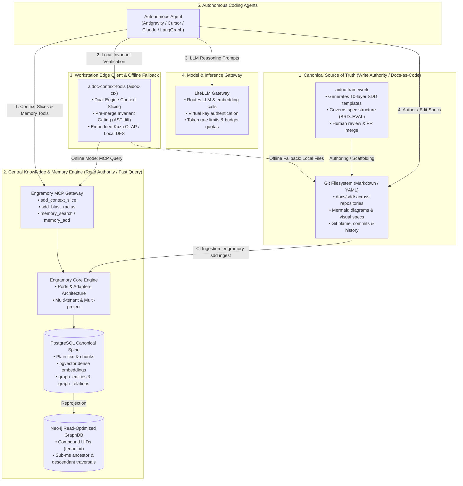
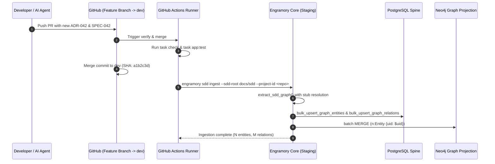
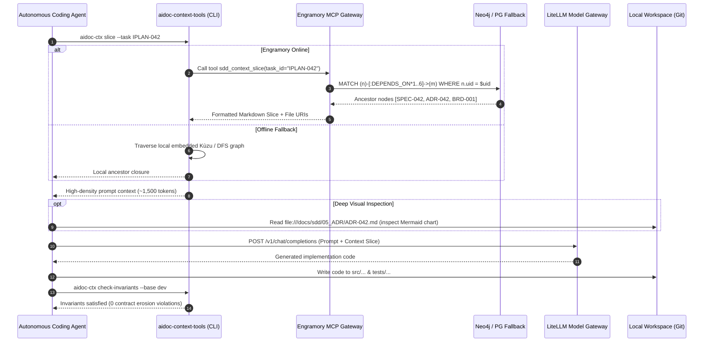

# Ecosystem SDD Integration Architecture

## Overview

This document specifies the end-to-end integration architecture between the **AIDoc Framework** (`vladm3105/aidoc-flow-framework`), **AIDoc Context Tools** (`vladm3105/aidoc-context-tools`), and **Engramory** (`vladm3105/aidoc-flow-engramory`).

It establishes the **Dual-Core CQRS (Command Query Responsibility Segregation) + Docs-as-Code** pattern for autonomous AI coding agents across the organization.

---

## 1. System Topology & Architectural Roles



---

## 2. Component Responsibility Matrix

| Component | Repository | Primary Responsibility | Ground Truth Status | Interfaces Exposed |
|---|---|---|---|---|
| **AIDoc Framework** | `vladm3105/aidoc-flow-framework` | Authoring 10-layer SDD specifications, lifecycle governance (`SEED2C`..`SDD2C`), document templates, review crews. | **Canonical Ground Truth (Write Authority)** for all markdown/YAML files. | File templates, `.aidoc/Taskfile.yml`, `deploy.sh`. |
| **Engramory** | `vladm3105/aidoc-flow-engramory` | Multi-project knowledge base (L0), semantic embeddings (pgvector), topological graph (Neo4j), and agent episodic memory (L1–L3). | **Primary Query & Retrieval Engine (Read Model)**. Rebuildable from Git files. | `engramory` CLI, MCP Gateway (stdio / HTTP), `AccessSurface`. |
| **AIDoc Context Tools** | `vladm3105/aidoc-context-tools` | Edge CLI (`aidoc-ctx`), local context slicing, AST pre-merge invariant gating (`check-invariants`), embedded Kùzu OLAP. | **Edge Client & Linter**. Operates on local worktree files. | `aidoc-ctx` CLI, FastMCP local server. |
| **LiteLLM Proxy** | Platform Gateway | Model virtualization, embedding generation, rate-limiting, and cost allocation. | Stateless gateway. | `/v1/chat/completions`, `/v1/embeddings`. |

---

## 3. The Dual-Core Operational Model (CQRS)

### 3.1 Write Model: Git as Ground Truth

1. **Human & Agent Authoring**:
   - All architectural requirements, decisions, specifications, test plans, and change requests are authored as structured Markdown and YAML files in `docs/sdd/` (`01_BRD` through `10_EVAL`).
2. **Git Verifiability**:
   - Specifications undergo code review, cryptographic commit signing, PR approval gates, and git blame auditing.
3. **Visual Media & Diagrams**:
   - Rich visuals (Mermaid diagrams, sequence charts, architectural schemas, state machines) live natively in Git Markdown. They are not forced into vector chunks; instead, their files are referenced by URI in graph metadata.

### 3.2 Read Model: Engramory as High-Performance Projection

1. **Automated Ingestion**:
   - On PR merge or CLI trigger, `engramory sdd ingest` scans the repository's `docs/sdd/` directory.
   - Extracts metadata, entity IDs, dependencies (`REFERENCES`, `SPECIFIES`, `DERIVED_FROM`), tokenizes targets, and auto-generates stubs for uncommitted references.
   - Bulk-upserts rows into PostgreSQL (`graph_entities`, `graph_relations`, `memories`) inside atomic transactions.
2. **Graph Projection**:
   - Project entities and relations into Neo4j using compound `uid = f"{tenant_id}:{id}"` for sub-millisecond multi-hop graph traversals.
3. **High-Density Context Slicing**:
   - When an autonomous coding agent starts working on an implementation task (e.g. `IPLAN-042`), it requests the upstream context slice:
     $$\text{Context}(T_k) = \text{Ancestors}(T_k) \cap \{\text{SPEC}, \text{BDD}, \text{ADR}, \text{EARS}, \text{BRD}\}$$
   - Engramory traverses the graph and returns a compact, high-density context slice (~1,500 tokens instead of 25k+ tokens), slashing token consumption by 70–85% and eliminating specification amnesia.
4. **Disaster Recovery & Zero-Data-Loss**:
   - If Neo4j or PostgreSQL is wiped, re-running `engramory sdd ingest` completely reconstructs the knowledge graph deterministically from Git files.

---

## 4. Interaction Flows

### 4.1 Knowledge Ingestion Sequence (CI/CD Pipeline)



### 4.2 Agent Execution & Context Slicing Sequence



---

## 5. Rich Media, Diagrams & Visualizations

Technical specifications often contain diagrams, charts, and tables that are essential for humans and multimodal agents, but difficult or noisy to vectorize into vector databases:

1. **Mermaid & Sequence Diagrams**:
   - Remain authored in Markdown files in Git (`docs/sdd/`).
   - Engramory extracts textual metadata, structural relations (`DEPENDS_ON`, `SPECIFIES`), and summary abstracts.
   - When an agent requests a context slice, Engramory returns the summary and the local file link:

     ```markdown
     ### [ADR-042: Compound Graph UIDs](file:///workspace/docs/sdd/05_ADR/ADR-042.md#L1-L80)
     - **Summary**: Neo4j Community single-property compound uniqueness.
     - **Status**: accepted
     - **Full Document & Diagrams**: See linked file for architectural Mermaid flowcharts.
     ```

2. **Multimodal Agent Fallback**:
   - If an agent needs to reason about the visual flow, it uses its toolchain to read the linked file directly from the filesystem.

---

## 6. Implementation & Adoption Roadmap

1. **Continuous Ingestion in CI/CD**:
   - Add automated `engramory sdd ingest` actions to `aidoc-framework` and consumer repos on merge to `dev` and `main`.
2. **`aidoc-context-tools` Dual-Engine Adapter**:
   - Teach `aidoc-ctx slice` to check for `ENGRAMORY_MCP_URL` or local `engramory` binary, delegating to Engramory when available and falling back to embedded Kùzu when offline.
3. **Standard Agent MCP Configuration**:
   - Ship standardized `.cursor/mcp.json` and Antigravity MCP definitions across all ecosystem repositories.
