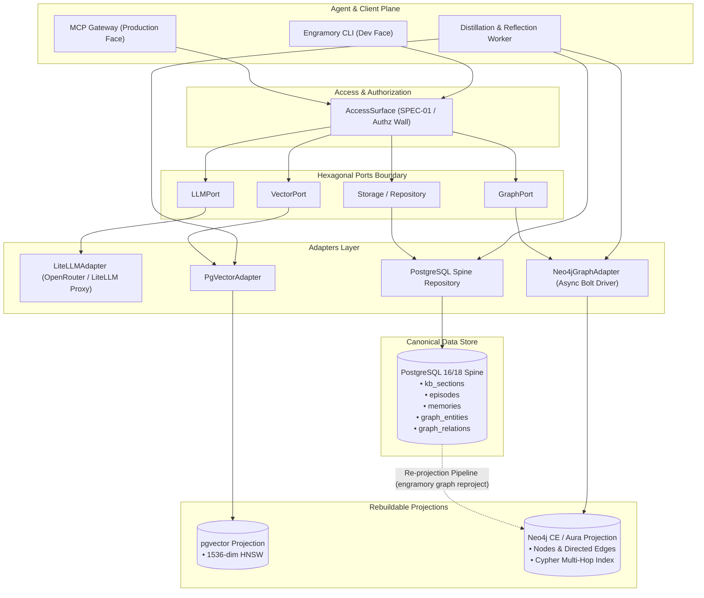
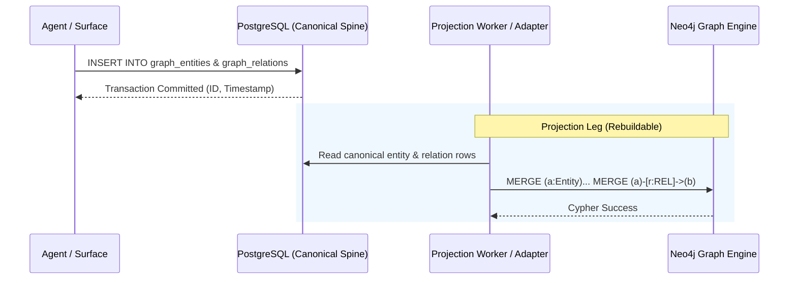
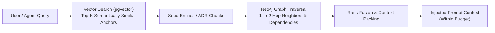

# Neo4j Migration & Post-Migration Architecture Guide

> **Document Version:** 1.0  
> **Status:** Draft / Proposed  
> **Canonical References:** [ADR-01 (PostgreSQL Spine)](../sdd/05_ADR/ADR-01_postgres_spine.yaml), [ADR-02 (Ports & Adapters)](../sdd/05_ADR/ADR-02_ports_and_adapters.yaml), [ADR-03 (Neo4j Graph Engine)](../sdd/05_ADR/ADR-03_graph_engine.yaml), [ADR-05 (Rebuildable Projections)](../sdd/05_ADR/ADR-05_rebuildable_projections.yaml), [PLAN-006](../plans/PLAN-006_neo4j-graph-engine-integration.md)

---

## 1. Overview & Architectural Intent

Engramory serves as the shared memory and knowledge core for agentic systems across the platform. While vector embeddings provide fuzzy semantic matching over unstructured text, complex agent reasoning requires **topological and relational awareness**—such as tracking architectural dependencies, multi-hop entity lineage, and constraint propagation.

Per **ADR-03**, Engramory adopts **Neo4j Community Edition (CE)** in development and staging (with an unblocked path to Neo4j Aura in cloud environments) as its dedicated graph engine behind [`GraphPort`](../src/engramory/ports/graph.py).

### The Prime Invariant: Rebuildable Projection ([ADR-01](../sdd/05_ADR/ADR-01_postgres_spine.yaml) / [ADR-05](../sdd/05_ADR/ADR-05_rebuildable_projections.yaml))

> **CRITICAL ARCHITECTURAL RULE:**  
> **PostgreSQL is the single canonical source of truth.**  
> Neo4j is **never** an independent source of truth. The Neo4j graph is a **derived, rebuildable projection** of entities, relations, and lineage recorded in PostgreSQL.

If a Neo4j instance or its storage volume is corrupted, upgraded, or destroyed, the entire graph can be deterministically re-projected from PostgreSQL with zero data loss.

---

## 2. Post-Migration System Topology

The diagram below illustrates the post-migration architecture and data flow across Engramory components:



---

## 3. The Dual-Store Contract & Write Flow

To maintain data integrity without complex distributed transactions (2PC), Engramory follows an asynchronous projection pattern:

### 3.1 Write Lifecycle

1. **Canonical Commit:** When new entities, document sections, or relationship triplets are created, they are written first to PostgreSQL tables (`graph_entities`, `graph_relations`, or `kb_sections`).
2. **Projection Dispatch:**
   - *Synchronous Projection:* For fast interactive writes via `GraphPort`, the adapter updates Neo4j immediately after the PostgreSQL transaction commits.
   - *Asynchronous Projection / Backfill:* The distillation worker scans unprojected records in PostgreSQL and projects them into Neo4j in batched Cypher transactions.
3. **Failure Handling:** If a write to Neo4j fails, the canonical data in PostgreSQL remains secure. A background reconciler flags the projection as pending retry.



---

## 4. Graph Data Model & Ontology Standards

### 4.1 Node Labels & Schema

All nodes in Neo4j belong to the base label `:Entity` and carry at least one domain-specific label:

| Label | Domain | Example Identifier | Mandatory Properties |
|---|---|---|---|
| `:Entity` | Global base label | All nodes | `id`, `tenant_id`, `updated_at` |
| `:ADR` | Architecture Decisions | `ADR-01_postgres_spine` | `id`, `title`, `status`, `layer` |
| `:SPEC` | Component Specifications | `SPEC-01_access_surface` | `id`, `title`, `layer` |
| `:BRD` | Business Requirements | `BRD-01_platform_engramory`| `id`, `title` |
| `:Concept` | Architectural & Domain Concepts | `Concept:Spine` | `name`, `domain` |
| `:Memory` | Distilled Long-Term Memory | `mem-UUID` | `id`, `agent_id`, `project_id` |

### 4.2 Relationship Types & Conventions

Relationship types are uppercase snake-case nouns or verbs representing semantic connections:

| Relationship | Direction | Meaning |
|---|---|---|
| `:DEPENDS_ON` | `(A)-[:DEPENDS_ON]->(B)` | Node A requires Node B to function or be implemented |
| `:IMPLEMENTS` | `(SPEC)-[:IMPLEMENTS]->(ADR)` | Component specification implements the architectural decision |
| `:CONSTRAINS` | `(ADR)-[:CONSTRAINS]->(Target)` | Decision imposes technical or architectural boundaries |
| `:SUPERSEDES` | `(New)-[:SUPERSEDES]->(Old)` | Newer record replaces an older, deprecated record |
| `:MENTIONS` | `(Memory)-[:MENTIONS]->(Entity)` | Episodic or ambient memory references an entity |

### 4.3 Uniqueness Constraints

Neo4j constraints must be asserted upon adapter startup:

```cypher
CREATE CONSTRAINT entity_id_unique IF NOT EXISTS
FOR (n:Entity) REQUIRE n.id IS UNIQUE;
```

---

## 5. Migration Execution Runbook

### Step 1: Database Migration (PostgreSQL Canonical Tables)

Apply database migration `0007_graph_entities_canonical.sql` creating the relational store for entities and relationships:

```bash
task app:migrate
```

### Step 2: Container Provisioning

#### Local Development

```bash
docker compose up -d neo4j
```

Verify container status:

```bash
docker compose ps neo4j
curl -s http://localhost:7474 | grep "Neo4j"
```

#### Pre-Production Staging (`100.98.134.10`)

1. Provision credentials in OpenBao:

   ```bash
   bao kv put kv/stage/engramory/neo4j NEO4J_USER=neo4j NEO4J_PASSWORD=<secure_password>
   ```

2. Start container on `platform-mesh` network:

   ```bash
   docker compose up -d stage-neo4j
   ```

### Step 3: Initial Full Graph Projection (Bootstrap)

Run the canonical graph projection tool to parse all existing ADRs, specifications, and entities from PostgreSQL into Neo4j:

```bash
uv run engramory graph reproject --all
```

---

## 6. Disaster Recovery & Zero-Data-Loss Re-projection

If the Neo4j container experiences data corruption or volume loss:

```bash
# 1. Stop and purge corrupted Neo4j volume
docker compose down neo4j -v

# 2. Start fresh Neo4j container
docker compose up -d neo4j

# 3. Wait for Bolt port readiness
until nc -z 127.0.0.1 7687; do sleep 1; done

# 4. Re-project entire graph from PostgreSQL canonical tables
uv run engramory graph reproject --all
```

**Outcome:** All nodes, relationships, and metadata are restored with 100% fidelity without touching primary backups.

---

## 7. Hybrid GraphRAG Retrieval Architecture

In the post-migration architecture, `AccessSurface.memory_search` performs **fused hybrid retrieval**:



1. **Vector Leg (Precision Anchoring):** Finds the top-3 most relevant document sections or memories using cosine similarity (`<=>`) with Qwen 8B embeddings.
2. **Graph Leg (Topological Expansion):** Takes the IDs of the matched documents and queries Neo4j for connected nodes (e.g. what ADRs does this document depend on? what constraints apply?).
3. **Context Fusion:** Fuses and deduplicates the text and the relational subgraph, injecting a self-consistent contextual slice into the agent's prompt within token limits.

---

## 8. Operational & Security Checklist

- [x] **Network Isolation:** Port `7687` (Bolt) accessible only over internal bridge network / `platform-mesh`; never exposed to public internet.
- [x] **Management UI:** Port `7474` (Neo4j Browser) secured behind Tailscale / platform authentication proxy.
- [x] **Memory Caps:** Heap constrained to max 1GB and pagecache to 512MB in compose configurations to prevent host OOM.
- [x] **Non-Root Execution:** Container runs as non-privileged user.
- [x] **Architecture Guard:** CI test `test_no_vendor_imports.py` verifies zero `neo4j` SDK imports outside `adapters/dev/`.
