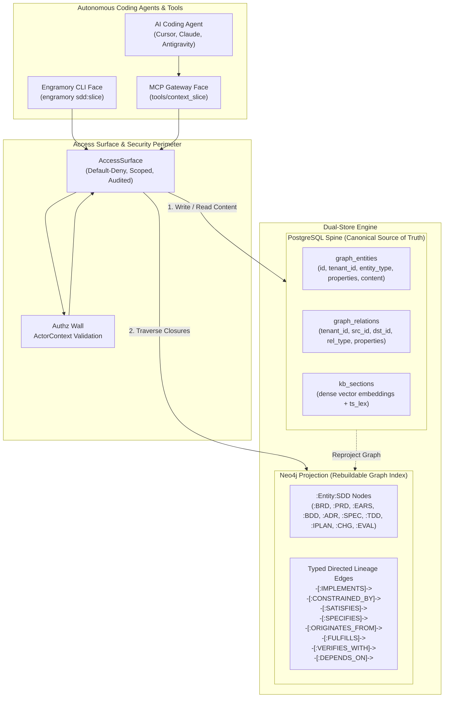
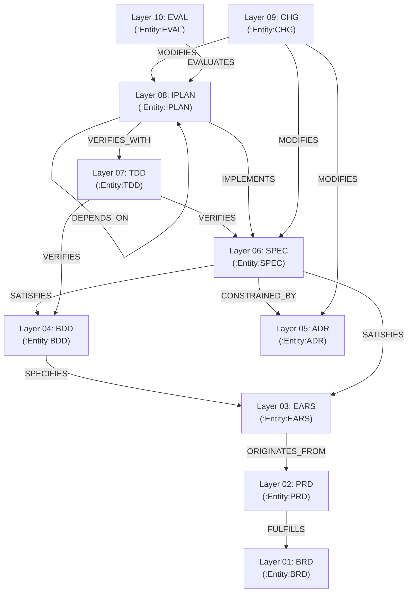
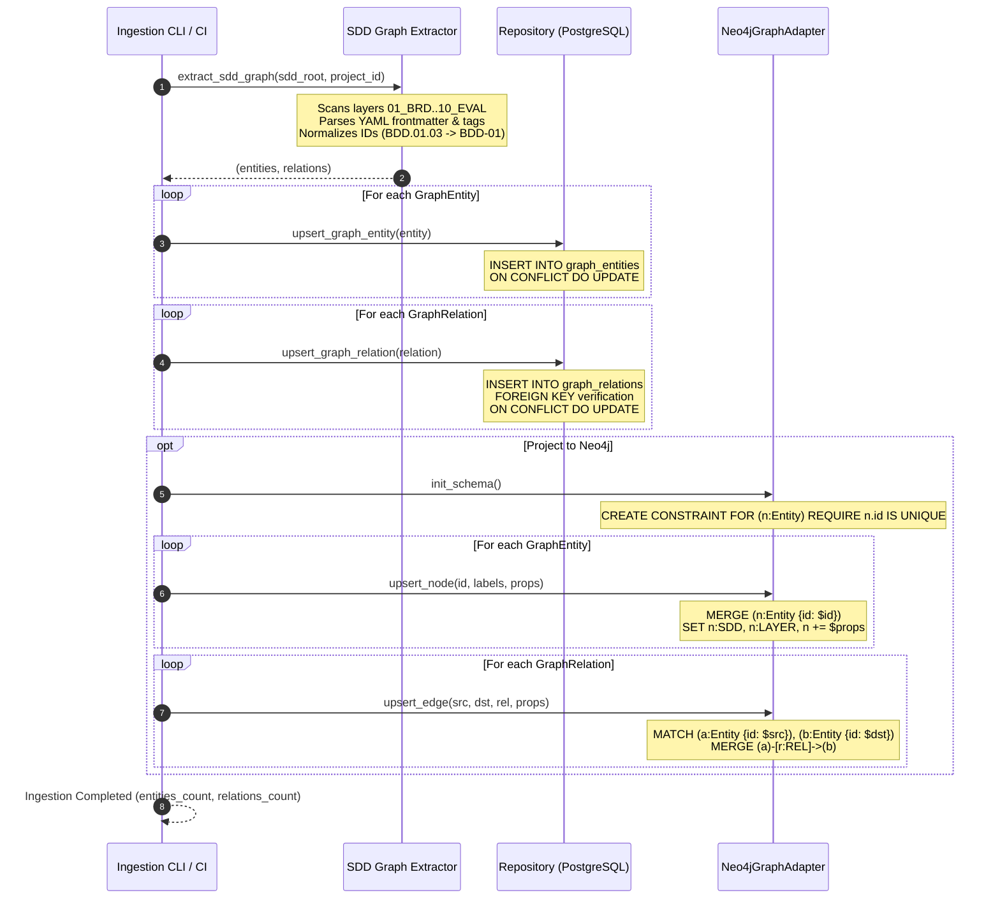
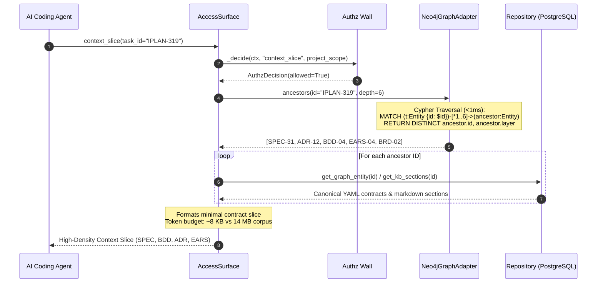
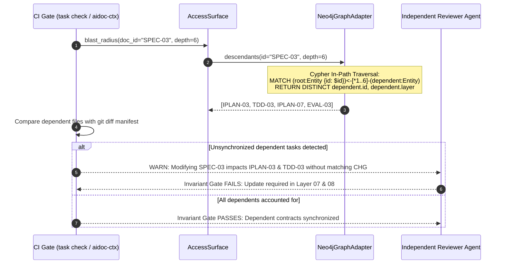
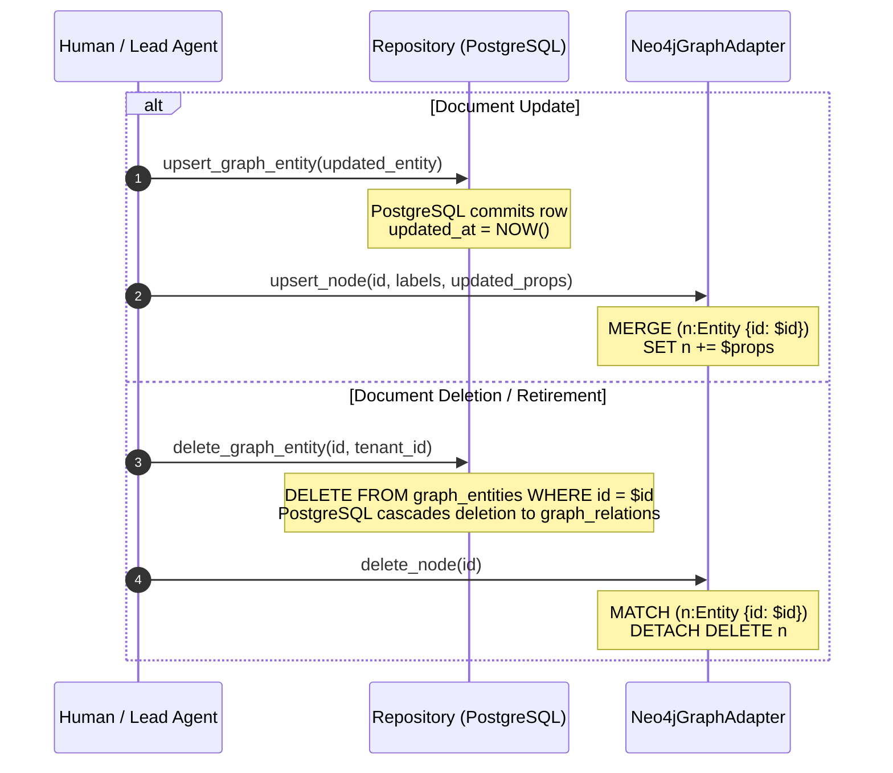

# SDD Knowledge Graph Architecture: PostgreSQL & Neo4j Spine

## 1. Executive Summary & Grounding in the SDD Framework

Specification-Driven Development (**SDD**) is the formal 10-layer engineering methodology governing all projects in the ecosystem (`aidoc-flow`, `iplanic`, `b-local-privy`, `aidoc-flow-engramory`). Rather than treating documentation as static or secondary, SDD treats formal specifications as the **computable source of truth** from strategic business intent down to individual implementation tasks and verification runs.

Engramory serves as the **shared knowledge spine and graph operating system** for this entire SDD corpus.

```text
 01_BRD ──► 02_PRD ──► 03_EARS ──► 04_BDD ──► 05_ADR ──► 06_SPEC ──► 07_TDD ──► 08_IPLAN ──► [Code] ──► 10_EVAL
                                                                                     ▲
 09_CHG (Transactional Governance Overlay) ──────────────────────────────────────────┘
```

Engramory combines **PostgreSQL** (canonical store, full-text search, and dense vector embeddings) with **Neo4j** (rebuildable property graph projection for multi-hop lineage, context slicing, and blast-radius analysis) to empower autonomous coding agents to navigate enterprise-scale codebases without context degradation or token budget exhaustion.

---

## 2. Empirical Scale Evaluation: Real-World SDD Corpus (`b-local-privy`)

To evaluate the operational requirements of the SDD knowledge graph, we analyzed an active production repository: `b-local-privy/docs/sdd`.

### 2.1 Empirical Corpus Metrics

| SDD Layer | Folder | Document Type | File Count | Primary Responsibility |
|---|---|---|---|---|
| **01** | `01_BRD/` | Business Requirements Document | 10 | Strategic objectives, ROI models, problem statements |
| **02** | `02_PRD/` | Product Requirements Document | 12 | Persona definitions, user journeys, functional scopes |
| **03** | `03_EARS/` | Easy Approach to Requirements Syntax | 42 | Formal requirement statements (`WHEN-THE-SYSTEM-SHALL`) |
| **04** | `04_BDD/` | Behavior-Driven Development Scenarios | 43 | State machines, acceptance criteria (`Given-When-Then`) |
| **05** | `05_ADR/` | Architecture Decision Records | 45 | Design rationale, architectural trade-offs, standards |
| **06** | `06_SPEC/` | Component Specifications | 46 | Wire contracts, schemas, API endpoints, data models |
| **07** | `07_TDD/` | Test-Driven Development Plans | 33 | Verification matrices, test pyramid, test cases |
| **08** | `08_IPLAN/` | Implementation Plans | 319 | Atomic implementation tasks, file manifests, steps |
| **09** | `09-CHG/` | Change Governance Envelopes | 472 | Transactional change manifests and architectural gates |
| **10** | `10_EVAL/` | Verification & Evaluation Reports | 153 | Evaluation runs, test outputs, baseline sign-offs |
| **Total** | | **All 10 SDD Layers** | **1,180 files** | **14.0 MB of structured YAML & Markdown** |

### 2.2 The Context Amnesia Problem

In an autonomous multi-agent engineering workflow, a coding agent is assigned an atomic task, such as `IPLAN-319` (*Oferta forward home & card contrast*) or `IPLAN-03` (*Identity and custody foundation*):

1. **Context Window Exhaustion:** 1,180 files (~14 MB) translates to roughly **3.5 million LLM tokens**. No modern frontier model can or should ingest an entire project documentation dump into its active context.
2. **Context Degradation & Amnesia:** Even with large 1M+ token context windows, "needle-in-a-haystack" retrieval across thousands of lines triggers severe attention degradation, causing agents to hallucinate signatures, ignore security constraints, or miss ratified architectural decisions.
3. **Grep and Keyword Search Failure:** Blind keyword grep searches (`git grep`, `rg`) fail because lineage across SDD layers is topological and hierarchical (e.g. `IPLAN-03` links to `SPEC-03`, which links to `ADR-03` and `BDD-01`, which links to `EARS-01`, which links to `PRD-01`).
4. **The Solution: Graph-Driven Deterministic Context Slicing:**
   $$\text{Slice}(T) = \text{Ancestors}(T) \cap \{\text{SPEC}, \text{BDD}, \text{ADR}, \text{EARS}, \text{BRD}\}$$
   By traversing the topological graph in Neo4j, Engramory extracts the exact upstream contract closure ($<1\,\text{ms}$) and hydrates only the governing sections from PostgreSQL, delivering a **5–15 KB high-density prompt** (a **99.9% token reduction**).

---

## 3. Dual-Store Division of Labor: PostgreSQL Spine & Neo4j Projection

Engramory enforces a strict separation between persistent canonical state and rebuildable graph traversal per **ADR-01**, **ADR-02**, and **ADR-05**:



### 3.1 Store Responsibilities

| Dimension | PostgreSQL Spine (Canonical) | Neo4j Projection (Unprivileged) |
|---|---|---|
| **Authority** | **Single Source of Truth (ADR-01)** | **Derived Rebuildable Projection (ADR-05)** |
| **Data Scope** | Full document text, YAML metadata, section chunks, vector embeddings (1536-d), tsvector lexical indexes, audit log | Topological nodes, directed lineage edges, node properties (id, layer, title, status) |
| **Query Strengths** | ACID transactional mutations, exact ID lookup, semantic vector similarity, hybrid rank fusion | Arbitrary-depth path traversals (`*1..6`), cycle detection, topological sorting, upstream closures, downstream blast radius |
| **Failure Mode** | Disaster recovery via PostgreSQL backups / WAL | Reconstructible in seconds via `engramory graph reproject` or `ingest_sdd_knowledge_graph` |
| **Multi-Tenancy** | Composite primary keys `(tenant_id, id)` and foreign key cascading | Node labels + `tenant_id` / `project_id` properties with openCypher filtering |

---

## 4. The SDD Lineage Graph Ontology

In SDD, cross-layer references form a strictly directed, acyclic graph (DAG). The ontology mapped between PostgreSQL and Neo4j is structured as follows:



### 4.1 Relationship Semantics

| Source Layer | Target Layer | Relationship Type | Trigger / Lineage Tag | Semantic Meaning |
|---|---|---|---|---|
| `08_IPLAN` | `06_SPEC` | `IMPLEMENTS` | `source_spec: "@spec: ..."` | The task builds code satisfying this contract |
| `08_IPLAN` | `07_TDD` | `VERIFIES_WITH` | `traceability.upstream.tdd_references` | Tests to run to verify task completion |
| `08_IPLAN` | `08_IPLAN` | `DEPENDS_ON` | `@depends: IPLAN-xx` | Pre-requisite task that must finish first |
| `06_SPEC` | `05_ADR` | `CONSTRAINED_BY` | `architecture_decision: "@adr: ..."` | Architectural boundary constraining interface |
| `06_SPEC` | `04_BDD` | `SATISFIES` | `source_document: "@bdd: ..."` | Behavioral scenario fulfilled by interface |
| `06_SPEC` | `03_EARS` | `SATISFIES` | `source: "@ears: ..."` | Formal requirement syntax fulfilled |
| `04_BDD` | `03_EARS` | `SPECIFIES` | `source_document: "@ears: ..."` | Concrete Given-When-Then of formal syntax |
| `03_EARS` | `02_PRD` | `ORIGINATES_FROM` | `traceability: "@prd: ..."` | Product requirement broken into EARS rules |
| `02_PRD` | `01_BRD` | `FULFILLS` | `brd_reference: "@brd: ..."` | Product container fulfilling business objective |
| `09_CHG` | Any Layer | `MODIFIES` | `authoring_chg:` / file manifest | Governance change modifying document |
| `10_EVAL` | `08_IPLAN` | `EVALUATES` | `evaluation_target:` | Validation sign-off for task |

---

## 5. Sequential Data Flow Diagrams

### 5.1 SDD Corpus Ingestion & Graph Projection Sequence

This sequence runs during project onboarding or CI sync to ingest the full SDD corpus into PostgreSQL and project it to Neo4j.



### 5.2 Autonomous Agent IPLAN Context Slicing Sequence

When an AI coding agent begins working on an implementation plan (e.g. `IPLAN-319`), it requests its deterministic ancestor closure.



### 5.3 PR Blast Radius & Anti-Contract Erosion Invariant Gating

When a pull request proposes modifying an architecture decision record or component specification (e.g. `SPEC-03` or `ADR-04`), the CI gate calculates the downstream blast radius to detect contract erosion.



### 5.4 Document Lifecycle Synchronization: Update & Cascading Deletion

When an SDD document is modified or retired:



---

## 6. Access Surface & openCypher Query Reference

### 6.1 openCypher Queries Used in Engramory

#### 1. Upstream Ancestor Closure (Context Slice)

```cypher
MATCH (n:Entity {id: $id})-[*1..6]->(m:Entity)
WHERE m.id <> $id
RETURN DISTINCT m.id AS id, labels(m) AS labels, properties(m) AS properties
```

#### 2. Downstream Descendant Impact (Blast Radius)

```cypher
MATCH (n:Entity {id: $id})<-[*1..6]-(m:Entity)
WHERE m.id <> $id
RETURN DISTINCT m.id AS id, labels(m) AS labels, properties(m) AS properties
```

#### 3. Traceability Gap & Orphan Detection (CI Hygiene)

```cypher
// Detect specifications with no verifying TDD tests
MATCH (s:SPEC)
WHERE NOT (s)<-[:VERIFIES]-(:TDD)
RETURN s.id AS untested_spec;

// Detect BDD scenarios with no implementing specification
MATCH (b:BDD)
WHERE NOT (b)<-[:SATISFIES]-(:SPEC)
RETURN b.id AS unimplemented_bdd;
```

---

## 7. Cross-Project Domain Segregation & Multi-Tenancy

In enterprise multi-agent deployments, multiple projects store their SDD trees on the shared Engramory core:

- `b-local-privy` (FinTech banking & identity custody: 1,180 documents)
- `aidoc-framework` (SDD workflow and engine contracts)
- `iplanic` (Planning & state machine engine)
- `aidoc-flow-engramory` (Shared memory core)

Engramory enforces strict tenant and project isolation:

1. **PostgreSQL Partitioning & Compound Primary Keys:** Every row is scoped by `(tenant_id, id)`. Deletion or queries cannot leak cross-tenant rows.
2. **Neo4j Property Scoping:** All nodes and relationships carry `tenant_id` and `project_id`. Graph queries run within parameter-bound tenant filters.
3. **Fail-Closed Authorization Wall:** Every request through `AccessSurface` validates `ActorContext.tenant_id` against `TargetScope.tenant_id`. Cross-tenant requests immediately fail closed and are written to the audit log.
