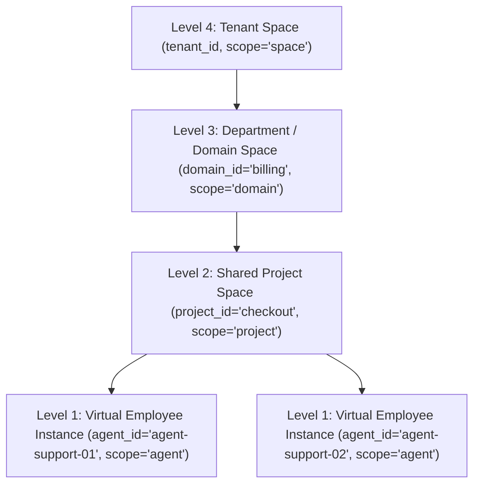

# Engramory Virtual Employee Hierarchy, Multi-Model Brain Variants & Portable Brain Passports

**Authority:** Engramory `ADR-05` (*Canonical Store*), `ADR-06` (*Governed Write & Fail-Closed*), `ADR-07` (*4-Level Scope Ladder*), `SPEC-01` (*AccessSurface*), `SPEC-02` (*Memory Store*), `SPEC-03` (*Retrieval & Graph*), `SPEC-07` (*CLI Face*), and `CHG-009` (`PLAN-024`).

Engramory models every deployed agent instance as a **Virtual Employee** operating on a canonical PostgreSQL 18 spine (`127.0.0.1:5432`) and LiteLLM model gateway (`127.0.0.1:4000`). A tenant fleet (for example, `10` `agent-support` instances, `5` `agent-pm` instances, and `5` `agent-dev` instances) shares project and department knowledge at $O(1)$ memory cost while accumulating specialized, portable per-instance experience.

---

## 1. Three-Level Virtual Employee Fleet Taxonomy

### 1.1 Archetypes, Instances, and Specializations

Engramory separates **Agent Archetype**, **Virtual Employee Instance**, and **Instance Specialization** across L3 `agent_profiles`, L2 `memories.provenance`, and portable Brain Passports:

| Taxonomy Tier | Field | Example Values | Storage Location |
| :--- | :--- | :--- | :--- |
| **Agent Archetype (Class)** | `agent_type` | `"agent-support"`, `"agent-pm"`, `"agent-dev"` | `agent_profiles.standing_preferences->>'agent_type'`, `memories.provenance->>'agent_type'` |
| **Virtual Employee Instance** | `agent_id` | `"agent-support-01"` .. `"agent-support-10"` | Composite primary key `(tenant_id, agent_id)` on `agent_profiles`; private `scope='agent'` L1/L2 wall |
| **Specialization & Department** | `specializations` + `domain_id` | `["stripe", "chargebacks"]`, `domain_id="billing"` | `agent_profiles.standing_preferences->'specializations'`, `memories.provenance->'specializations'`, `memories.domain_id` |

### 1.2 Experience-Ranked Roster Discovery (`agent_roster_list`)

Layer-1 Stewards and routers discover and rank specialist instances within a tenant via `AccessSurface.agent_roster_list` (`engramory profile list`):

- Filters by `domain_id`, `agent_type`, `role`, and `specialization`.
- Left-joins live `scope='agent'` L2 memory aggregates (`active_skill_count`, `mean_confidence`, `brain_variants`) ordered by `mean_confidence DESC, active_skill_count DESC, agent_id ASC`.

---

## 2. Four-Level Visibility Lattice (`ADR-07`)

### 2.1 Zero-Copy Shared Memory & Private Experience

Every Virtual Employee query executes a single scoped SQL read (`Repository.get_memories`) over the 4-level `ADR-07` visibility ladder without duplicating rows across instances:

- **Private Instance Brain (`scope='agent'`):** Stores personal L1 episodes and distilled L2 procedural/episodic skills for a single `agent_id` (`agent-support-01`). Unrelated instances never load these rows into context or HNSW searches.
- **Shared Project Space (`scope='project'`):** Shared by all instances (`support`, `pm`, `dev`) assigned to `project_id`.
- **Department Space (`scope='domain'`):** Shared by all instances holding `domain_id` (for example, `"billing"`), with department spoofing blocked by `AccessSurface._enforce_domain_boundary`.
- **Tenant Space (`scope='space'`):** Organization-wide policies and conventions visible across the tenant.

### 2.2 Governed Skill Promotion (`memory_promote`)

When a Virtual Employee validates a high-value `scope='agent'` skill, `AccessSurface.memory_promote` (`engramory memory promote`) elevates the memory to `scope='project'`, `scope='domain'`, or `scope='space'`:

- Enforces `evidence_ref` (`ADR-06`), source visibility (`_SCOPE_CLAUSES`), and ladder monotonicity.
- Deduplicates across retries and sibling instances via `Repository.find_existing_promoted_memory` without `MAX_K` truncation.

---

## 3. Multi-Model `brain_metadata` & A/B Benchmarking

### 3.1 Parallel `brain_variant` Distillation

Engramory tracks structured `brain_metadata` (`brain_variant`, `distiller_model`, `extraction_model`, `embedding_model`, `rag_params`) across L3 `brain_config`, L2 `memories.provenance`, and L0 `kb_sections.media_metadata`:

- `Repository.get_unreflected_episodes` and `get_active_agents_with_unreflected_episodes` scope their `NOT EXISTS` check by `(m.agent_id, coalesce(m.provenance->>'brain_variant', 'default'))`.
- Operators can run `reflect()` (`engramory memory distill --brain-variant ... --distiller-model ...`) multiple times over the exact same L1 episodes to maintain 2+ parallel distilled knowledge copies per agent instance.

### 3.2 Side-by-Side Comparison (`agent_brain_compare`)

`AccessSurface.agent_brain_compare` (`engramory profile compare-brains --variant-a ... --variant-b ...`) benchmarks two brain variants across:

- `skill_count`, `mean_confidence`, and `mean_token_count`.
- Closed-loop retrieval feedback (`total_retrievals`, `useful_count`, `not_useful_count`, `harmful_count`, `useful_rate`).
- Live side-by-side query hit lists, overlap ratio, and recommended winning variant (`winner`).

---

## 4. Sanitized Portable Brain Passports & Tenant Offboarding

### 4.1 Export, SHA-256 Integrity, & Archetype Guard

To reassign or clone a specialized Virtual Employee across tenants without leaking customer PII or raw L1 logs:

1. **Sanitized Export (`agent_brain_export`):** Exports only L3 `standing_preferences` and high-confidence L2 `scope='agent'` skills. `sanitize_portable_value` recursively scrubs secrets, emails, URLs, IPs, UUIDs, and length-sorted `redact_terms`, sealing the bundle (`engramory.brain_passport.v1`) with a canonical `passport_sha256` digest.
2. **Transactional Offboarding (`agent_space_offboard`):** Retires live `scope='agent'` memories, deletes private `scope='agent'` episodes, and removes the L3 profile on the source tenant while preserving shared `project`/`domain`/`space` artifacts.
3. **Governed Import (`agent_brain_import`):** Verifies `evidence_ref`, mandatory `passport_sha256`, and `agent_type` compatibility (`allow_type_override=False` by default), screens all fields via `inspect_memory_write()`, preserves existing `display_name` and union-merges `specializations` on sibling clones, and re-embeds imported skills into `1536`-dim `pgvector`.
