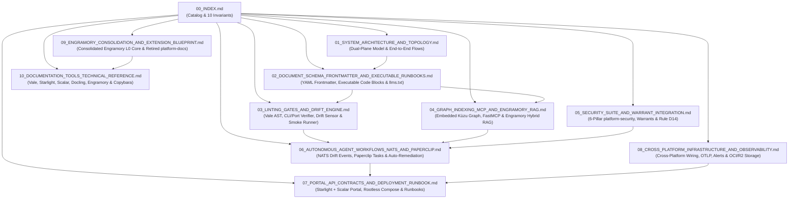

# Platform Docs Documentation Index & Architecture Map

> **Status:** Ratified Platform Specification v1.0  
> **Repository:** `platform-docs` (`doc-tools`)  
> **Primary Consumers:** `aiops-harness`, `aidoc-context-tools`, `aidoc-flow-engramory`, `aidoc-flow-support-desk`, `aiops-pm`, `aiops-dev`, `platform-paperclip`, `platform-security`

---

## 1. Purpose of This Documentation Suite

This directory contains the authoritative architectural, schema, linting, graph-indexing, security, workflow, and operational specifications for **`platform-docs`** (`doc-tools`).

`platform-docs` provides the unified open-source toolchain that maintains, validates, indexes, and serves project documentation, operational playbooks, and infrastructure runbooks across all 35+ repositories in the ecosystem—ensuring every document is simultaneously **machine-executable for autonomous AI agents** and **clear, navigable, and interactive for human engineers**.

---

## 2. Document Map

### 2.1 Specification Catalog

| # | Document | Key Topics Covered |
| :--- | :--- | :--- |
| **01** | **[`01_SYSTEM_ARCHITECTURE_AND_TOPOLOGY.md`](01_SYSTEM_ARCHITECTURE_AND_TOPOLOGY.md)** | • Dual-Audience & Dual-Plane Architecture (`sdd/*` specification chain vs. `docs/*.md` operational playbooks/runbooks) • How `platform-docs` synthesizes Google (`g3doc`/`Tricorder`) and Anthropic (`MCP`/`llms.txt`/agent triage loops) using 100% open-source tools • 4-Layer functional topology (Authoring, Tier-1/2/3 Gates, Agent Context Plane, Human Portal Plane) • End-to-end sequence diagrams for Incident Runbook Execution and Code-to-Doc Drift Remediation |
| **02** | **[`02_DOCUMENT_SCHEMA_FRONTMATTER_AND_EXECUTABLE_RUNBOOKS.md`](02_DOCUMENT_SCHEMA_FRONTMATTER_AND_EXECUTABLE_RUNBOOKS.md)** | • Canonical `DocumentFrontmatter` YAML schema (`id`, `kind`, `domain`, `namespace`, `status`, `autonomy_tier`, `triggers`, `endpoints`, `watched_paths`, `last_verified`) • Executable Fenced Code-Block AST specification (`{id, tier, mode, expect_exit, timeout_sec, requires_warrant}`) • Strict Chunk-Level Independence rules for lossless RAG / Kùzu slicing • Standardized `/llms.txt` and `/llms-full.txt` machine manifest specifications |
| **03** | **[`03_LINTING_GATES_AND_DRIFT_ENGINE.md`](03_LINTING_GATES_AND_DRIFT_ENGINE.md)** | • Tier-1 Offline Gate (`<1s`, zero network): `platform-docs lint`, `Vale` (MIT) prose & chunk-independence rule pack, `markdownlint-cli2`, `yamllint` • Live Command & Endpoint Verifier (validating `aiops-harness` CLI flags, FastMCP tool names, and `127.0.0.1` vs. `10.250.0.1` stage ports) • Deterministic Code-to-Doc Drift Sensor (`watched_paths` git diff matcher) & 90-day `last_verified` TTL staleness scanner • Live `tier="green"` Runbook Smoke Execution integrated with `unified-test-suite` (`uts`) |
| **04** | **[`04_GRAPH_INDEXING_MCP_AND_ENGRAMORY_RAG.md`](04_GRAPH_INDEXING_MCP_AND_ENGRAMORY_RAG.md)** | • Extending `aidoc-context-tools` Embedded Kùzu schema with `RunbookNode`, `RunbookStepNode`, `AlertTriggerNode`, and `ServiceEndpointNode` • openCypher queries for `<1ms` alert-to-runbook and command-to-playbook slicing • FastMCP tool definitions (`docs_slice_runbook`, `docs_validate_file`, `docs_check_drift`, `docs_export_llms`, `docs_search_hybrid`) • Heading-path semantic chunking and hybrid retrieval (`pgvector` HNSW + BM25 RRF) in `aidoc-flow-engramory` |

### 2.2 Security, Workflows & Consolidation Catalog (05–10)

| # | Document | Key Topics Covered |
| :--- | :--- | :--- |
| **05** | **[`05_SECURITY_SUITE_AND_WARRANT_INTEGRATION.md`](05_SECURITY_SUITE_AND_WARRANT_INTEGRATION.md)** | • Full integration with all 6 Pillars of `platform-security` • Authentik 2-Axis Hybrid RBAC & disjoint namespace isolation (`ns:platform`, `ns:aidoc`, `ns:b-local`) for documentation & runbook access • 3-Layer AWS Cedar policies (`platform_security.authz`) + Ed25519 `X-Agent-Warrant` enforcement on `green`/`yellow`/`red` runbook steps • Rule D14 secret scrubbing prior to Kùzu/Engramory indexing and `/llms.txt` export, plus 96-bit CaMeL nonce fencing |
| **06** | **[`06_AUTONOMOUS_AGENT_WORKFLOWS_NATS_AND_PAPERCLIP.md`](06_AUTONOMOUS_AGENT_WORKFLOWS_NATS_AND_PAPERCLIP.md)** | • Autonomous documentation maintenance & self-healing drift loops • NATS JetStream subjects (`xp.platform.docs.drift.v1`, `xp.platform.docs.stale.v1`, `xp.platform.docs.indexed.v1`) and JCS-signed CloudEvents • `aiops-pm` routing and `platform-paperclip` `DOC2C` / `CODE2S` task creation with `$1.50` LiteLLM spend caps • Execution by `aiops-dev` in isolated Gitea worktrees with 2-pass `task review` |
| **07** | **[`07_PORTAL_API_CONTRACTS_AND_DEPLOYMENT_RUNBOOK.md`](07_PORTAL_API_CONTRACTS_AND_DEPLOYMENT_RUNBOOK.md)** | • 100% MIT Open-Source Human Supervision Portal built on **Astro Starlight** + **Scalar** (OpenAPI 3.1 / Protobuf / FastMCP reference) + **Mermaid v11** • Multi-repo aggregator pulling thin-spoke `docs/*.md` and Tier-3 SDD projections • Rootless Docker Compose deployment in `ns:platform` (`UID 1004`), ports `127.0.0.1:8005` / `10.250.0.1:8000`, and OpenBao Path C sidecar • Executable operational runbooks for `platform-docs` health checks, index rebuilds, and incident recovery |
| **08** | **[`08_CROSS_PLATFORM_INFRASTRUCTURE_AND_OBSERVABILITY.md`](08_CROSS_PLATFORM_INFRASTRUCTURE_AND_OBSERVABILITY.md)** | • Cross-platform integration matrix across all `platform-*` repositories (`platform-openbao`, `platform-observability-monitoring`, `platform-litellm-laya`, `platform-temporal`, `platform-superset`, `platform-stage-ops`) • Outbound OTLP spans/metrics/logs to ClickHouse, HyperDX, and Langfuse • Production alert rules (`ALT-DOC-001`–`004`) routed via Chatwoot & `aidoc-flow-support-desk` • Artifact persistence in OCI Object Storage (`stage-docs-bundles`) and Cloudflare R2 Tier B1 off-site backups |
| **09** | **[`09_ENGRAMORY_CONSOLIDATION_AND_EXTENSION_BLUEPRINT.md`](09_ENGRAMORY_CONSOLIDATION_AND_EXTENSION_BLUEPRINT.md)** | • Architectural evaluation: Extending `platform-engramory` (`KnowledgeCore` L0) and retiring standalone `platform-docs` • Alignment with Engramory ADR-08 (*Two Bounded Cores on One Spine*), [MULTIMODAL_AND_POSTGRES_BLOB_STORAGE.md](../MULTIMODAL_AND_POSTGRES_BLOB_STORAGE.md) (`CHG-008`), and [VIRTUAL_EMPLOYEE_ARCHITECTURE.md](../VIRTUAL_EMPLOYEE_ARCHITECTURE.md) (`CHG-009` / `v0.2.0`) • Exact module-by-module extension map for `src/engramory/` (`docs_tools.py`, `portal_builder.py`, `knowledge.py`, `chunking.py`, `git_sync.py`, `kb_graph.py`, `mcp/server.py`) and migrations `0008`–`0010` • Unified **L0 Runbook + L2 Episodic Memory Fusion** for autonomous incident triage |
| **10** | **[`10_DOCUMENTATION_TOOLS_TECHNICAL_REFERENCE.md`](10_DOCUMENTATION_TOOLS_TECHNICAL_REFERENCE.md)** | • Master documentation toolchain inventory (`DOCUMENTATION_TOOL_CATALOG`: 8 `Adopt`, 2 `Trial`, 2 `Hold`) • Technical reference for `engramory docs`, `Vale` (`AIOpsAgent` rule pack), `Astro Starlight`, `Scalar`, `Docling` + `PyMuPDF` + `BeautifulSoup4`, `Mermaid v11`, `markdownlint-cli2`, `yamllint`, `lychee`, and `aidoc-framework` + `Kùzu` • Architectural evaluation placing `Copybara` and proprietary SaaS portals (`Mintlify`, `MkDocs Material Insiders`) on **Hold** |

---

## 3. Ten Non-Negotiable Architectural Invariants

1. **100% Permissive Open Source (`INV-DOC-01`):** Every component in `platform-docs` must be licensed under MIT, Apache-2.0, or BSD. Proprietary SaaS doc platforms (Mintlify cloud, ReadMe) and open-core paywalled features (`mkdocs-material` Insiders, `bytebase`) are strictly prohibited (**Hold**).
2. **Dual-Consumer Parity — Agents First, Humans Projected (`INV-DOC-02`):** Every document in `docs/*.md` is authored as a machine-readable, chunk-independent contract for autonomous agents first, and compiled into human-browsable HTML/Mermaid/Scalar views second.
3. **Sub-Second Offline Tier-1 Gate (`INV-DOC-03`):** All Tier-1 documentation checks (`platform-docs lint`, `vale`, `markdownlint-cli2`, `yamllint`) execute 100% offline with zero network I/O in `< 1 second` inside `lefthook` and `task check`.
4. **Mandatory Deterministic Frontmatter (`INV-DOC-04`):** No Markdown file in `docs/*.md` may merge without passing `DocumentFrontmatter` schema validation (`id`, `title`, `kind`, `domain`, `namespace`, `status`, `autonomy_tier`, `watched_paths`, `last_verified`).
5. **Strict Chunk-Level Independence (`INV-DOC-05`):** Every `##` and `###` section in an operational runbook or playbook must be semantically self-contained (explicitly naming the service, alert ID, or CLI command) and bounded to `<= 450 words` so Kùzu and Engramory retrievals never return ambiguous fragments.
6. **Warrant-Governed Runbook Execution (`INV-DOC-06`):** Every executable fenced code block in a runbook (`kind: runbook | playbook`) must declare `{id, tier, mode}`. `aiops-harness` executes `tier="green" mode="read-only"` blocks autonomously, but hard-blocks `tier="yellow"` and `tier="red"` blocks unless accompanied by a valid Ed25519 `X-Agent-Warrant` and verified human `consent_id`.
7. **Deterministic Code-to-Doc Drift Blocking (`INV-DOC-07`):** When a PR modifies files matching a document's `watched_paths` (or alters CLI commands/ports in `aiops-harness` / `compose.yaml`) without updating the corresponding `docs/*.md` or bumping `last_verified`, `platform-docs check-drift` fails the CI gate or dispatches a tracked `DOC2C` task in `platform-paperclip`.
8. **Disjoint Namespace Isolation (`INV-DOC-08`):** Documentation and runbooks carry an explicit `namespace` attribute (`ns:platform`, `ns:aidoc`, `ns:b-local`) enforced by `platform_security.authz` Layer 1 Cedar policies across Kùzu queries, Engramory vector pre-filters, and the Starlight portal.
9. **Rule D14 Secret Scrubbing & CaMeL Fencing (`INV-DOC-09`):** All generated `/llms.txt` files, Kùzu graph nodes, and Engramory chunks pass `redact_for_d14()` fail-closed prior to persistence, and all external defect/feedback inputs are wrapped in 96-bit CaMeL nonce fences (`fence_untrusted()`).
10. **Live Smoke Verification of Green Runbook Probes (`INV-DOC-10`):** Read-only diagnostic blocks (`tier="green" mode="read-only" expect_exit=0`) in `platform-*` operational runbooks are continuously validated against live staging endpoints by `unified-test-suite` (`uts`) and Tier-3 scheduled sweeps, ensuring operational playbooks never rot.
