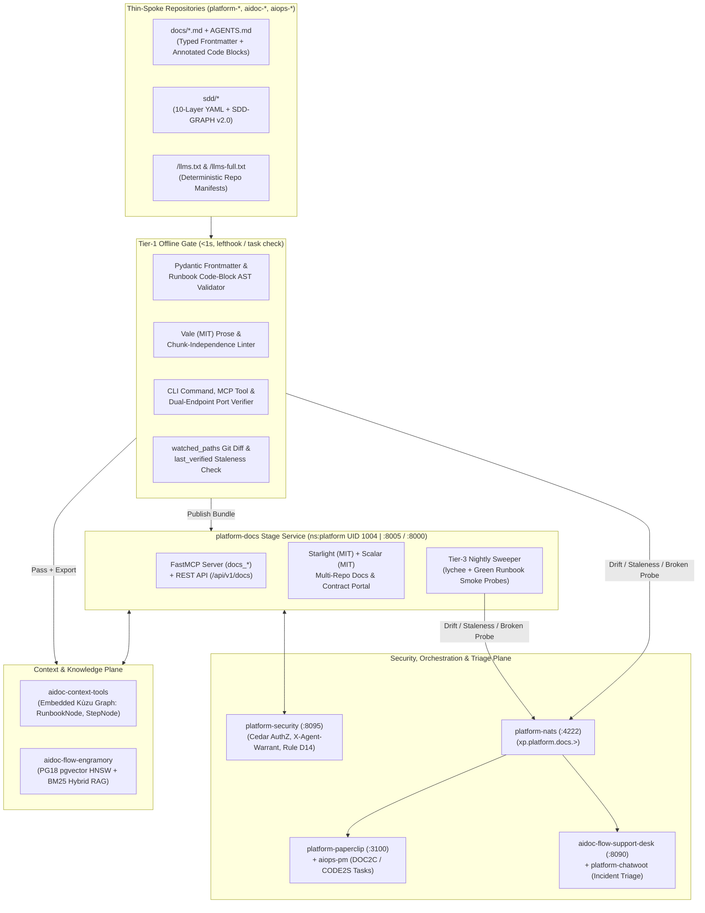
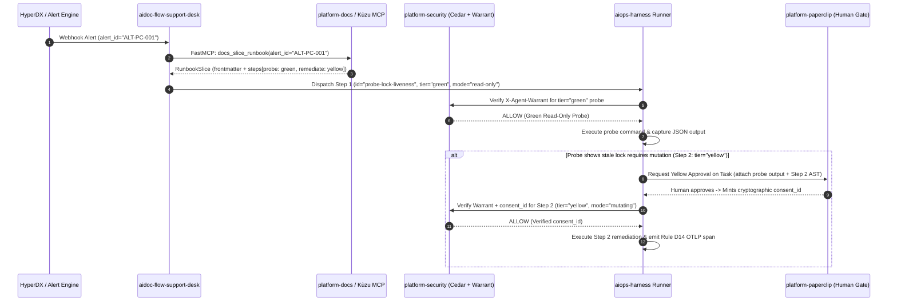
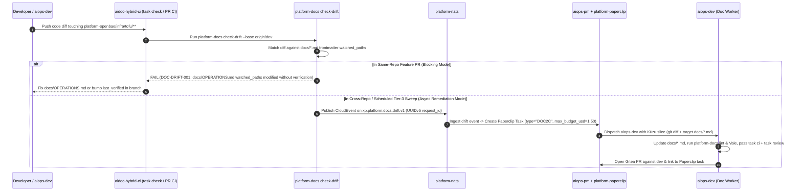

# System Architecture, Dual-Plane Topology & End-to-End Agent Flows

## 1. The Dual-Plane Documentation Problem in AI-First Engineering

Across the 35+ repositories in our ecosystem (`platform-*`, `aidoc-*`, `aiops-*`), documentation is split across two complementary planes that serve autonomous agents (`agy`, `claude`, `codex`, `gemini`) and human operators:

| Dimension | Plane A: SDD Specification Chain (`sdd/*`) | Plane B: Operational Playbooks, Runbooks & Architecture (`docs/*.md`) |
| :--- | :--- | :--- |
| **Authoritative Framework** | `aidoc-framework` (`BRD→PRD→EARS→BDD→ADR→SPEC→TDD→IPLAN→CHG→EVAL`) | **`platform-docs` (`doc-tools`)** |
| **Primary Purpose** | Defines *what software to build* and *how to verify correctness* before code is written. | Defines *how to operate, deploy, integrate, diagnose, and remediate* live `platform-*` infrastructure and `aiops-*` agents. |
| **Primary Format** | Typed YAML (`*-TEMPLATE.yaml`, `*-SWF-TEMPLATE.yaml`, `*.graph.yaml`) + Tier-3 compiled Markdown. | Standard Markdown (`docs/*.md`, `README.md`, `AGENTS.md`) with **Deterministic YAML Frontmatter** and **Annotated Executable Code Blocks**. |
| **Primary Agent Consumers** | `aiops-dev`, `aiops-qa`, `iplan-runner` during feature implementation (`SDD2C` / `DIR2C`). | `aiops-harness`, `aidoc-flow-support-desk`, `aiops-pm`, `aiops-sec`, and `aiops-dev` during stage operations, incident triage, and cross-service wiring. |
| **Graph & RAG Indexing** | Indexed as `ArtifactNode` in `aidoc-context-tools` (Embedded Kùzu). | Indexed as `RunbookNode` + `RunbookStepNode` in **Embedded Kùzu** (for `<1ms` topological slicing) AND chunked into **`aidoc-flow-engramory`** (`pgvector` HNSW + BM25). |

Without `platform-docs`, Plane B (`docs/*.md`) degrades into unstructured prose with inconsistent headers, dangling pronouns, unverified bash snippets, and silent drift when ports or CLI flags change. `platform-docs` brings the same deterministic rigor of Plane A to Plane B across every repository in the fleet.

---

## 2. How `platform-docs` Synthesizes Google & Anthropic Best Practices (100% Open Source)

`platform-docs` combines Google's monorepo-grade static analysis (`g3doc` + `Tricorder`) with Anthropic's agent-native context protocols (`MCP` + `llms.txt` + autonomous triage loops), built strictly on **MIT / Apache-2.0 open-source software**:

| Capability | Google Proprietary Stack | Anthropic Commercial Stack | `platform-docs` Open-Source Implementation |
| :--- | :--- | :--- | :--- |
| **Co-Located Docs-as-Code** | `g3doc` (`g3doc/*.md` in Piper) | Mintlify MDX in GitHub | `docs/*.md` + `sdd/*` in every thin-spoke repo, aggregated by **Astro Starlight (MIT)**. |
| **Interactive API & Contract Playground** | Internal gRPC / Stubby Explorer | Mintlify API Playground (SaaS) | **Scalar (MIT)** rendering OpenAPI 3.1, FastMCP schemas, and `platform-data-contracts` Proto3 contracts. |
| **Presubmit Static Analysis & QA Gate** | `Tricorder` + `Critique` | GitHub Actions linters | **`platform-docs lint`** in Tier-1 `lefthook` (`<1s` offline): **Vale (MIT)** + **`markdownlint-cli2` (MIT)** + **CLI/Port/Frontmatter AST Verifier** + Tier-2 **`lychee` (MIT/Apache-2.0)**. |
| **Machine Discovery & Context Slicing** | Internal CodeSearch index | `/llms.txt`, `/llms-full.txt` & MCP | **`platform-docs export-llms`** + **`aidoc-context-tools`** Embedded **Kùzu (MIT)** openCypher slicer + **FastMCP** (`docs_*` tools). |
| **Hybrid Semantic + Keyword RAG** | Vertex / Internal Search | Vector + Keyword RAG | **`aidoc-flow-engramory`** on shared **PostgreSQL 18 (`pgvector` HNSW + `tsvector` BM25 RRF)** with heading-path chunking. |
| **Autonomous Drift & Triage Loop** | Manual CL bug filing | Claude background agents via Mintlify API & Slack | **`platform-docs check-drift`** $\rightarrow$ **`platform-nats`** $\rightarrow$ **`aiops-pm`** $\rightarrow$ **`platform-paperclip`** `DOC2C` task $\rightarrow$ **`aiops-dev`** Gitea PR. |

---

## 3. Master System Topology

`platform-docs` operates in two modes simultaneously:

1. **In-Process / CLI Library Mode (`platform_docs` via `uv`):** Runs 100% offline in `<1s` inside every developer workstation, gVisor agent sandbox (`runsc --network=none`), and Gitea Actions runner during `task check` and `task ci`.
2. **Shared Stage Platform Service (`ns:platform`, UID `1004`):** Runs on stage at `127.0.0.1:8005` (host loopback) and `10.250.0.1:8000` (container gateway) / `https://docs.int.aiops-flow.io`, hosting the aggregated multi-repo **Starlight + Scalar Portal**, the central **FastMCP Documentation & Runbook Server**, and the **Tier-3 Nightly Staleness & Smoke Sweep Worker**.

---

## 4. End-to-End Operational Lifecycle Flows

### 4.1 Flow 1: Autonomous Incident Triage & Warrant-Gated Runbook Execution

When an infrastructure alert fires in `platform-observability-monitoring` (e.g., `ALT-BAO-SEALED` or `ALT-PC-001`), the responding agent does not guess shell commands or scrape prose—it slices the exact verified runbook step from `platform-docs`:

### 4.2 Flow 2: Deterministic Code-to-Doc Drift Detection & Autonomous Self-Healing

When a developer or coding agent modifies source code, Compose topologies, or CLI commands without updating the bound operational documentation:

---

## 5. Dual-Endpoint & Namespace Allocation

In compliance with the Stage-First Development Standard (`09-authoritative-platform-technology-stack.md` & `16-tri-environment-dev-stage-prod.md`), `platform-docs` is assigned the following canonical stage coordinates:

| Resource | Value | Notes |
| :--- | :--- | :--- |
| **Rootless Namespace & UID** | `ns:platform` (`UID 1004`) | Runs alongside `platform-paperclip`, `aidoc-flow-support-desk`, and `platform-security` gate. |
| **Host Loopback Endpoint** | `http://127.0.0.1:8005` | Used by host CLI agents (`agy`, `claude`, `codex`) and `aiops-harness` on the stage host. |
| **Container Gateway Endpoint** | `http://10.250.0.1:8000` | Used by containerized workers and gVisor sandboxes via `platform_bridge`. |
| **Internal Mesh FQDN** | `https://docs.int.aiops-flow.io` | Routed via `platform-edge-gateway` (Traefik v3 + Authentik OIDC ForwardAuth over NetBird mesh). |
| **Unix Domain Socket (MCP)** | `/run/platform-docs/mcp.sock` | Zero-hop local FastMCP transport for `aiops-harness`. |
| **OCI Object Storage Bucket** | `stage-docs-bundles` | Stores compiled Starlight static bundles, Kùzu graph snapshots, and `/llms-full.txt` archives. |
