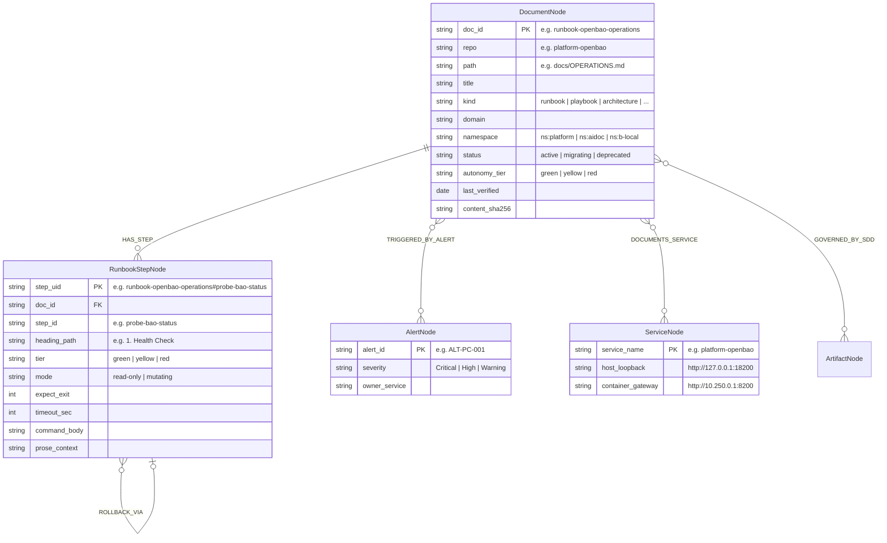

# Embedded Kùzu Graph Indexing, FastMCP Server & Engramory Hybrid RAG Integration

## 1. Dual-Engine Retrieval Architecture: Why Graph + Hybrid Vector/BM25

Autonomous agents operating across 35+ repositories require two complementary retrieval modalities:

1. **Deterministic Topological Graph Slicing (`aidoc-context-tools` + Embedded Kùzu):**
   When an agent knows the exact entity—an Alert ID (`ALT-PC-001`), a Service (`platform-openbao`), a CLI command (`aiops-harness secrets health`), or an SDD Task (`IPLAN-AUTH-012`)—fuzzy vector similarity is the wrong tool. Embedded **Kùzu openCypher** traverses the explicit edges in `< 1ms` and returns the exact `RunbookStepNode` closure with zero hallucination and 70% fewer prompt tokens.
2. **Hybrid Semantic + Sparse BM25 Search (`aidoc-flow-engramory` on PostgreSQL 18):**
   When an agent or engineer asks an open-ended operational question (*"How do we rotate OpenBao dynamic database roles without dropping PgBouncer connections?"*) or searches for exact error codes (`0x80040115`, `seal "ocikms"`), **Engramory** combines **dense `pgvector` HNSW embeddings (`vector(1536)`)** with **sparse PostgreSQL `tsvector` / BM25 keyword search** fused via **Reciprocal Rank Fusion (RRF)** and pre-filtered by `namespace`, `domain`, and `status = 'active'`.

---

## 2. Embedded Kùzu Property Graph Schema Extension

`platform-docs` extends the `aidoc-context-tools` Kùzu schema (`ArtifactNode`, `DEPENDS_ON`) with four operational documentation node tables and five relationship tables:



### 2.1 Canonical Kùzu DDL (`platform_docs/graph/schema.cypher`)

```cypher
CREATE NODE TABLE IF NOT EXISTS DocumentNode(
    doc_id STRING,
    repo STRING,
    path STRING,
    title STRING,
    kind STRING,
    domain STRING,
    namespace STRING,
    status STRING,
    autonomy_tier STRING,
    last_verified DATE,
    content_sha256 STRING,
    PRIMARY KEY (doc_id)
);

CREATE NODE TABLE IF NOT EXISTS RunbookStepNode(
    step_uid STRING,
    doc_id STRING,
    step_id STRING,
    heading_path STRING,
    tier STRING,
    mode STRING,
    expect_exit INT64,
    timeout_sec INT64,
    command_body STRING,
    prose_context STRING,
    PRIMARY KEY (step_uid)
);

CREATE NODE TABLE IF NOT EXISTS AlertNode(
    alert_id STRING,
    severity STRING,
    owner_service STRING,
    PRIMARY KEY (alert_id)
);

CREATE REL TABLE IF NOT EXISTS HAS_STEP(FROM DocumentNode TO RunbookStepNode, step_order INT64);
CREATE REL TABLE IF NOT EXISTS TRIGGERED_BY_ALERT(FROM DocumentNode TO AlertNode);
CREATE REL TABLE IF NOT EXISTS DOCUMENTS_SERVICE(FROM DocumentNode TO ArtifactNode);
CREATE REL TABLE IF NOT EXISTS ROLLBACK_VIA(FROM RunbookStepNode TO RunbookStepNode);
```

### 2.2 Example openCypher Alert-to-Runbook Slicing Query

When `aidoc-flow-support-desk` receives an alert (`ALT-PC-001`), it queries Kùzu to retrieve the exact ordered runbook steps and their autonomy tiers in `< 1ms`:

```cypher
MATCH (a:AlertNode {alert_id: $alert_id})<-[:TRIGGERED_BY_ALERT]-(d:DocumentNode)-[r:HAS_STEP]->(s:RunbookStepNode)
WHERE d.status = 'active' AND d.namespace = $agent_namespace
RETURN d.doc_id, d.title, d.autonomy_tier, s.step_id, s.tier, s.mode, s.command_body, s.prose_context
ORDER BY r.step_order ASC;
```

---

## 3. FastMCP Server Tool Catalog (`platform-docs serve --mcp`)

`platform-docs` exposes a FastMCP server over stdio (`uv run platform-docs serve --mcp`), Unix domain socket (`/run/platform-docs/mcp.sock`), and streamable HTTP (`http://10.250.0.1:8000/mcp`), integrated directly into `aiops-harness` and `aidoc-context-tools`:

| FastMCP Tool Name | Arguments | Returns (JSON) | Primary Agent Consumer |
| :--- | :--- | :--- | :--- |
| **`docs_slice_runbook`** | `alert_id?: str`, `service?: str`, `cli_command?: str`, `max_tier?: "green"\|"yellow"\|"red"` | Deterministic Kùzu slice containing matching `DocumentFrontmatter` + ordered `RunbookStepNode[]` filtered by caller's `X-Agent-Warrant` namespace. | `aidoc-flow-support-desk`, `aiops-harness`, `aiops-sec` |
| **`docs_search_hybrid`** | `query: str`, `domain?: str`, `kind?: str`, `top_k: int = 5` | RRF-fused (`pgvector` HNSW + BM25) heading-prefixed chunks from `aidoc-flow-engramory` (`status='active'` only). | All agents (`agy`, `claude`, `codex`, `aiops-dev`) |
| **`docs_validate_file`** | `path: str`, `verify_registry: bool = True` | Structured lint report (Frontmatter schema, `Vale` JSON violations, `markdownlint`, CLI/Port registry check). | `aiops-dev` during doc authoring |
| **`docs_check_drift`** | `repo_path: str`, `base_ref: str = "origin/dev"` | List of `docs/*.md` files whose `watched_paths` intersect the git diff or whose `last_verified` TTL has expired. | `aiops-harness`, `aidoc-hybrid-ci`, `aiops-pm` |
| **`docs_export_llms`** | `repo_path: str`, `write: bool = True` | Generates Rule D14-scrubbed `/llms.txt` and `/llms-full.txt` manifests and returns token counts. | `aiops-harness` onboarding & `lefthook` |
| **`docs_execute_step`** | `doc_id: str`, `step_id: str`, `warrant_jws: str`, `consent_id?: str` | Verifies warrant + `consent_id` against `platform-security` Cedar PDP and executes the annotated runbook step. | `aiops-harness`, `aidoc-flow-support-desk` |

---

## 4. `aidoc-flow-engramory` Hybrid RAG Ingestion Pipeline

While Kùzu handles exact graph traversal, `platform-docs sync-engramory` populates the **L0 Knowledge Base** inside `aidoc-flow-engramory` (shared PostgreSQL 18 `engramory` database):

1. **Heading-Depth AST Splitter (`##` and `###` Boundaries):**
   Never splits mid-paragraph or mid-code-block. Every chunk corresponds to an atomic Markdown heading section.
2. **Deterministic Breadcrumb & Metadata Injection:**
   Prepends the document's `id`, `domain`, `namespace`, `autonomy_tier`, `endpoints`, and full heading path (`Title > H2 > H3`) to the chunk text prior to embedding via `platform-litellm-laya` (`vector(1536)`).
3. **Mandatory Metadata Pre-Filter (`HYBRID MODE`):**
   Every Engramory query filters deterministically on indexed JSONB/column metadata (`namespace = $warrant.namespace AND status = 'active'`) **before** executing the HNSW cosine similarity + PostgreSQL `ts_rank_cd` BM25 Reciprocal Rank Fusion:
   $$\text{RRF\_Score}(c) = \frac{1}{60 + \text{rank}_{\text{dense}}(c)} + \frac{1}{60 + \text{rank}_{\text{bm25}}(c)}$$
4. **Content-Hash Idempotency:**
   Each section chunk is keyed by `sha256(doc_id + heading_path + normalized_content)`. Unchanged sections are never re-embedded on commit.
