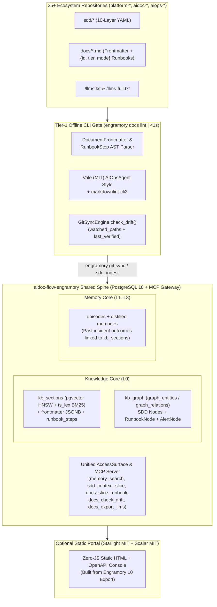

# Architectural Evaluation & Blueprint: Extending `aidoc-flow-engramory` vs. Standalone `platform-docs`

## 1. Executive Verdict: Extend `aidoc-flow-engramory` (`KnowledgeCore` L0) as the Primary Engine

Inspecting the live codebase of `aidoc-flow-engramory` confirms that **extending `aidoc-flow-engramory` is strongly superior to running a separate `platform-docs` backend service**, and directly upholds Engramory's foundational **ADR-08 (*Two Bounded Cores on One Spine*)** and the platform's **Multi-Tenant Consolidation Pillar (Pillar 5)**.

### 1.1 Why `aidoc-flow-engramory` Already Owns 70% of This Substrate

`aidoc-flow-engramory/src/engramory/` already implements the core primitives of a documentation & knowledge engine inside its **L0 Knowledge Core**:

| Existing Module in `aidoc-flow-engramory` | What It Already Does Today | What We Add to Complete the Documentation Toolchain |
| :--- | :--- | :--- |
| **`core/knowledge.py`** (`KnowledgeCore`) | Batch document extraction, section chunking, line-number citation calculation, and `kb_sections` upsert with `vector(1536)` embeddings. | Parse & persist `DocumentFrontmatter` metadata (`kind`, `autonomy_tier`, `triggers`, `endpoints`, `watched_paths`, `last_verified`) on `kb_sections`. |
| **`core/chunking.py`** (`chunk_markdown`) | Splits Markdown by `#{1,3}` headings, enforces `MAX_CHUNK_WORDS = 300`, and resolves `get_git_commit_hash(file_path)`. | Prefix each chunk with the full heading breadcrumb (`Title > H2 > H3`) + extract annotated `{id, tier, mode, expect_exit}` executable code blocks. |
| **`core/git_sync.py`** (`GitSyncEngine`) | Commit-differential incremental Git synchronization (`ADDED`, `MODIFIED`, `DELETED`, `RENAMED`) across `.md`, `.html`, `.pdf`, `.docx`. | Add `check_drift()` comparing touched code paths in `git diff` against `kb_sections` `watched_paths` + `last_verified` TTL expiry scan. |
| **`core/kb_graph.py`** | Parses SDD layers (`01_BRD`..`10_EVAL`) and ADRs, extracts `@`-tags, stores canonical `GraphEntity`/`GraphRelation` rows in PostgreSQL, and projects to GraphPort. | Extend `kb_graph.py` to extract `RunbookNode`, `RunbookStepNode`, and `AlertTriggerNode` from `docs/*.md` playbooks/runbooks alongside SDD nodes. |
| **`access/surface.py` & `poisoning_guard.py`** | Default-deny hierarchical scope ladder (`agent → project → domain → space`), JWT validation, fail-closed `audit_records`, and `MemoryPoisoningGuard`. | Wire `platform-security` Cedar policies + Ed25519 `X-Agent-Warrant` verification for `green`/`yellow`/`red` executable runbook steps. |
| **`mcp/server.py`** | Exposes `memory_search`, `knowledge_ingest`, `sdd_context_slice`, `sdd_blast_radius`, `sdd_ingest`, and `graph_neighbors`. | Add `docs_slice_runbook`, `docs_validate`, `docs_check_drift`, and `docs_export_llms` on the **exact same MCP gateway**. |

---

## 2. Trade-Off Matrix: Extending `aidoc-flow-engramory` vs. Separate `platform-docs`

| Architectural Dimension | Option A: Extend `aidoc-flow-engramory` (Recommended) | Option B: Standalone `platform-docs` Service |
| :--- | :--- | :--- |
| **Alignment with Engramory ADR-08 (`docs/CORES.md`)** | **100% Aligned:** Keeps all L0 curated documents (SDD specs, ADRs, `platform-*` runbooks, playbooks) in the L0 Knowledge Core on one PostgreSQL spine. | **Violates ADR-08:** Splits L0 documentation across two databases, two ingestion pipelines (`GitSyncEngine` vs. `platform-docs`), and two MCP servers. |
| **Runtime Retrieval Coupling (L0 Docs + L2 Memory)** | **Zero-Hop Unified Retrieval:** When an agent calls `memory_search` or `docs_slice_runbook` for an OpenBao alert, Engramory returns the **L0 official runbook step** AND **L2 distilled episodic lessons from past incidents** in one query. | Requires two separate MCP calls to two different services and manual context merging by the agent. |
| **Container & Infrastructure Footprint** | **Zero New Containers:** Uses Engramory's existing PostgreSQL spine (`kb_sections` + `graph_entities`), existing MCP gateway, and existing `engramory` CLI. | Adds an extra container (`:8000`), extra OpenBao sidecar, extra DB schema, and duplicate graph/vector sync workers. |
| **Tier-1 Offline Linting (`< 1s` in `lefthook`)** | `engramory docs lint` (or lightweight `aidoc-ctx` CLI plugin) runs offline in `< 1s` using pure-Python Pydantic frontmatter validation + `Vale` Go binary. | Requires maintaining a separate CLI package just for linting. |
| **Human Web Portal (`Starlight` + `Scalar`)** | Can live either as a lightweight static build target (`engramory docs build-portal`) or keep `$WORKSPACE_ROOT/platform-engramory` **purely** as the thin static frontend repo consuming Engramory's exported bundles. | Bundles backend ingestion, linting, and frontend UI into a new monolith. |

---

## 3. Recommended Target Topology: `aidoc-flow-engramory` as the Unified Knowledge, Runbook & Documentation Engine

Under this consolidated architecture, **`aidoc-flow-engramory` owns the entire L0 Documentation, Executable Runbook, Linting, Drift, and `/llms.txt` lifecycle**, while `$WORKSPACE_ROOT/platform-engramory` is either:

- **Merged directly into `aidoc-flow-engramory`** (so the 8 specification documents in `$WORKSPACE_ROOT/platform-engramory/docs/` become the specification for `engramory.core.docs`), **OR**
- **Kept strictly as a zero-backend static UI portal repo** (`Starlight` + `Scalar`) that renders static HTML from `aidoc-flow-engramory`.



---

## 4. Exact Extension Map for `aidoc-flow-engramory`

To fold all capabilities specified in `docs/01`–`08` directly into `aidoc-flow-engramory`, we extend six existing files/modules in `src/engramory/` and add one PostgreSQL migration (`0008_runbooks_and_doc_governance.sql`):

### 4.1 Database Migration (`db/migrations/0008_runbooks_and_doc_governance.sql`)

Extends `kb_sections` and adds `kb_documents` + `kb_runbook_steps` on the existing PostgreSQL spine:

```sql
-- 1. Document-level metadata & drift tracking table (L0 Knowledge Core)
CREATE TABLE IF NOT EXISTS kb_documents (
    doc_id          TEXT PRIMARY KEY,
    tenant_id       TEXT NOT NULL DEFAULT 'default',
    project_id      TEXT NOT NULL,
    repo_path       TEXT NOT NULL,
    title           TEXT NOT NULL,
    kind            TEXT NOT NULL, -- runbook | playbook | architecture | specification | ...
    domain          TEXT NOT NULL,
    namespace       TEXT NOT NULL DEFAULT 'ns:platform',
    status          TEXT NOT NULL DEFAULT 'active',
    autonomy_tier   TEXT NOT NULL DEFAULT 'green',
    frontmatter     JSONB NOT NULL DEFAULT '{}'::jsonb,
    watched_paths   TEXT[] NOT NULL DEFAULT '{}',
    trigger_alerts  TEXT[] NOT NULL DEFAULT '{}',
    last_verified   DATE NOT NULL DEFAULT CURRENT_DATE,
    review_ttl_days INTEGER NOT NULL DEFAULT 90,
    git_commit_sha  TEXT NOT NULL,
    updated_at      TIMESTAMPTZ NOT NULL DEFAULT NOW()
);

CREATE INDEX IF NOT EXISTS idx_kb_documents_alerts ON kb_documents USING GIN (trigger_alerts);
CREATE INDEX IF NOT EXISTS idx_kb_documents_watched ON kb_documents USING GIN (watched_paths);
CREATE INDEX IF NOT EXISTS idx_kb_documents_ns_status ON kb_documents (namespace, status);

-- 2. Executable Runbook Step AST table linked to kb_documents & kb_sections
CREATE TABLE IF NOT EXISTS kb_runbook_steps (
    step_uid        TEXT PRIMARY KEY, -- <doc_id>#<step_id>
    doc_id          TEXT NOT NULL REFERENCES kb_documents(doc_id) ON DELETE CASCADE,
    section_id      UUID REFERENCES kb_sections(id) ON DELETE SET NULL,
    step_order      INTEGER NOT NULL,
    step_id         TEXT NOT NULL,
    heading_path    TEXT NOT NULL,
    tier            TEXT NOT NULL CHECK (tier IN ('green', 'yellow', 'red')),
    mode            TEXT NOT NULL CHECK (mode IN ('read-only', 'mutating')),
    expect_exit     INTEGER NOT NULL DEFAULT 0,
    timeout_sec     INTEGER NOT NULL DEFAULT 30,
    command_body    TEXT NOT NULL,
    prose_context   TEXT NOT NULL,
    rollback_step   TEXT
);
```

### 4.2 Module-by-Module Extension Plan in `src/engramory/`

1. **`src/engramory/core/parsers/frontmatter.py` (New):**
   Implements `DocumentFrontmatter` (Pydantic v2) and `extract_runbook_steps()` (`{id, tier, mode, expect_exit}` fenced code-block AST parser with `INV-STEP-01`/`02` read-only safety validation).
2. **`src/engramory/core/chunking.py` (Extend):**
   Enhances `chunk_markdown()` to preserve full hierarchical heading breadcrumbs (`# Title > ## Section > ### Subsection`) and associate `kb_runbook_steps` with their parent `kb_sections` row.
3. **`src/engramory/core/git_sync.py` (Extend `GitSyncEngine`):**
   Adds `check_drift(repo_path, base_sha, head_sha)` to match modified code files against `kb_documents.watched_paths` and `check_staleness()` for `last_verified` TTL expiration, emitting NATS events via `EventsPort`.
4. **`src/engramory/core/kb_graph.py` (Extend):**
   Extracts `RUNBOOK`, `RUNBOOK_STEP`, and `ALERT` graph entities (`GraphEntity` / `GraphRelation`) from `docs/*.md` frontmatter and links them to `SPEC` and `ADR` nodes in PostgreSQL (`graph_entities` / `graph_relations`) and Neo4j/Kùzu.
5. **`src/engramory/core/llms_export.py` (New):**
   Deterministically compiles `/llms.txt` and `/llms-full.txt` from `kb_documents` + `kb_sections` (or local repo files in offline CLI mode) with Rule D14 secret redaction.
6. **`src/engramory/cli.py` & `src/engramory/mcp/server.py` (Extend):**
   - Adds CLI group `engramory docs {lint, check-drift, export-llms, slice-runbook, smoke-run, ingest, tools, tool-inventory, build-portal}`.
   - Adds built-in `DOCUMENTATION_TOOL_CATALOG` (`list_documentation_tools` in `src/engramory/core/docs_tools.py`), `stage_portal_bundle` (`src/engramory/core/portal_builder.py`), and the Astro Starlight + Scalar `portal/` scaffold so the standalone `platform-docs` spoke is retired.
   - Adds MCP tools `docs_slice_runbook`, `docs_validate`, `docs_check_drift`, `docs_export_llms`, `docs_smoke_run`, `docs_tools_inventory`, and `docs_build_portal` to `TOOLS_SCHEMA` in `src/engramory/mcp/server.py`.

---

## 5. Why This Gives Autonomous Agents a Unique Superpower (L0 Runbook + L2 Episodic Memory Fusion)

When `docs_slice_runbook` lives inside `aidoc-flow-engramory`, an agent responding to an alert (e.g., `ALT-PC-001` or `ALT-BAO-SEALED`) gets a **fused L0 + L2 context package** in a single `<5ms` call that no standalone documentation tool can provide:

1. **From L0 (`kb_documents` + `kb_runbook_steps`):** The authoritative, versioned, warrant-gated runbook steps (`probe-bao-status` `[green]`, `remediate-bao-restart` `[yellow]`).
2. **From L2 (`memories` cross-linked by `doc_id`):** Distilled episodic/procedural lessons from previous executions of that exact runbook step (e.g., *"Lesson learned 2026-10-29: On LAN stage host, wait 15s after `docker restart openbao` before querying `bao status` to allow OCI KMS auto-unseal to complete"*).
