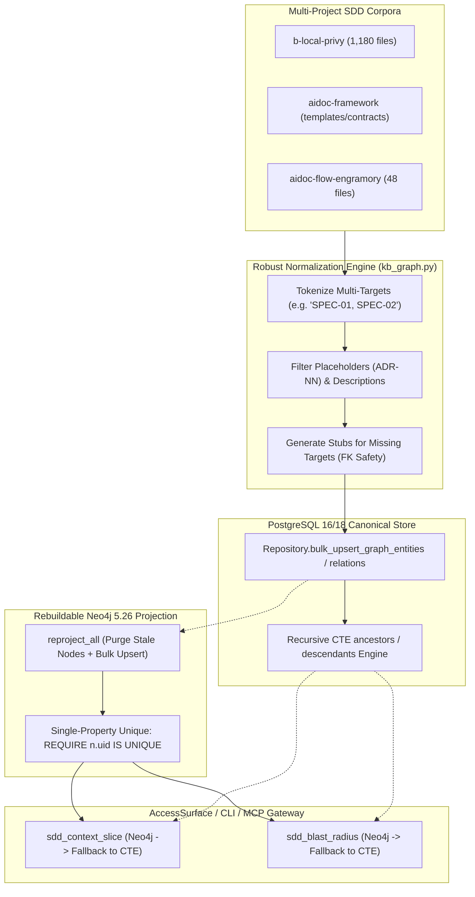

# PLAN-007: Staging Multi-Project Corpus Sync & Graph Hardening

> **Status**: Approved & Patched  
> **Authority**: Issue #72 (`TODO: Staging Multi-Project Corpus Sync`), ADR-01, ADR-03, ADR-05, ADR-07  
> **Ecosystem Scope**: `aidoc-flow-engramory` (shared core), `b-local-privy`, `aidoc-framework`, `iplanic`  

---

## 1. Executive Summary & Objectives

The goal of this plan is to execute and harden multi-project SDD corpus synchronization between canonical PostgreSQL storage and rebuildable Neo4j graph projections.

The plan specifically addresses and patches the **6 critical gaps** discovered during real-world corpus testing (1,180 files in `b-local-privy`, 48 files in `aidoc-flow-engramory`):

1. **Extraction Normalization & Foreign Key Safety**: Parsing multi-target comma lists, filtering placeholders (`ADR-NN`), and resolving dangling references via automatic stub creation to eliminate Postgres `ForeignKeyViolationError`.
2. **Multi-Project Identity Scoping**: Preventing ID collisions (e.g. `ADR-001` in both `privy` and `engramory`) across tenants and within shared domain tenants.
3. **Neo4j Community Edition Compatibility**: Using compound unique keys (`uid = f"{tenant_id}:{id}"`) compatible with single-property unique constraints in Neo4j Community.
4. **PostgreSQL CTE Graph Fallback**: Adding recursive CTE traversal directly to `Repository` so `context_slice` and `blast_radius` function without Neo4j.
5. **Graph Projection Reconciliation**: Purging stale/deleted nodes in `reproject_all` for true rebuildability.
6. **Transactional Bulk Upsert**: Slashing bulk ingestion time from ~15s to < 300ms via batch operations in PostgreSQL.

---

## 2. Technical Architecture & Component Changes



---

## 3. Detailed Implementation Phases

### Phase 1: Robust Extractor & Referential Integrity

- **Target File**: `src/engramory/core/kb_graph.py`
- **Actions**:
  1. Update regex parsing in `extract_sdd_graph` to split comma/semicolon/newline-delimited references in YAML frontmatter and document control blocks.
  2. Normalize all IDs: strip surrounding whitespace, lowercase prefixes, and remove extraneous trailing text (e.g. `CHG-09 (User Deactivation)` $\rightarrow$ `CHG-09`).
  3. Filter out template placeholders matching `.*-NN$` (e.g. `ADR-NN`, `BRD-NN`).
  4. Auto-generate stub `GraphEntity` rows for missing relation targets (`dst_id` not found in extracted set) with property `{"status": "external_or_stub", "stub": True}`. This guarantees that `FOREIGN KEY (tenant_id, dst_id) REFERENCES graph_entities` is never violated.

### Phase 2: Multi-Project & Multi-Tenant Identity Model

- **Target Files**:
  - `src/engramory/adapters/dev/graph_neo4j.py`
  - `src/engramory/core/kb_graph.py`
  - `src/engramory/ports/graph.py`
- **Actions**:
  1. **Neo4j Single-Property Constraint**:
     Update `init_schema()`:

     ```cypher
     CREATE CONSTRAINT entity_uid_unique IF NOT EXISTS FOR (n:Entity) REQUIRE n.uid IS UNIQUE
     ```

  2. **Compound Node UID**:
     In `Neo4jGraphAdapter`, calculate `node_uid = f"{tenant_id}:{id}"` (or `f"{tenant_id}:{project_id}:{id}"` if multi-project shared tenant). Store `uid`, `id`, `tenant_id`, `project_id` as indexed properties.
  3. **Scoped Traversal**:
     In `ancestors`, `descendants`, and `neighbors`, enforce tenant boundary filtering in Cypher:

     ```cypher
     MATCH (n:Entity {uid: $uid})-[...]->(m:Entity)
     WHERE m.tenant_id = $tenant_id
     RETURN m.id AS id, ...
     ```

### Phase 3: Transactional Bulk Persistence & Reconciliation

- **Target Files**:
  - `src/engramory/core/repository.py`
  - `src/engramory/workers/graph_projection.py`
- **Actions**:
  1. Add `bulk_upsert_graph_entities(entities: Sequence[GraphEntity])` and `bulk_upsert_graph_relations(relations: Sequence[GraphRelation])` to `Repository`. Execute via `executemany` inside a single `async with conn.transaction():`.
  2. Update `reproject_all(repo, graph, tenant_id=...)`:
     - Query canonical PostgreSQL entity IDs for `tenant_id`.
     - In Neo4j, delete any entity nodes belonging to `tenant_id` whose `id` is no longer in PostgreSQL:

       ```cypher
       MATCH (n:Entity {tenant_id: $tenant_id})
       WHERE NOT n.id IN $canonical_ids
       DETACH DELETE n
       ```

     - Project canonical entities and relations in batches.

### Phase 4: PostgreSQL Recursive CTE Graph Fallback

- **Target Files**:
  - `src/engramory/core/repository.py`
  - `src/engramory/access/surface.py`
- **Actions**:
  1. Implement `find_ancestors(id: str, *, tenant_id: str = "default", depth: int = 6)` and `find_descendants(id: str, *, tenant_id: str = "default", depth: int = 6)` on `Repository` using PostgreSQL recursive CTEs.
  2. In `AccessSurface.context_slice()` and `AccessSurface.blast_radius()`:
     If `self._graph is None`, fall back seamlessly to `self._repo.find_ancestors()` and `self._repo.find_descendants()`.

### Phase 5: Verification, Multi-Project Integration Tests & Staging Run

- **Target Files**:
  - `tests/integration/test_multiproject_sdd.py`
  - `docs/runbooks/neo4j_ops.md`
- **Actions**:
  1. Ingest `aidoc-flow-engramory` (self, 48 files) under `tenant_id="engramory"`, `project_id="engramory"`.
  2. Ingest `b-local-privy` (1,180 files) under `tenant_id="privy"`, `project_id="b-local-privy"`.
  3. Verify:
     - 0 ForeignKeyViolationErrors.
     - Ingestion completes in < 2 seconds for both corpora combined.
     - Context slicing `TASK-001` in `tenant="engramory"` returns 0 nodes from `tenant="privy"`.
     - `reproject_all` successfully purges drift without crossing tenants.
  4. Document staging reconciliation commands and connection parameters in `docs/runbooks/neo4j_ops.md`.

---

## 4. Acceptance Criteria & Quality Gates

- [ ] `extract_sdd_graph` ingests `b-local-privy/docs/sdd` without foreign key violations or dropped multi-target links.
- [ ] Multi-tenant isolation verified: two projects with overlapping document IDs (`ADR-001`) never collide in PostgreSQL or Neo4j.
- [ ] Context slicing works seamlessly via Neo4j and falls back gracefully to PostgreSQL CTE when Neo4j is offline.
- [ ] Ingestion speed for 1,180 files < 3 seconds total.
- [ ] `task check` and `uv run pytest` pass cleanly.
- [ ] Operational guide added to `docs/runbooks/neo4j_ops.md`.
