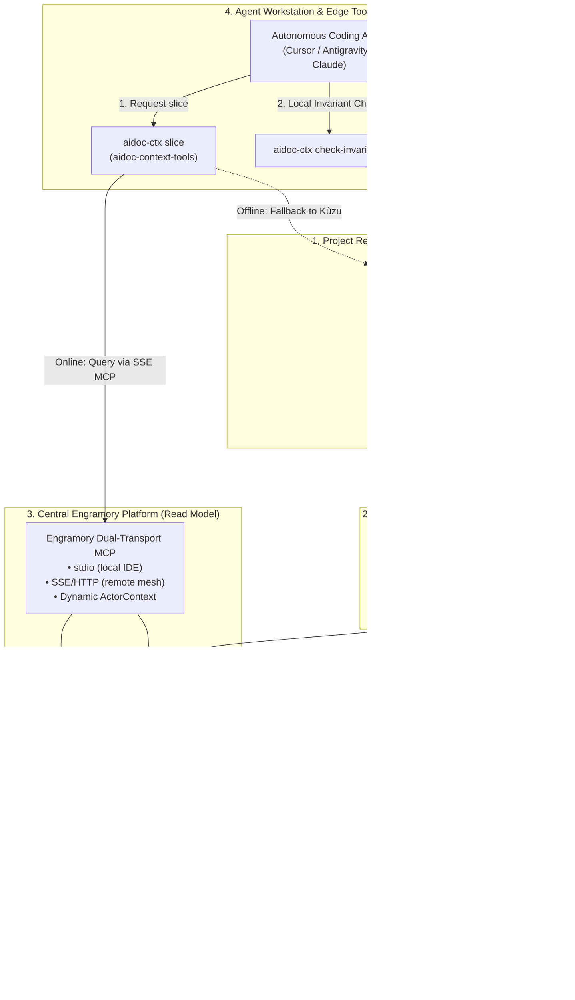

# PLAN-008: Ecosystem SDD Integration — Continuous Ingestion, Client Adaptation & Agent Configuration

## 1. Executive Summary & Goals

This plan establishes the concrete, gap-remediated implementation steps to operationalize the **CQRS (Docs-as-Code Ground Truth + Engramory Read Model)** pattern across the three core repositories:

- `vladm3105/aidoc-flow-engramory` (Core Memory & Knowledge Engine, Tracking Issue: #78)
- `vladm3105/aidoc-flow-framework` (10-Layer SDD Scaffold & Authoring Authority, Tracking Issue: #1057)
- `vladm3105/aidoc-context-tools` (Edge CLI, Linter & Fast Slicer, Tracking Issue: #8)

### Key Objectives

1. **Secure Automated Ingestion**: Ingest modified SDD specifications into Engramory PostgreSQL + Neo4j on merge to `dev` or `main` without exposing unauthenticated database ports to public CI runners.
2. **Stale Entity & Rename Reconciliation**: Prune or retire entities in PostgreSQL and Neo4j when specification files are deleted or renamed in Git.
3. **Deterministic Project & Tenant Scoping**: Resolve `project_id` and `tenant_id` reliably across local worktrees, CI checkouts, and production environments.
4. **Dual-Transport MCP Gateway (`stdio` + `SSE/HTTP`)**: Extend Engramory's MCP server with Server-Sent Events (SSE) / HTTP transport and dynamic `ActorContext` authentication for remote clients.
5. **Quad-Pillar Context Slicing Parity**: Format context slices with layer filtering (`BRD`..`SPEC`), root-to-leaf topological sorting, token budgeting, and clickable `file:///` Markdown links.
6. **Dual-Engine Slicing in `aidoc-ctx`**: Slicing transparently queries Engramory MCP for enterprise multi-project DAG traversals, falling back to embedded Kùzu OLAP when offline.

---

## 2. Architecture & Component Interaction



---

## 3. Implementation Phases

### Phase 1: Secure Ingestion, Reconciliation & Identity Resolution

- **Target Repositories**: `aidoc-flow-engramory`, `aidoc-flow-framework`.
- **Deliverables**:
  1. **Deterministic Project & Tenant ID Resolution**:
     Update `engramory sdd ingest` and `.aidoc/Taskfile.yml` to resolve `project_id` via fallback hierarchy:
     - Explicit `--project-id` flag.
     - `.aidoc/profile.yaml` (`name:` property) or `pyproject.toml` (`name = "..."`).
     - Git remote slug (`git config --get remote.origin.url` parsed to repo name).
     - Directory basename only as a fallback.
  2. **Stale Entity & Rename Reconciliation**:
     Update `ingest_sdd_knowledge_graph` in `src/engramory/core/kb_graph.py`:
     - Scan current active file entity IDs in the corpus for `(tenant_id, project_id)`.
     - Mark any existing database entities for that project not present in current files as `status = 'retired'` (or delete obsolete relations).
     - Call `purge_stale_nodes()` in `Neo4jGraphAdapter` to reconcile the graph projection.
  3. **Secure CI Ingestion Workflow**:
     In `aidoc-flow-framework` (and consumer templates), create `.github/workflows/engramory-sync.yml`:
     - Use `tailscale/github-action@v2` with ephemeral `TS_OAUTH_CLIENT_ID` / `TS_OAUTH_SECRET` to join the runner to `platform-mesh` before ingestion.
     - In air-gapped or non-mesh runners, invoke the authenticated Engramory HTTP/MCP ingestion endpoint over HTTPS via Cloudflare Access tunnel (`POST /api/v1/sdd/ingest`).
     - Configure job with `continue-on-error: true` so external network glitches never block application PR deployments.

### Phase 2: Dual-Transport MCP Gateway (`stdio` + `SSE/HTTP`) & Dynamic Auth

- **Target Repository**: `aidoc-flow-engramory`.
- **Deliverables**:
  1. **SSE / HTTP Transport in `src/engramory/mcp/server.py`**:
     Add Server-Sent Events (SSE) transport alongside stdio:

     ```bash
     engramory mcp --transport sse --port 8000 --host 0.0.0.0
     ```

     - Uses `starlette` / `uvicorn` (or standard `mcp.server.sse`).
     - Exposes `/sse` endpoint for SSE connection and `/messages` for JSON-RPC tool calls.
  2. **Dynamic `ActorContext` Resolution**:
     - Parse incoming `Authorization: Bearer <token>` or HTTP headers (`X-Tenant-ID`, `X-Project-ID`, `X-Agent-ID`).
     - Resolve virtual keys via `LiteLLMAdapter` or environment token policy.
     - Instantiate request-scoped `ActorContext` for each tool call rather than relying on a static daemon identity.

### Phase 3: Quad-Pillar Topological Slicing Parity & Prompt Formatting

- **Target Repositories**: `aidoc-flow-engramory`, `aidoc-context-tools`.
- **Deliverables**:
  1. **Topological Ordering & Layer Filtering in Engramory Core**:
     Update `AccessSurface.context_slice` and `sdd_context_slice` tool:
     - Accept optional `layers` filter (`default=["BRD", "PRD", "SYS", "SRS", "ADR", "SPEC", "BDD"]`).
     - Sort returned ancestor nodes in strict topological order (root architectural requirements down to immediate specifications).
     - Add `formatted_markdown` output property containing ready-to-inject Markdown sections with clickable `file:///` URIs.
     - Implement token-budget ceiling (`max_tokens`, default: 2,000) to guarantee compact agent prompts.
  2. **Dual-Engine Slicing Router in `aidoc-context-tools`**:
     In `aidoc_context.core.slicer`:
     - Add `aidoc_context.adapters.engramory` client.
     - If `ENGRAMORY_MCP_URL` is set or local daemon is reachable: delegate to Engramory for multi-project DAG traversal.
     - If unreachable, offline, or `--engine kuzu` passed: fall back seamlessly to local embedded Kùzu OLAP.

### Phase 4: Fast Invariant Gating with Blast-Radius Warning

- **Target Repository**: `aidoc-context-tools`.
- **Deliverables**:
  1. **AST Diff Invariant Guard**:
     Preserve fast local execution of `aidoc-ctx check-invariants` without database requirements.
  2. **Optional Downstream Blast-Radius Warning**:
     When connected to Engramory, query `sdd_blast_radius` for modified ADR/SPEC files:
     - Output non-blocking advisories listing downstream `IPLAN-*` tasks and `TDD-*` suites requiring verification.

### Phase 5: Standardized Agent Configuration Templates

- **Target Repositories**: All ecosystem projects.
- **Deliverables**:
  1. **Local Developer Stdio Config (`.cursor/mcp.json` / Claude Code)**:

     ```json
     {
       "mcpServers": {
         "engramory": {
           "command": "uv",
           "args": ["run", "engramory", "mcp", "--transport", "stdio"],
           "env": {
             "ENGRAMORY_CONFIG": ".engramory/config.toml"
           }
         }
       }
     }
     ```

  2. **Staging Mesh SSE Config**:

     ```json
     {
       "mcpServers": {
         "engramory-staging": {
           "url": "http://100.98.134.10:8000/sse",
           "headers": {
             "Authorization": "Bearer ${ENGRAMORY_API_KEY}",
             "X-Tenant-ID": "default",
             "X-Project-ID": "aidoc-framework"
           }
         }
       }
     }
     ```

### Phase 6: Verification & Multi-Project Cross-Validation

- **Deliverables**:
  1. **Multi-Project Ingestion Test**:
     Validate automated sync of `aidoc-framework` (10 layers), `b-local-privy` (1,180 files), and `aidoc-flow-engramory` without ID collision.
  2. **Slice Parity Benchmark**:
     Verify that `aidoc-ctx slice --task <ID>` and `engramory sdd slice --task <ID>` produce equivalent topological closures and respect layer constraints.
  3. **Reconciliation Test**:
     Rename and delete test specification files; verify that stale entities and relations are cleanly pruned from both PostgreSQL and Neo4j.

---

## 4. Rollout Schedule & Milestone Tracking

| Milestone | Target Repo | Primary Deliverable | Success Criteria |
|---|---|---|---|
| **M1: Reconciliation & Ingestion Security** | `aidoc-flow-engramory` | Stale node pruning + deterministic project ID resolution | `engramory sdd ingest` reconciles renames and derives project ID safely. |
| **M2: Dual-Transport MCP Gateway** | `aidoc-flow-engramory` | SSE/HTTP transport in `engramory mcp` with dynamic auth | Remote clients query tools over SSE with Bearer auth. |
| **M3: Slicing Parity & Prompt Formatting** | `aidoc-flow-engramory` | Topological sorting, layer filtering, and prompt packing | `sdd_context_slice` returns high-density, sorted Markdown within token budget. |
| **M4: Dual-Engine Client Adapter** | `aidoc-context-tools` | Engramory SSE adapter with Kùzu fallback in `aidoc-ctx` | `aidoc-ctx slice` delegates online, falls back offline cleanly. |
| **M5: CI Workflows & Agent Profiles** | `aidoc-flow-framework` | GitHub Actions sync workflow + `.cursor/mcp.json` | Merges to `dev` update staging graph; agents discover tools out-of-the-box. |

---

## 5. Risk Assessment & Mitigations

| Risk | Impact | Mitigation |
|---|---|---|
| **Public Database Exposure in CI** | Security vulnerability / non-compliance with platform stack. | Use Tailscale Action / Cloudflare tunnel; never expose raw PostgreSQL/Neo4j ports to public internet. |
| **Stale Ghost Nodes from Renames/Deletes** | Erroneous graph traversals and hallucinated references. | Reconciliation pass during ingestion marks deleted files retired and purges Neo4j nodes. |
| **Network Latency / Disconnection in Edge Tooling** | Slicing failure blocks local agent coding loop. | Fallback to embedded Kùzu OLAP ensures 100% offline availability. |
| **Token Budget Exhaustion from Unfiltered Ancestors** | High prompt costs and LLM context truncation. | Topologically sorted, layer-filtered slice packing with strict 2,000-token ceiling. |
| **Multi-Tenant Identity Collisions in Shared Cloud** | Cross-tenant data leakage between projects. | Enforce compound `uid = "{tenant_id}:{id}"` and dynamic request-scoped `ActorContext`. |
