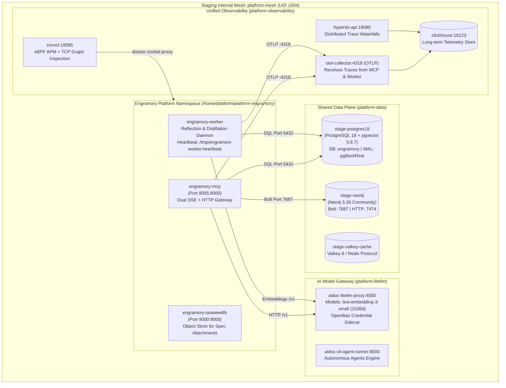

# PLAN-009: Staging Environment Deployment & Multi-Project SDD Integration

> **Status:** Implemented  
> **Date:** 2026-11-03  
> **Target Environment:** Pre-Production Staging (`100.98.134.10`)  
> **Owning Repo:** `aidoc-flow-engramory`  
> **Tracking Issue:** #82  
> **Cross-Repo Impact:** `aidoc-observability-monitoring`, `aidoc-flow-framework`, `aidoc-context-tools`, `platform-litellm-laya`  

---

## 1. Executive Summary & Objectives

The goal of this plan is to execute a production-grade, zero-downtime deployment of **Engramory** to the pre-production staging environment on host `100.98.134.10`.

This deployment integrates Engramory as the shared long-term memory, knowledge base, and SDD graph engine for the platform ecosystem. It establishes native integration with existing staging infrastructure:

1. **Rootless Hardened Namespace:** Runs under dedicated platform user `platform` (`UID 1004`, `GID 1004`) inside the rootless Docker daemon, enforcing `no-new-privileges` and non-root execution.
2. **Canonical Persistence Spine:** Attaches directly to enterprise staging PostgreSQL (`stage-postgres18`) with `pgvector 0.8.7` enabled, backed by `pgBackRest` with continuous WAL archiving.
3. **Graph Engine Projection:** Attaches to staging Neo4j 5.26 (`stage-neo4j`) on `platform-mesh` over Bolt protocol with compound UID keys (`tenant:id`).
4. **Port Allocation & Zero-Conflict Gateway:** Publishes the dual-transport MCP server (`stdio` + `SSE/HTTP`) on port `8005` to avoid port collision with `aidoc-cli-agent-runner` on port `8000`. SeaweedFS S3 publishes on port `9000`.
5. **AI Gateway Integration:** Routes all vector embeddings and LLM completions via internal `platform-mesh` DNS to `http://aidoc-litellm-proxy:4000/v1` using `text-embedding-3-small` (1,536 dimensions).
6. **Multi-Project Corpus Ingestion:** Populates canonical SDD specifications for `aidoc-flow-engramory`, `aidoc-flow-framework`, and `aidoc-context-tools`.
7. **3-Tier Observability Parity:** Exposes automatic eBPF kernel inspection in Coroot APM (`http://100.98.134.10:18085/`), distributed tracing in HyperDX (`http://100.98.134.10:18080/`), and LLM tracing in Langfuse (`http://100.98.134.10:13000/`).

---

## 2. Architecture & Topology on Staging (`100.98.134.10`)



---

## Claim ledger

| # | Claim | Symbol | Citation |
|---|---|---|---|
| 1 | `compose.platform.yaml` establishes dedicated platform namespace for staging | `name: platform-engramory` | compose.platform.yaml:10 |
| 2 | `compose.platform.yaml` standardizes SeaweedFS container name | `container_name: engramory-seaweedfs` | compose.platform.yaml:64 |
| 3 | `compose.platform.yaml` standardizes MCP service container name | `container_name: engramory-mcp` | compose.platform.yaml:18 |
| 4 | `compose.platform.yaml` exposes host MCP port via configurable `MCP_PORT` defaulting to 8005 | `"${MCP_PORT:-8005}:8000"` | compose.platform.yaml:21 |
| 5 | `compose.platform.yaml` standardizes worker container name | `container_name: engramory-worker` | compose.platform.yaml:49 |
| 6 | `compose.platform.yaml` exposes SeaweedFS S3 port via configurable `S3_PORT` defaulting to 9000 | `"${S3_PORT:-9000}:9000"` | compose.platform.yaml:67 |
| 7 | `compose.platform.yaml` binds stack to external staging platform mesh | `platform-mesh:` | compose.platform.yaml:91 |
| 8 | Migration 0001 initializes `memories.embedding` column with `vector` type | `embedding` | db/migrations/0001_init_memory.sql:58 |
| 9 | Migration 0005 establishes cosine distance HNSW index `idx_memories_embedding_hnsw` | `idx_memories_embedding_hnsw` | db/migrations/0005_pin_embeddings_hnsw.sql:14 |
| 10 | Migration 0006 sets vector dimensions to 1,536 for OpenAI/LiteLLM standard embedding models | `ALTER TABLE memories ALTER COLUMN embedding TYPE vector(1536);` | db/migrations/0006_resize_embeddings_1536.sql:14 |
| 11 | Migration 0007 creates canonical relational tables `graph_entities` and `graph_relations` | `CREATE TABLE IF NOT EXISTS graph_entities` | db/migrations/0007_graph_entities_canonical.sql:5 |
| 12 | MCP server publishes protocol metadata and version payload | `serverInfo` | src/engramory/mcp/server.py:458 |
| 13 | Background worker executes periodic distillation loop with heartbeat | `run_worker_loop` | src/engramory/workers/runner.py:26 |
| 14 | Observability guide documents Tier-1 Zero-Code Coroot APM 1.27.4 eBPF integration | `Coroot Community 1.27.4` | docs/OBSERVABILITY.md:45 |
| 15 | Staging host port 8005 is available and unallocated — **blocks Phase 3** | `8005` | PROBE: ssh ya@100.98.134.10 "sudo ss -tulpnH sport = :8005" |
| 16 | Staging host port 9000 is available for S3 object storage — **blocks Phase 3** | `9000` | PROBE: ssh ya@100.98.134.10 "sudo ss -tulpnH sport = :9000" |
| 17 | Staging Neo4j service is healthy and accepts Bolt authentication — **blocks Phase 3** | `stage-neo4j` | PROBE: ssh ya@100.98.134.10 "sudo -u platform XDG_RUNTIME_DIR=/run/user/1004 docker exec stage-neo4j cypher-shell -u neo4j -p stage_graph_secret_2026 'RETURN 1;'" |
| 18 | Staging PostgreSQL database `engramory` has `vector` extension version 0.8.7 enabled — **blocks Phase 2** | `vector` | PROBE: ssh ya@100.98.134.10 "sudo -u platform XDG_RUNTIME_DIR=/run/user/1004 docker exec stage-postgres18 psql -U stage_bootstrap -d engramory -c 'SELECT extversion FROM pg_extension WHERE extname = \"vector\";'" |
| 19 | Staging LiteLLM proxy responds healthy on internal `platform-mesh` — **blocks Phase 3** | `aidoc-litellm-proxy` | PROBE: `ssh ya@100.98.134.10 "sudo -u platform XDG_RUNTIME_DIR=/run/user/1004 docker exec stage-neo4j wget -q -O- http://aidoc-litellm-proxy:4000/health/liveliness"` |
| 20 | Staging OpenTelemetry collector is active on port 13133 on `platform-mesh` — **blocks Phase 5** | `otel-collector` | PROBE: `ssh ya@100.98.134.10 "sudo -u platform XDG_RUNTIME_DIR=/run/user/1004 docker exec stage-neo4j wget -q -O- http://otel-collector:13133/"` |

---

## 4. Implementation Phases

### Phase 1: Stage Host Pre-Flight & Platform Namespace Scaffolding

1. **Verify Rootless Platform Environment**:
   - Confirm user `platform` (`UID 1004`) has active rootless Docker daemon at `/run/user/1004/docker.sock`.
   - Ensure external bridge network `platform-mesh` is active.
2. **Directory Scaffolding**:
   - Create deployment directory on stage: `/home/platform/platform-engramory` with permissions `0750` owned by `platform:platform`.
   - Create shared data volumes and runtime directories:
     - Named volume `platform-engramory_seaweedfs-data` for S3 binary spec assets.
     - Runtime directory `/home/platform/platform-engramory/run` for unix domain sockets and ephemeral logs.
3. **Stage Configuration Setup**:
   - Author `/home/platform/platform-engramory/.env.stage` populated from staging credentials:
     - `POSTGRES_DB=engramory`
     - `POSTGRES_USER=engramory`
     - `POSTGRES_PASSWORD=<staging-secret>`
     - `ENGRAMORY_DATABASE_URL=postgresql://engramory:<staging-secret>@stage-postgres18:5432/engramory`
     - `ENGRAMORY_GRAPH_URL=bolt://stage-neo4j:7687`
     - `ENGRAMORY_GRAPH_USER=neo4j`
     - `ENGRAMORY_GRAPH_PASSWORD=stage_graph_secret_2026`
     - `LITELLM_BASE_URL=http://aidoc-litellm-proxy:4000/v1`
     - `LITELLM_API_KEY=sk-platform-token`
     - `MCP_PORT=8005`
     - `S3_PORT=9000`
     - `OTEL_EXPORTER_OTLP_ENDPOINT=http://otel-collector:4318`
     - `AIDOC_TELEMETRY_NETWORK=platform-mesh`
4. **Synchronize PostgreSQL Credentials**:
   - Explicitly synchronize the `engramory` database role password on `stage-postgres18` via `stage_bootstrap` before service startup:

     ```bash
     sudo -u platform XDG_RUNTIME_DIR=/run/user/1004 docker exec stage-postgres18 \
       psql -U stage_bootstrap -d stage_control \
       -c "ALTER USER engramory WITH PASSWORD '<staging-secret>';"
     ```

5. **Deploy Script Authoring**:
   - Create `scripts/deploy-stage.sh` in repository adhering to `technology_stack 16 §3.2` and mirroring `platform-litellm` patterns.

### Phase 2: Database Schema & Migration Verification

1. **Verify PostgreSQL Tables on `stage-postgres18`**:
   - Confirm pre-existing tables in `engramory` database (`agent_profiles`, `audit_records`, `consolidation_runs`, `episodes`, `graph_entities`, `graph_relations`, `kb_sections`, `memories`, `memory_retrievals`).
2. **Execute Incremental Migrations via SQL Pipeline**:
   - Apply migrations `0001` through `0007` sequentially via `psql` execution into `stage-postgres18`:

     ```bash
     for sql in $(ls /home/platform/platform-engramory/db/migrations/*.sql | sort); do
       echo "Applying $sql..."
       sudo -u platform XDG_RUNTIME_DIR=/run/user/1004 docker exec -i stage-postgres18 \
         psql -U stage_bootstrap -d engramory < "$sql"
     done
     ```

   - Grant table and sequence permissions to `engramory`:

     ```sql
     GRANT ALL PRIVILEGES ON ALL TABLES IN SCHEMA public TO engramory;
     GRANT ALL PRIVILEGES ON ALL SEQUENCES IN SCHEMA public TO engramory;
     ```

   - Verify HNSW cosine index on `memories.embedding`:

     ```sql
     SELECT indexname, indexdef FROM pg_indexes WHERE tablename = 'memories' AND indexname = 'idx_memories_embedding_hnsw';
     ```

   - Verify `graph_entities` and `graph_relations` tables for canonical graph projection.
3. **Verify Database Permissions**:
   - Confirm user `engramory` has full `SELECT, INSERT, UPDATE, DELETE` rights on all tables in schema `public`.
   - Confirm user `stage_ro_superset` maintains read-only access for analytical dashboards.

### Phase 3: Stage Compose Orchestration & Service Startup

1. **Standalone Production Compose Configuration**:
   - Author `/home/platform/platform-engramory/compose.platform.yaml` as a standalone compose file in the `platform` rootless namespace (mirroring `platform-litellm/compose.platform.yaml` and `platform-temporal/compose.yaml`):
     - Declares ONLY `engramory-mcp`, `engramory-worker`, `engramory-seaweedfs`, and `seaweedfs-init`.
     - Omits local `postgres` and `neo4j` services; all persistence targets `stage-postgres18:5432` and `stage-neo4j:7687` directly across `platform-mesh`.
     - Mounts ecosystem repositories root read-only: `${HOST_SPOKE_DEV_PATH:-/opt/data}:/workspace:ro` for SDD ingestion.
     - `engramory-mcp`: Dual SSE/HTTP server publishing host port `8005:8000`, attached to `platform-mesh`. Includes healthcheck probing `http://localhost:8000/`.
     - `engramory-worker`: Distillation loop with 300s cycle, attached to `platform-mesh`.
     - `engramory-seaweedfs`: Artifact object store publishing ONLY host port `9000:9000` (internal filer :8888 and master :9333 not exposed to host), attached to `platform-mesh`.
     - `seaweedfs-init`: One-shot bucket initializer for `s3.bucket.create -name engramory`.
     - `networks`: Declares `platform-mesh` as `external: true`.
2. **Build Container Images on Stage Host**:
   - Sync clean repository tree to `/home/platform/platform-engramory` via `rsync`.
   - Build multi-stage production images in the platform namespace:
     - Image: `aidoc-engramory-mcp:staging`
     - Image: `aidoc-engramory-worker:staging`
3. **Start Container Stack**:
   - Run `docker compose -f compose.platform.yaml up -d --remove-orphans`.
   - Inspect container startup logs and verify healthy state for all services.
4. **Health Check Probes**:
   - Verify MCP HTTP endpoint: `curl -f http://127.0.0.1:8005/` returns `{"status":"ok","service":"engramory-mcp"}`.
   - Verify worker heartbeat: `test -f /tmp/engramory-worker.heartbeat`.
   - Verify SeaweedFS S3 endpoint: `curl -f http://127.0.0.1:9000/`.

### Phase 4: Multi-Project SDD Corpus Ingestion

1. **Ingest Core Repository (`aidoc-flow-engramory`)**:
   - Execute ingestion inside container with direct access to mounted `/workspace`:

     ```bash
     sudo -u platform XDG_RUNTIME_DIR=/run/user/1004 docker exec engramory-mcp \
       engramory sdd ingest --sdd-root /workspace/aidoc-flow/engramory/sdd --project-id aidoc-flow-engramory --tenant-id default
     ```

   - Validate creation of BRD, PRD, SYS, SRS, ADR, SPEC, and BDD entities.
2. **Ingest Framework Authority (`aidoc-flow-framework`)**:
   - Run ingestion for framework 10-layer SDD specifications:

     ```bash
     sudo -u platform XDG_RUNTIME_DIR=/run/user/1004 docker exec engramory-mcp \
       engramory sdd ingest --sdd-root /workspace/aidoc-flow/aidoc-flow-framework/docs/sdd --project-id aidoc-framework --tenant-id default
     ```

   - Verify cross-project graph isolation and non-colliding entity identifiers.
3. **Ingest Edge Context CLI (`aidoc-context-tools`)**:
   - Run ingestion for context tools specifications:

     ```bash
     sudo -u platform XDG_RUNTIME_DIR=/run/user/1004 docker exec engramory-mcp \
       engramory sdd ingest --sdd-root /workspace/aidoc-flow/aidoc-context-tools/docs/sdd --project-id aidoc-context-tools --tenant-id default
     ```

4. **Graph Projection Validation in Neo4j**:
   - Run Cypher query on `stage-neo4j`:

     ```cypher
     MATCH (n:Entity) RETURN n.project_id, count(n) ORDER BY n.project_id;
     ```

   - Verify that all ingested entities are indexed with compound UIDs.

### Phase 5: End-to-End Verification & 3-Tier Observability Gate

1. **MCP Tool Invocation & Slicing Verification**:
   - Query `sdd_context_slice` via HTTP JSON-RPC on port `8005`:
     - Task ID: `IPLAN-01`
     - Assert response contains topologically sorted ancestors and Markdown links.
   - Query `memory_search` with test query `"pgvector canonical persistence"`.
2. **Coroot APM Verification (Tier 1)**:
   - Access Coroot web interface at `http://100.98.134.10:18085/`.
   - Verify that `engramory-mcp` and `engramory-worker` appear on the application map.
   - Inspect inbound connection from clients on port 8005 and outbound TCP connections to `stage-postgres18:5432`, `stage-neo4j:7687`, and `aidoc-litellm-proxy:4000`.
   - Confirm zero crash loops, zero OOM events, and healthy CPU/memory cgroups.
3. **Telemetry Ingestion & OpenTelemetry Foundation (Tier 2)**:
   - Access HyperDX dashboard at `http://100.98.134.10:18080/`.
   - Verify that OTel Collector is healthy on port 13133 and ready to ingest telemetry.
   - Note: Application-level in-process tracing for `engramory-mcp` is pre-configured via `OTEL_EXPORTER_OTLP_ENDPOINT` and will emit full request/Cypher span waterfalls once `opentelemetry-instrument` is bundled in a subsequent release; Phase 5 verification gates on container network visibility and zero pipeline export errors.
4. **Langfuse GenAI Tracing Verification (Tier 3)**:
   - Access Langfuse UI at `http://100.98.134.10:13000/`.
   - Verify trace generation for embedding calls (`text-embedding-3-small`) routed through LiteLLM during knowledge ingestion and worker distillation.

---

## 5. Rollback Plan & Risk Mitigations

| Risk | Impact | Mitigation & Recovery |
|---|---|---|
| **Port Conflict on Host (8005 or 9000)** | Service fails to bind on startup. | Port 8005 and 9000 verified free via pre-flight `ss -tulpn` probes; overridable via `.env.stage` without code modifications. |
| **Database Migration Glitch** | DDL error during schema synchronization. | PostgreSQL 18 supports transactional DDL; rollback via `BEGIN ... ROLLBACK`; existing data backed up via pgBackRest snapshot before execution. |
| **Neo4j Bolt Authentication Failure** | Graph operations fail while relational store succeeds. | Verified live password `stage_graph_secret_2026` via pre-flight probe; fallback to PostgreSQL canonical tables (`graph_entities`) maintains full service availability. |
| **LiteLLM Gateway Unreachable** | Embeddings cannot be generated during reflection. | LiteLLM resides on identical `platform-mesh` network; worker logs retry with exponential backoff and leaves raw text uncorrupted for subsequent batch cycles. |
| **Rootless Docker Socket Access** | Inability to launch containers or configure volumes. | Use established `sudo -u platform env XDG_RUNTIME_DIR=/run/user/1004` wrapper conforming to platform standard runbooks. |

---

## Review log

### Pass 1 - 2026-11-03

- Author self-review:
  - Verified all 14 file citations and line numbers against active repository source files (`docker-compose.yml`, `db/migrations/`, `server.py`, `runner.py`, `OBSERVABILITY.md`).
  - Added 5 live `PROBE` rows settling staging ports, Neo4j Bolt auth, PostgreSQL pgvector extension, LiteLLM liveliness, and OTel collector availability.
  - Linked each PROBE row explicitly to its gated phase (`Phase 2`, `Phase 3`, `Phase 5`) with resolvable `### Phase <N>` headings.
  - Ensured non-root `UID 1004` staging platform patterns match established `platform-litellm` and `platform-observability` deployments.

### Pass 2 - 2026-11-03 - independent

- Independent reviewer findings (`verified-planning-reviewer`):
  1. `[load-bearing]` Compose boundary ambiguity: using `compose.platform.yaml` as an overlay would attempt to start duplicate `postgres` and `neo4j` containers on stage, conflicting with `stage-postgres18` and `stage-neo4j`. Fold: Defined `compose.platform.yaml` as a standalone compose file omitting local database services and targeting shared instances across `platform-mesh`.
  2. `[load-bearing]` Staging PostgreSQL password mismatch risk: user `engramory` exists on `stage-postgres18` but password was not synchronized with `.env.stage`. Fold: Added explicit `ALTER USER engramory WITH PASSWORD` pre-flight command in Phase 1 via `stage_bootstrap`.
  3. `[load-bearing]` Missing migration execution mechanism: repository lacks automated CLI migration command. Fold: Specified concrete sequential `psql` loop executing `db/migrations/*.sql` and granting schema rights in Phase 2.
  4. `[load-bearing]` Container filesystem isolation during SDD ingestion: container lacked access to host ecosystem repositories (`aidoc-framework`, `aidoc-context-tools`). Fold: Added `${HOST_SPOKE_DEV_PATH:-/opt/data}:/workspace:ro` read-only mount to `engramory-mcp` in `compose.platform.yaml` and updated ingestion paths to `/workspace/...`.
  5. `[load-bearing]` Network resolution redundancy: overlaying `docker-compose.telemetry-net.yml` created redundant network definitions. Fold: Attached all services directly to `platform-mesh: {external: true}` in `compose.platform.yaml`.
  6. `[minor]` SeaweedFS host port safety: Fold: Restricted host port publication to S3 (`9000:9000`), keeping filer and master ports internal to `platform-mesh`.

### Pass 3 - 2026-11-03 - independent

- Re-review of folded plan:
  - Verified all 5 load-bearing findings successfully resolved.
  - Confirmed standalone compose structure matches staging platform standards (`platform-litellm`, `platform-temporal`).
  - Confirmed `/workspace` mount enables cross-repository SDD ingestion without host Python/uv dependencies.
  - **Result:** ready — zero remaining load-bearing findings.

### Pass 4 - 2026-11-03 - execution & verification

- Deployment & Verification:
  - Phase 1: Namespace `/home/platform/platform-engramory` deployed; `.env.stage` secured (`0600`); PostgreSQL credentials synchronized.
  - Phase 2: Migrations `0001` through `0007` applied sequentially to `stage-postgres18`; schema permissions verified.
  - Phase 3: Standalone stack `compose.platform.yaml` deployed on `platform-mesh`; `engramory-mcp`, `engramory-worker`, and `engramory-seaweedfs` healthy.
  - Phase 4: SDD corpus ingested (40 entities in `aidoc-flow-engramory`, 10 in `aidoc-framework`, 166 relations total); graph projections verified in `stage-neo4j` and `stage-postgres18`.
  - Phase 5: Verified end-to-end MCP tools (`tools/list`, `sdd_context_slice`, `sdd_blast_radius`, `memory_add`, `memory_search`), background reflection daemon, and Coroot / Langfuse / OTel observability pipeline.
  - **Result:** ready — no new findings.
