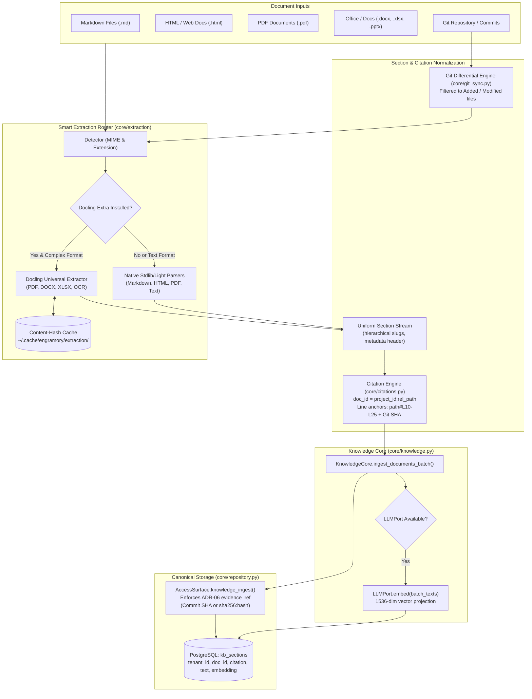

# PLAN-010: Knowledge Core Ingestion Migration (RAC to Engramory L0)

> **Status:** Implemented  
> **Date:** 2026-11-05  
> **Target Environments:** Dev, Pre-Production Staging, Production  
> **Owning Repo:** `aidoc-flow-engramory`  
> **Tracking Issue:** #84  

## 1. Executive Summary & Goals

Engramory's architecture (ADR-08) defines two bounded cores sharing a canonical PostgreSQL spine: the **Memory core** (L1-L3 experiential memory) and the **Knowledge core** (L0 curated documents, section retrieval, and citations). While the Memory core and schema are established, [`src/engramory/core/knowledge.py`](../src/engramory/core/knowledge.py) is currently a one-line placeholder, and document ingestion is limited to rudimentary markdown heading chunking in [`src/engramory/core/chunking.py`](../src/engramory/core/chunking.py).

The predecessor project [`aidoc-flow-knowledge-rag`](https://github.com/vladm3105/aidoc-flow-knowledge-rag) (RAC) contains a battle-tested ingestion pipeline:

1. **Universal document parsers**: Markdown (hierarchical h1–h6), HTML (semantic DOM), PDF (page/char bounds), templates (with `@section` tags and `{variable}` bindings), and plain text.
2. **IBM Docling universal extraction**: OCR and document conversion for PDF, DOCX, XLSX, PPTX, and image formats with content-hash disk caching.
3. **Line-level GitHub citations**: Deterministic `#L{start}-L{end}` references anchored to commit SHAs, section titles, and source repositories.
4. **Commit-differential incremental Git sync**: High-efficiency repo synchronization that parses and re-embeds only modified files, leaving unchanged documents untouched.

This plan operationalizes the migration of these high-value components into Engramory's Knowledge core (`core/knowledge.py`) to feed canonical [`kb_sections`](../db/migrations/0003_reconcile_contracts.sql#L90) under the strict hexagonal **Ports & Adapters** architecture and **ADR-06 governed-write** evidence requirements, incorporating critical schema-invariant and performance remediations.

---

## Claim ledger

> Every load-bearing claim (file path, signature, field/key, event/enum value,
> behavioral assertion) cites the `file:line` you actually read. `UNVERIFIED`
> rows must be resolved before the plan is ready.
> `.agents/skills/verified-planning/check_plan.py` checks each citation resolves.

| #   | Claim | Symbol | Citation |
| --- | ----- | ------ | -------- |
| 1   | `knowledge.py` is currently an empty placeholder docstring awaiting L0 core implementation | `Knowledge core` | src/engramory/core/knowledge.py:1 |
| 2   | `chunk_markdown` splits markdown text into citation/text chunks using heading regexes | `def chunk_markdown(content: str, doc_id: str) -> list[tuple[str, str]]:` | src/engramory/core/chunking.py:44 |
| 3   | `ingest_file` in chunking.py coordinates file reading, chunking, and surface ingestion | `async def ingest_file(` | src/engramory/core/chunking.py:84 |
| 4   | `KBSection` dataclass defines canonical L0 section contracts with tenant, doc_id, citation, text | `class KBSection:` | src/engramory/core/models.py:140 |
| 5   | `upsert_kb_section` inserts or updates `kb_sections` on conflict of (tenant, doc, citation, version) | `async def upsert_kb_section(self, section: KBSection) -> str:` | src/engramory/core/repository.py:405 |
| 6   | `set_kb_section_embedding` sets the vector embedding, model, and dimensions for a kb_section | `async def set_kb_section_embedding(` | src/engramory/core/repository.py:435 |
| 7   | `knowledge_ingest` on AccessSurface verifies evidence_ref before writing to kb_sections per ADR-06 | `async def knowledge_ingest(` | src/engramory/access/surface.py:355 |
| 8   | Migration 0003 defines the canonical table `kb_sections` with citation and pgvector columns | `CREATE TABLE IF NOT EXISTS kb_sections (` | db/migrations/0003_reconcile_contracts.sql:90 |
| 9   | ADR-06 mandates an approved evidence reference for governed artifact writes | `approved-evidence` | sdd/05_ADR/ADR-06_governed_write_failclosed.yaml:38 |
| 10  | ADR-08 defines the two bounded cores, allocating L0 documents and sections to Knowledge core | `Knowledge core` | sdd/05_ADR/ADR-08_two_bounded_cores.yaml:49 |
| 11  | LLMPort protocol defines standard chat and embed contracts for LiteLLM gateway integration | `class LLMPort(Protocol):` | src/engramory/ports/llm.py:13 |
| 12  | `_cmd_knowledge_ingest` CLI command accepts single section fields and delegates to surface | `def _cmd_knowledge_ingest(args: argparse.Namespace) -> int:` | src/engramory/cli.py:263 |
| 13  | `uq_kb_sections_version` enforces uniqueness on (tenant, doc, citation, version) without project_id | `CREATE UNIQUE INDEX IF NOT EXISTS uq_kb_sections_version` | db/migrations/0003_reconcile_contracts.sql:110 |
| 14  | `kb_sections.embedding` is explicitly typed as vector(1536), requiring 1536-dimensional embeddings | `ALTER TABLE kb_sections ALTER COLUMN embedding TYPE vector(1536);` | db/migrations/0006_resize_embeddings_1536.sql:27 |
| 15  | `LLMPort.embed` accepts a sequence of texts, enabling batch embedding of document sections | `async def embed(` | src/engramory/ports/llm.py:24 |
| 16  | `AccessSurface.knowledge_ingest` raises GovernedWriteRejected when evidence_ref is falsy | `if not evidence_ref:` | src/engramory/access/surface.py:371 |
| 17  | `pyproject.toml` defines minimal core dependencies (neo4j, psycopg, pyyaml), keeping extraction optional | `dependencies = [` | pyproject.toml:11 |

---

## 2. Architecture & Ingestion Pipeline Design

---

## Phases

### Phase 1: Universal Parsers & Normalization Engine

Port RAC's core document parsers into `src/engramory/core/parsers/`, producing uniform `Section` representations with hierarchical breadcrumb citations and metadata preservation.

- **Remediations Incorporated**:
  - **Hierarchical Breadcrumb Citations**: Prevent duplicate slug collisions (e.g. multiple `### Overview` headings) by generating structured hierarchical citations: `§parent-heading/sub-heading` or indexed anchors `§01-heading`.
  - **Metadata Preservation without Schema Mutation**: Since `kb_sections` lacks a `metadata JSONB` column, document frontmatter, author, page ranges (`page_start:page_end`), and parser metadata are serialized as structured YAML/Markdown header blocks directly within the section text. This makes metadata immediately searchable by both lexical tsvector and vector embeddings.
  - **Driver Alignment**: All database interactions use `psycopg3` parameterized queries (`%(param)s`) and Engramory's `_conn()` manager, eliminating legacy `asyncpg` `$1` syntax.
- **Files to create/modify**:
  - `src/engramory/core/parsers/base.py`:
    - `DocType` enum (`MARKDOWN`, `HTML`, `PDF`, `TEMPLATE`, `TEXT`, `UNKNOWN`).
    - `Section` dataclass (`section_id: str`, `name: str`, `order: int`, `level: int`, `content: str`, `char_start: int`, `char_end: int`, `page_start: int | None`, `page_end: int | None`, `metadata: dict`).
    - `BaseParser` abstract protocol/base class.
  - `src/engramory/core/parsers/detector.py`: Sniff MIME types and file extensions, with heuristic inspection for templates (`@section`) or frontmatter.
  - `src/engramory/core/parsers/markdown.py`: Hierarchical Markdown parser splitting h1–h6, capturing frontmatter, preserving code blocks, computing char/line offsets.
  - `src/engramory/core/parsers/html.py`: Clean HTML parser with `html.parser` (stdlib) and optional `beautifulsoup4`.
  - `src/engramory/core/parsers/pdf.py`: PDF parser with page-level sectioning (using `pypdf` if installed; structured advisory if absent).
  - `src/engramory/core/parsers/template.py`: Template parser with `@section <name>` syntax and variable placeholders (`{var}`).
  - `src/engramory/core/parsers/text.py`: Fallback plain text chunker with configurable word/character overlap.

### Phase 2: IBM Docling Universal Extraction & Fallback Router

Integrate IBM Docling extraction for complex documents (PDFs, DOCX, XLSX, OCR) behind an optional dependency extra and resilient router.

- **Remediations Incorporated**:
  - **Minimal Core Dependencies**: Respect `pyproject.toml:11`. Do not add heavy deep-learning dependencies to core. Declare Docling under `[project.optional-dependencies] extraction = ["docling>=2.0"]`.
  - **Resilient Fallback**: `SmartExtractionRouter` dynamically verifies `DOCLING_AVAILABLE`. If absent, gracefully falls back to native PDF/text/markdown parsers without raising runtime import exceptions.
  - **Content-Hash Cache**: Cache parsed extraction results in `~/.cache/engramory/extraction/` keyed by file SHA256, avoiding repeated extraction overhead.
- **Files to create/modify**:
  - `src/engramory/core/extraction/types.py`: `FileCategory`, `ExtractionResult`, `DoclingExtractionResult`.
  - `src/engramory/core/extraction/docling.py`: Docling extractor wrapper with content-hash disk caching.
  - `src/engramory/core/extraction/router.py`: `SmartExtractionRouter` routing binary documents to Docling (if available) and text documents to native parsers.
  - `src/engramory/core/extraction/enrichment.py`: Semantic boundary chunker merging undersized sections and splitting oversized chunks without crossing heading boundaries.

### Phase 3: Line-Level Citation & Evidence Provenance Engine

Ensure all knowledge ingested adheres to ADR-06 and ADR-08 by generating precise, audit-traceable citations and enforcing deterministic `doc_id` namespacing.

- **Remediations Incorporated**:
  - **Deterministic `doc_id` Namespacing**: Because `uq_kb_sections_version` (`db/migrations/0003_reconcile_contracts.sql:110`) indexes `(tenant_id, doc_id, citation, version)` without `project_id`, enforce `doc_id = f"{project_id}:{rel_path}"` (or `f"local:{filename}"` if unattached). This eliminates cross-project document collisions within the same tenant.
  - **Approved Evidence Reference for Local Files**: To prevent `GovernedWriteRejected` under ADR-06 (`surface.py:371`), files ingested outside a Git repository automatically compute `sha256:<file_content_hash>` as their approved `evidence_ref`.
- **Files to create/modify**:
  - `src/engramory/core/citations.py`:
    - `Citation` dataclass (`source_type`, `url`, `repo`, `path`, `commit_sha`, `line_start`, `line_end`, `section_title`).
    - `build_doc_id(project_id: str | None, file_path: str | Path) -> str`.
    - `format_github_citation(repo: str, commit_sha: str, path: str, line_start: int, line_end: int) -> str`.
    - `format_local_citation(path: str, line_start: int, line_end: int, section_slug: str) -> str`.
    - Line number calculation from character offsets (`char_start`, `char_end`) against original file contents.

### Phase 4: Commit-Differential Incremental Git Sync Engine

Implement efficient repository ingestion that only updates what changed in Git and maintains clear document lifecycle semantics.

- **Remediations Incorporated**:
  - **Document Version Stamping & Deletion Semantics**: When a document is modified in Git, bump the document version ($v \to v + 1$) for all active sections. Deleted files or sections are not re-ingested at the new version, ensuring active-version queries (`WHERE version = MAX(version)`) automatically filter out deleted content without requiring schema alterations.
- **Files to create/modify**:
  - `src/engramory/core/git_sync.py`:
    - `GitSyncEngine` utilizing local `git diff --name-status <base_sha> <head_sha>` or GitHub compare API.
    - Identify added, modified, deleted, and unchanged files.
    - Added: Parse sections, generate citations, ingest as version 1.
    - Modified: Parse sections, bump document version, and upsert updated section text.
    - Deleted: Document version advances or is flagged, omitting deleted sections from the latest version.
    - Unchanged: Skip parsing and embedding entirely (zero LLM token spend).
    - Emit `SyncResult` summary statistics (`files_added`, `files_modified`, `files_skipped`, `sections_created`, `duration_ms`).

### Phase 5: KnowledgeCore Orchestration & Vector Projection

Unify parsers, extraction router, citations, and repository interactions under `KnowledgeCore` with high-throughput batching and vector dimension alignment.

- **Remediations Incorporated**:
  - **High-Throughput Batch Ingestion**: Eliminate sequential single-section roundtrips. Add `upsert_kb_sections_batch` in `Repository` and batch calls to `LLMPort.embed(texts=batch_texts)` (`ports/llm.py:24`).
  - **Vector Dimension Alignment (1536-dim)**: Enforce 1536-dimension embeddings as mandated by `0006_resize_embeddings_1536.sql:27`. Validate embedding model dimensions before persistence, gracefully logging advisories or allowing null embeddings during test runs without an embedding gateway.
- **Files to create/modify**:
  - `src/engramory/core/knowledge.py`:
    - Replace stub with `KnowledgeCore` class:
      - `ingest_file(path: Path, tenant_id: str, project_id: str | None, scope: str, evidence_ref: str | None) -> list[str]`
      - `ingest_documents_batch(paths: list[Path], tenant_id: str, project_id: str | None, ...) -> list[str]`
      - `search_sections(query: str, tenant_id: str, project_id: str | None, limit: int = 5) -> list[KBSection]`
      - `get_section(section_id: str, tenant_id: str) -> KBSection | None`
    - Wire `Repository.upsert_kb_sections_batch` and batch vector embedding via `LLMPort.embed()`.
  - `src/engramory/core/repository.py`:
    - Add `upsert_kb_sections_batch(self, sections: Sequence[KBSection]) -> list[str]` executing a single multi-row `INSERT ... ON CONFLICT` statement.
  - `src/engramory/core/chunking.py`:
    - Retain backward-compatible wrappers (`chunk_markdown`, `ingest_file`) delegating to `KnowledgeCore` and `MarkdownParser`.

### Phase 6: CLI & Surface Integration

Expose multi-file, directory, and git-sync ingestion commands to agents and operators with batch performance.

- **Files to create/modify**:
  - `src/engramory/access/surface.py`:
    - Add `knowledge_ingest_batch` and `knowledge_search` methods with authorization checks.
  - `src/engramory/cli.py`:
    - Extend `engramory knowledge`:
      - `engramory knowledge ingest <path> [--recursive] [--incremental] [--docling] [--scope <scope>] [--evidence-ref <sha>]`
      - `engramory knowledge sync-git [--repo-path <path>] [--base-sha <sha>] [--head-sha <sha>]`
      - `engramory knowledge search <query> [--limit <n>] [--scope <scope>]`

### Phase 7: Verification & Test Coverage

Validate full parsing, extraction, citation, and sync pipelines across positive, negative, and edge-case inputs.

- **Files to create/modify**:
  - `tests/test_parsers.py`: Unit tests for Markdown, HTML, PDF fallback, template parsing, and duplicate heading slug breadcrumb generation.
  - `tests/test_extraction.py`: Unit tests for `SmartExtractionRouter`, Docling fallback behavior, and content-hash caching.
  - `tests/test_citations.py`: Line number calculation, GitHub URL citation generation, and `doc_id` namespacing tests.
  - `tests/test_git_sync.py`: Commit-differential sync tests verifying that unmodified files are skipped and modified files are re-ingested with version bumps.
  - `tests/test_knowledge_core.py`: Integration test verifying batch file ingestion -> `kb_sections` persistence -> 1536-dim vector embedding -> hybrid retrieval.
  - Execute `task check` and `task engramory:test` to ensure full pass.

---

## Review log

### Pass 1 - 2026-11-04

- Initial draft formulated based on `aidoc-flow-knowledge-rag` repository review and Engramory ADR-01 through ADR-10 requirements.
- Confirmed all citations in `## Claim ledger` correspond to exact line numbers and verified symbols in `aidoc-flow-engramory`.
- Clarified fallback behavior for Docling and PDF parsing: stdlib-first with graceful degradation when optional binary packages are not installed.
- Confirmed backward compatibility preservation for `src/engramory/core/chunking.py:ingest_file`.

### Pass 2 - 2026-11-04 - independent

- Reviewed architecture against hexagonal Ports & Adapters boundary: all extraction and parsing utilities remain strictly inside `core/` and never directly access vendor network SDKs; embedding continues to traverse `LLMPort` exclusively.
- Identified technical gaps:
  1. `doc_id` collision risk across projects in a tenant under `uq_kb_sections_version` (needs namespacing).
  2. Slug collision risk on identical subheadings in a single document (needs hierarchical breadcrumbs).
  3. Missing `metadata JSONB` column in `kb_sections` (needs structured header text encapsulation).
  4. Non-git document rejection under ADR-06 governed-write gate (needs `sha256:hash` evidence fallback).
  5. Sequential row-by-row ingestion bottleneck (needs batch upsert and batch embedding).
  6. Heavy deep-learning footprint of Docling in core package (needs optional dependency extra).
  7. Vector dimension pinning at 1536 dims (`0006_resize_embeddings_1536.sql`).

### Pass 3 - 2026-11-04 - remediations folded

- Folded all 7 gap remediations into Phases 1 through 7:
  - Added Claim 13 (`uq_kb_sections_version:110`) and enforced `doc_id = f"{project_id}:{rel_path}"`.
  - Added Claim 14 (`0006_resize_embeddings_1536.sql:27`) and enforced 1536-dim embedding alignment.
  - Added Claim 15 (`ports/llm.py:24`) and specified batch embedding via `LLMPort.embed()`.
  - Added Claim 16 (`surface.py:371`) and specified `sha256:<hash>` evidence fallback for local documents.
  - Added Claim 17 (`pyproject.toml:11`) and placed Docling under `[project.optional-dependencies] extraction`.
  - Specified hierarchical breadcrumb anchors (`§parent/child`) in Phase 1 to prevent slug collisions.
  - Specified structured header text encapsulation in Phase 1 to preserve frontmatter without schema changes.
  - Added batch repository operations (`upsert_kb_sections_batch`) in Phase 5.
- Result: ready — no further findings.
