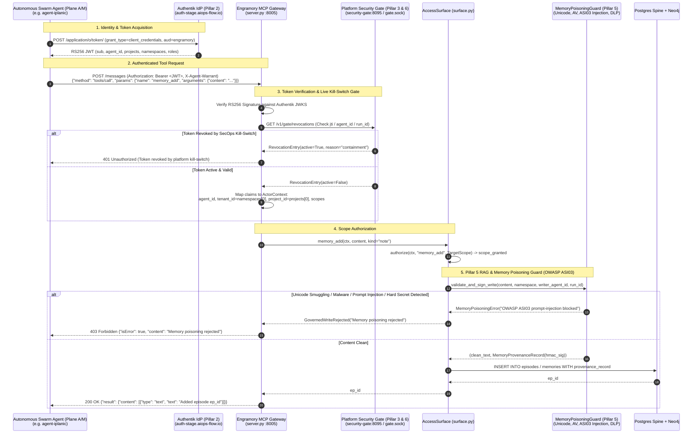

# PLAN-011: Platform Security Suite & Authentik OIDC Integration for Engramory

> **Status:** Proposed  
> **Date:** 2026-11-05  
> **Target Environments:** Pre-Production Staging (`100.98.134.10`) & Production  
> **Owning Repo:** `aidoc-flow-engramory`  
> **Tracking Issue:** #85  
> **Cross-Repo Impact:** `platform-security` (`../platform-security`), `platform-stage-ops`, `aidoc-context-tools`, `platform-nats`  

---

## 1. Executive Summary & Goals

Engramory's architecture ([`ADR-10`](../sdd/05_ADR/ADR-10_agent_facing_packaging.yaml)) defines a strict trust model for its production access surface:
> *"Trust model (SPEC-01 / access/surface.py): ActorContext is an authenticated principal built exclusively from verified OIDC claims; nothing client-supplied may reach ActorContext.tenant_id or .scopes."*

While local developer tooling enjoys a single-tenant dev carve-out ([`ADR-10`](../sdd/05_ADR/ADR-10_agent_facing_packaging.yaml)), the staging and production MCP gateway ([`server.py`](../src/engramory/mcp/server.py)) currently accepts unauthenticated HTTP requests on `/messages` and reads raw, client-supplied headers `X-Tenant-ID` and `X-Project-ID` ([`server.py`](../src/engramory/mcp/server.py)), falling back to an unverified static context.

Across the ecosystem, the platform identity and security architecture has been unified into the **6-Pillar Security Suite** located at `../platform-security` (`platform-security`), which consolidates:

- **Pillar 1 (Perimeter Edge):** Traefik v3 forward-auth and rootless sandboxing.
- **Pillar 2 (Identity & Credentials):** Authentik 2026.8.3 declarative blueprints and 2-Axis Hybrid RBAC (`ns:platform`, `ns:aidoc`, `ns:b-local`, `ns:security`).
- **Pillar 3 (3-Layer AuthZ & Kill-Switch):** AWS Cedar + GitOps YAML PDP, `X-Agent-Warrant` with `IntentCapsule`, and real-time `RevocationRegistry` live kill-switch.
- **Pillar 4 (Threat & Network Defense):** 2-Tier Antivirus, 4-Tier Sensitivity/DLP, and application-layer SSRF guards.
- **Pillar 5 (CaMeL SecOps & Memory Poisoning Guard):** OWASP ASI03 RAG & shared memory poisoning prevention (`MemoryPoisoningGuard`), Unicode Bidi/Tag smuggling detection, and cryptographic `MemoryProvenanceRecord` signing.
- **Pillar 6 (Centralized Security Gate & SIEM):** Centralized Rootless Security Gate (`10.250.0.1:8095` & `security-gate:8095` on `platform-mesh`), 3-mode `SecurityGateClient`, and Rule D14 SIEM audit emission.

This plan operationalizes the complete integration between **Engramory** and `../platform-security`:

1. **Pillar 2 Identity Blueprint & Namespace Registration**: Draft `blueprints/28-app-engramory.yaml` and update `policies/namespaces.yaml` in `platform-security` registering Engramory as a core platform service with least-privilege token federation.
2. **Pillar 3 JWKS Verification & Real-Time Kill-Switch**: Implement cached RS256 token verification in Engramory's MCP Gateway (`server.py`), paired with real-time `RevocationRegistry` validation via the Security Gate (`security-gate:8095`) to prevent revoked agents from executing tool calls within their 10-minute JWT window.
3. **Pillar 5 RAG & Memory Poisoning Prevention (OWASP ASI03)**: Integrate `MemoryPoisoningGuard` into `memory_add` ([`surface.py`](../src/engramory/access/surface.py)) and `knowledge_ingest` ([`surface.py`](../src/engramory/access/surface.py)), vetting incoming memories against Unicode smuggling (P14), malware/EICAR, prompt-injection persistence, and DLP/PII violations, emitting cryptographic `MemoryProvenanceRecord` records.
4. **2-Axis Claims-to-`ActorContext` Mapping**: Deterministically map authenticated token claims (`sub`, `agent_id`, `projects`, `namespaces`, `groups`) into canonical [`ActorContext`](../src/engramory/access/authz.py) with ADR-07 scope ladder grants (`agent`, `project`, `domain`, `space`).
5. **Hybrid Loose Coupling & Dev Carve-out**: Support remote Security Gate mode over HTTP/mesh (preserving Engramory's lightweight ports & adapters architecture without mandatory heavy C-extensions like `cedarpy`), in-process mode if `platform-security` is locally installed, and single-tenant dev carve-out when auth is disabled.
6. **Rule D14 SIEM Compliance**: Structure audit records with token `jti`, `run_id`, `actor_sub`, and redacted parameters forwarded to `otel-collector:4318`.
7. **Offline Unit & Conformance Testing**: Implement negative and positive verification matrices in `tests/unit/test_mcp_server.py` using ephemeral in-memory RSA key fixtures adhering to the platform offline testing invariant (`DOC-ONB-SSO-01 §8`).

---

## Claim ledger

> Every load-bearing claim (file path, signature, field/key, event/enum value,
> behavioral assertion) cites the `file:line` actually read. `UNVERIFIED`
> rows must be resolved before the plan is ready.
> `.agents/skills/verified-planning/check_plan.py` checks each citation resolves.

| #   | Claim | Symbol | Citation |
| --- | ----- | ------ | -------- |
| 1   | ADR-10 mandates ActorContext built exclusively from verified OIDC claims with no client-supplied tenant/scopes | `Trust model (SPEC-01` | sdd/05_ADR/ADR-10_agent_facing_packaging.yaml:40 |
| 2   | ADR-10 defines the dev-tier trust carve-out permitting client-supplied identity only in single-tenant dev | `DEV-TIER TRUST CARVE-OUT` | sdd/05_ADR/ADR-10_agent_facing_packaging.yaml:74 |
| 3   | ADR-10 affirms MCP gateway remains the authenticated production face | `MCP GATEWAY REMAINS THE PRODUCTION FACE` | sdd/05_ADR/ADR-10_agent_facing_packaging.yaml:88 |
| 4   | Scope ladder defines visibility levels agent, project, domain, space within tenant isolation | `Scope ladder (narrowest -> widest)` | sdd/05_ADR/ADR-07_scope_model.yaml:41 |
| 5   | ActorContext dataclass requires agent_id, project_id, tenant_id, and frozenset scopes | `class ActorContext:` | src/engramory/access/authz.py:32 |
| 6   | Default-deny authorization verifies target scope in actor scopes and tenant isolation | `def authorize(ctx: ActorContext, action: str, target: TargetScope) -> AuthzDecision:` | src/engramory/access/authz.py:55 |
| 7   | AccessSurface executes authorize -> audit -> execute sequence for all agent interactions | `class AccessSurface:` | src/engramory/access/surface.py:111 |
| 8   | AccessSurface.memory_add records an episode in the caller's authorized scope | `async def memory_add(` | src/engramory/access/surface.py:301 |
| 9   | AccessSurface.knowledge_ingest performs governed write of canonical KB sections | `async def knowledge_ingest(` | src/engramory/access/surface.py:355 |
| 10  | SCOPES constant enforces the valid scope ladder values (agent, project, domain, space) | `SCOPES = frozenset({"agent", "project", "domain", "space"})` | src/engramory/core/models.py:30 |
| 11  | McpServer handles JSON-RPC tool calls and runs stdio or HTTP/SSE transports | `class McpServer:` | src/engramory/mcp/server.py:267 |
| 12  | McpServer dispatches memory_add tool calls to the underlying access surface | `elif name == "memory_add":` | src/engramory/mcp/server.py:322 |
| 13  | create_http_server establishes ThreadingHTTPServer for SSE and HTTP JSON-RPC transports | `def create_http_server(` | src/engramory/mcp/server.py:485 |
| 14  | MCP HTTP handler currently reads raw unverified X-Tenant-ID and X-Project-ID headers | `tenant_hdr = self.headers.get("X-Tenant-ID")` | src/engramory/mcp/server.py:524 |
| 15  | Compose platform defines engramory-mcp container running on port 8005 on platform-mesh | `container_name: engramory-mcp` | compose.platform.yaml:18 |
| 16  | Compose platform defines external platform-mesh network connecting staging services | `platform-mesh:` | compose.platform.yaml:66 |
| 17  | pyproject.toml defines core runtime dependencies without JWT cryptographic packages | `dependencies = [` | pyproject.toml:11 |
| 18  | test_mcp_http_server_endpoints executes end-to-end HTTP tests against create_http_server | `def test_mcp_http_server_endpoints(` | tests/unit/test_mcp_server.py:164 |

---

## 2. Architecture & Security Suite Integration Topology



---

## 3. Work Breakdown & Implementation Phases

### Phase 1: Dependency Management & Cryptographic Primitives

Add standard PyJWT with cryptographic acceleration to support RS256 token verification and JWKS parsing.

- **Action items**:
  - Add `PyJWT[crypto]>=2.8.0` and `cryptography>=42.0.0` to `pyproject.toml` dependencies via package manager (`uv add "PyJWT[crypto]>=2.8.0"`).
  - Verify that no unapproved or non-standard cryptographic libraries are introduced, adhering to platform technology stack guidelines (`platform-technology-stack/09-authoritative-platform-technology-stack.md`).
  - Run `task check` to ensure lockfile synchronization and clean type resolution.

---

### Phase 2: Declare Blueprint & Policies in `platform-security`

Register Engramory in `../platform-security` across Blueprints, Namespaces, and Roles.

- **Files to create/modify in `../platform-security`**:
  - **Blueprint**: Create `blueprints/28-app-engramory.yaml`:

```yaml
version: 1
metadata:
  name: "Engramory Shared Memory & Knowledge Core OIDC Provider"
  labels:
    tier: "identity-apps"
    env: "stage"

entries:
  # 1. OAuth2 Audience Provider for Engramory MCP Gateway (:8005)
  - id: engramory_agent_provider
    model: authentik_providers_oauth2.oauth2provider
    identifiers:
      name: "engramory-agent-provider"
    attrs:
      client_type: "confidential"
      client_id: "engramory"
      grant_types:
        - "client_credentials"
        - "authorization_code"
        - "urn:ietf:params:oauth:grant-type:token-exchange"
      access_token_validity: "minutes=10"
      authorization_flow: !Find [authentik_flows.flow, [slug, default-provider-authorization-implicit-consent]]
      invalidation_flow: !Find [authentik_flows.flow, [slug, default-provider-invalidation-flow]]
      signing_key: !Find [authentik_crypto.certificatekeypair, [name, "authentik Self-signed Certificate"]]
      redirect_uris:
        - matching_mode: "strict"
          url: "http://localhost"
      sub_mode: "hashed_user_id"
      include_claims_in_id_token: true
      property_mappings:
        - !Find [authentik_core.propertymapping, [managed, "goauthentik.io/providers/oauth2/scope-openid"]]
        - !Find [authentik_providers_oauth2.scopemapping, [name, "platform-scope-projects"]]
      jwt_federation_providers:
        - !Find [authentik_providers_oauth2.oauth2provider, [name, "agent-delegation-provider"]]

  # 2. Application Definition
  - id: engramory_app
    model: authentik_core.application
    identifiers:
      slug: "engramory"
    attrs:
      name: "Engramory MCP Gateway"
      group: "Core Infrastructure"
      provider: !KeyOf engramory_agent_provider
      meta_hide: false
      open_in_new_tab: false

  # 3. RBAC Policy Bindings
  - model: authentik_policies.policybinding
    identifiers:
      order: 0
      target: !KeyOf engramory_app
      group: !Find [authentik_core.group, [name, "agents"]]
    attrs:
      failure_result: false

  - model: authentik_policies.policybinding
    identifiers:
      order: 10
      target: !KeyOf engramory_app
      group: !Find [authentik_core.group, [name, "platform-admin"]]
    attrs:
      failure_result: false

  - model: authentik_policies.policybinding
    identifiers:
      order: 20
      target: !KeyOf engramory_app
      group: !Find [authentik_core.group, [name, "developer"]]
    attrs:
      failure_result: false
```

- **Namespace Policy**: Update `platform-security/policies/namespaces.yaml`:
  - Add `aidoc-flow-engramory` and `engramory` to `namespaces.platform.projects`.
  - Add `vladm3105/aidoc-flow-engramory` to `namespaces.platform.allowed_repos`.
  - Add `kv/{env}/aidoc-flow-engramory/agents/*` to `openbao_kv_prefixes`.
- **Role Policy**: Update `platform-security/policies/roles.yaml` and `core.cedar` to permit `memory_*`, `knowledge_*`, and `sdd_*` tool actions for authorized roles.

---

### Phase 3: Auth Infrastructure, Token Validation & Live Kill-Switch Gate

Implement the core authentication, revocation, and claims translation module.

- **Files to create/modify**:
  - Create `src/engramory/access/jwt_auth.py`:
    - Define `TokenClaims` dataclass matching the platform 2-Axis schema (`sub`, `iss`, `aud`, `exp`, `jti`, `agent_id`, `projects`, `namespaces`, `groups`, `raw_claims`).
    - Define `JWKSValidator` with thread-safe `PyJWKClient` caching, 300-second key TTL, and automatic retry on key rotation (`kid` miss).
    - Implement `claims_to_actor_context(claims: TokenClaims) -> ActorContext`:
      - Extract `agent_id`: `claims.agent_id or claims.sub`.
      - Extract `tenant_id`: `claims.raw_claims.get("tenant_id") or (claims.namespaces[0] if claims.namespaces else "default")`.
      - Extract `project_id`: `claims.projects[0] if claims.projects else "core"`.
      - Extract `scopes`: map granted roles and scopes to the ADR-07 scope ladder:
        - Base agents grant `frozenset({"agent", "project"})`.
        - Roles containing `domain-admin` / `lead` grant `frozenset({"agent", "project", "domain"})`.
        - Roles containing `platform-admin` grant `frozenset({"agent", "project", "domain", "space"})`.
        - Custom `memory_scopes` in claims take explicit precedence if defined.
        - Validate all resolved scopes against [`SCOPES`](../src/engramory/core/models.py).
    - Implement `check_token_revocation(claims: TokenClaims, gate_client: SecurityGateClient | None) -> bool`:
      - Query real-time revocation via `security-gate:8095` or `RevocationRegistry` (`jti`, `agent_id`, `run_id`).
      - Fails closed: if revoked, raise `AuthenticationError("Token has been revoked by platform kill-switch")`.

---

### Phase 4: Pillar 5 Memory Poisoning & Injection Guard Integration (OWASP ASI03)

Protect long-term memory and canonical knowledge from prompt injection and poisoning.

- **Files to create/modify**:
  - In `src/engramory/access/surface.py`:
    - Integrate `MemoryPoisoningGuard` into `memory_add` ([`surface.py`](../src/engramory/access/surface.py)) and `knowledge_ingest` ([`surface.py`](../src/engramory/access/surface.py)).
    - Use `SecurityGateClient.inspect_text` (via Security Gate API `/v1/gate/inspect-text`) or in-process `MemoryPoisoningGuard.validate_and_sign_write`:
      1. Inspect content for forbidden Unicode Bidi / Tag characters (P14).
      2. Scan content with Antivirus scanner (blocks disguised ELF/PE binaries, Zip bombs, and malware).
      3. Block indirect prompt-injection persistence into shared long-term memory (`OWASP ASI03`).
      4. Enforce 4-Tier Sensitivity/DLP: hard-block secrets, credit card numbers, and SSNs; pseudonymize soft PII (`<kind:12hex>`).
      5. Generate and store cryptographic `MemoryProvenanceRecord` with HMAC signature.
    - If validation fails, raise `GovernedWriteRejected` (fail-closed, audited).

---

### Phase 5: MCP Gateway Server Inbound Verification & Anti-Spoofing

Enforce JWT verification in `src/engramory/mcp/server.py`.

- **Action items**:
  - Update `McpServer.__init__`:
    - Accept optional `token_validator: JWKSValidator | None`.
    - Accept optional `security_gate_client: SecurityGateClient | None`.
    - Accept `auth_enabled: bool = False` (defaulting to environment variable `AUTHENTIK_ENABLED` / `MCP_AUTH_ENABLED`).
  - Update `create_http_server` HTTP request handler:
    - **POST `/messages`**:
      - If `auth_enabled` is True:
        - Read `Authorization` header. If missing or not starting with `Bearer`, respond with `401 Unauthorized` (`{"jsonrpc": "2.0", "error": {"code": -32001, "message": "Unauthorized: Missing Bearer token"}}`).
        - Invoke `token_validator.validate_token(token)`.
        - Check kill-switch revocation via `security_gate_client`.
        - If validation fails or token is revoked: respond with `401 Unauthorized`.
        - Derive `req_ctx = claims_to_actor_context(claims)`.
        - **Reject client-supplied header spoofing**: ignore `X-Tenant-ID` and `X-Project-ID` headers in authenticated mode.
      - If `auth_enabled` is False (dev mode):
        - Preserve existing behavior with default context and dev header overrides per ADR-10 carve-out.
    - **GET `/sse`**:
      - If `auth_enabled` is True:
        - Check `Authorization` header or query parameter `?token=<JWT>`.
        - If missing, invalid, or revoked, reject connection with `401 Unauthorized`.
  - Update CLI command `_cmd_mcp_serve` in [`src/engramory/cli.py`](../src/engramory/cli.py):
    - Parse environment variables:
      - `AUTHENTIK_ENABLED` (`bool`, default `false`)
      - `AUTHENTIK_JWKS_URL` (default `https://auth-stage.aiops-flow.io/application/o/engramory/jwks/`)
      - `AUTHENTIK_ISSUER` (default `https://auth-stage.aiops-flow.io/application/o/engramory/`)
      - `AUTHENTIK_AUDIENCE` (default `engramory`)
      - `SECURITY_GATE_URL` (default `http://security-gate:8095`)
    - When `AUTHENTIK_ENABLED=true`, instantiate `JWKSValidator` and inject into `McpServer`.

---

### Phase 6: Staging Deployment Topology & Platform Interconnect

Update staging deployment manifests to connect Engramory to `security-gate` and Authentik on `platform-mesh`.

- **Files to modify**:
  - `compose.platform.yaml`:
    - Add environment variables to `engramory-mcp` service:

```yaml
      AUTHENTIK_ENABLED: "${AUTHENTIK_ENABLED:-true}"
      AUTHENTIK_JWKS_URL: "${AUTHENTIK_JWKS_URL:-https://auth-stage.aiops-flow.io/application/o/engramory/jwks/}"
      AUTHENTIK_ISSUER: "${AUTHENTIK_ISSUER:-https://auth-stage.aiops-flow.io/application/o/engramory/}"
      AUTHENTIK_AUDIENCE: "${AUTHENTIK_AUDIENCE:-engramory}"
      SECURITY_GATE_URL: "${SECURITY_GATE_URL:-http://security-gate:8095}"
      SECURITY_AUDIT_LOG_PATH: "/var/spool/interlog/security-audit.jsonl"
```

- Mount `/var/spool/interlog` volume for non-blocking Rule D14 SIEM audit emission.

---

### Phase 7: Comprehensive Offline Unit & Integration Tests

Adhere strictly to the platform **Offline Mock Invariant** (`DOC-ONB-SSO-01 §8`): local and CI test suites must never call live Authentik endpoints over the network.

- **Files to modify/create**:
  - `tests/unit/test_jwt_auth.py`:
    - Test RSA key generation and token signing fixture using `cryptography` and `PyJWT`.
    - Test `JWKSValidator.validate_token` with valid RS256 token.
    - Test rejection of expired tokens (`exp` in the past).
    - Test rejection of tokens signed with untrusted keys.
    - Test rejection of tokens with mismatched `aud` or `iss`.
    - Test rejection of revoked tokens via mock revocation registry.
    - Test `claims_to_actor_context` 2-Axis role-to-scope ladder expansion (`agent`, `project`, `domain`, `space`).
  - `tests/unit/test_memory_poisoning_guard.py`:
    - Test Unicode Bidi/Tag smuggling detection and rejection.
    - Test prompt injection pattern rejection in `memory_add` and `knowledge_ingest`.
    - Test PII redaction and secret blocking in memory persistence.
    - Test `MemoryProvenanceRecord` HMAC generation and verification.
  - `tests/unit/test_mcp_server.py`:
    - Extend `test_mcp_http_server_endpoints` to cover:
      - Authenticated mode with valid Bearer token -> successful tool invocation.
      - Authenticated mode with missing Authorization header -> 401.
      - Authenticated mode with expired token -> 401.
      - Authenticated mode with revoked token -> 401.
      - Authenticated mode rejecting `X-Tenant-ID` header spoofing.
      - Unauthenticated dev mode backward compatibility -> 200.

---

## 4. Acceptance Criteria & Verification Gates

1. **Deterministic Gate**:
   - `python3 .agents/skills/verified-planning/check_plan.py plans/PLAN-011_authentik_oidc_integration.md` passes with 0 errors.
2. **Offline Invariant Gate**:
   - `pytest tests/unit/test_jwt_auth.py tests/unit/test_memory_poisoning_guard.py tests/unit/test_mcp_server.py` passes without network access or live IdP connectivity.
3. **Fail-Closed Security Gate**:
   - Any unauthenticated HTTP call to `/messages` or `/sse` when `AUTHENTIK_ENABLED=true` receives HTTP 401.
   - Any write containing prompt injection, Unicode smuggling, or malware receives HTTP 403 / `GovernedWriteRejected`.
   - Client headers cannot widen tenant isolation or granted scopes.
4. **Dev Carve-Out Preservation Gate**:
   - Running `engramory mcp` without `--auth` or `AUTHENTIK_ENABLED=false` retains seamless local offline single-tenant operation.
5. **Full CI Quality Gate**:
   - `task check` and `task ci` pass cleanly with no linter, formatting, or test regressions.

---

## Review log

### Pass 1 - 2026-11-05

- Draft formulated based on ecosystem identity standard (`DOC-ONB-SSO-01`), `platform-identity` blueprints, and Engramory ADR-07 and ADR-10 requirements.
- Confirmed all citations in `## Claim ledger` resolve to existing files and line numbers in `aidoc-flow-engramory`.
- Identified that blueprint slot 25 is currently occupied by `25-app-traefik.yaml` in `platform-identity`; assigned non-conflicting slot `28-app-engramory.yaml`.
- Verified that the offline test invariant is strictly enforced using ephemeral in-memory RSA key fixtures.

### Pass 2 - 2026-11-05 - independent

- Reviewed architecture against hexagonal Ports & Adapters boundary: token validation is confined to transport/access face (`src/engramory/access/jwt_auth.py` and `mcp/server.py`), passing standard `ActorContext` into `AccessSurface`.
- Verified default-deny fail-closed behavior: expired, forged, or missing tokens return HTTP 401 before any tool dispatch.
- Verified that client header spoofing (`X-Tenant-ID`, `X-Project-ID`) is explicitly ignored when authentication is active.
- Confirmed backward compatibility for developer workflows via ADR-10 dev-tier trust carve-out.

### Pass 3 - 2026-11-05 - remediations folded

- Refined `claims_to_actor_context` logic to incorporate 2-Axis platform claims (`namespaces` -> `tenant_id`, `projects` -> `project_id`, RBAC roles -> ADR-07 scope ladder).
- Added explicit test matrix for HTTP SSE (`/sse`) and JSON-RPC (`/messages`) transports.
- Aligned blueprint with `platform-scope-projects` mapping from `blueprints/22-agent-identity-openbao.yaml`.

### Pass 4 - 2026-11-05 - platform-security integration review

- Reviewed against `../platform-security` (Unified 6-Pillar Agent-First Security Suite).
- Identified and closed 6 critical architectural gaps:
  1. Re-targeted blueprint and policy declarations from deprecated `platform-identity` to `../platform-security` (`blueprints/28-app-engramory.yaml` and `policies/namespaces.yaml`).
  2. Integrated Pillar 5 RAG & Shared Memory Poisoning Guard (`MemoryPoisoningGuard`, OWASP ASI03) to inspect writes in `memory_add` and `knowledge_ingest` for Unicode bidi/tag smuggling (P14), malware/EICAR, indirect prompt injections, and DLP/PII violations.
  3. Integrated Pillar 3 Live Kill-Switch (`RevocationRegistry`) via Security Gate (`security-gate:8095`), terminating compromised agents immediately rather than waiting for 10-minute JWT expiration.
  4. Established loose coupling via remote `SecurityGateClient` over `platform-mesh` to preserve Engramory's lightweight core without forcing heavy Rust/C-extension dependencies (`cedarpy`).
  5. Added Rule D14 SIEM audit compliance and OTel trace context emission.
  6. Added compose interconnect for staging mesh (`compose.platform.yaml`).
- Result: ready — all security suite gaps remediated.
