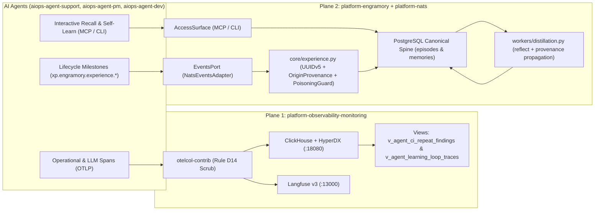

# PLAN-020: Retire `aidoc-flow-interlog` and Consolidate Deterministic Agent Experience Pipeline into `platform-engramory` & `platform-observability-monitoring`

> **Status:** Ready for Implementation  
> **Date:** 2026-11-10  
> **Repository:** `platform-engramory` (Primary) + Cross-Spoke Updates (`platform-observability-monitoring`, `aiops-agent-pm`, `aidoc-flow-interlog`)  
> **Target Branch:** `feature/plan-020-interlog-retirement-and-experience-pipeline` -> `dev`  
> **Governance Standard:** `aiops-harness` v0.2.0 (`verified-planning`, `SDD2C` / `C3`)  
> **Authorizing CHG:** `docs/sdd/09_CHG/CHG-006_interlog_retirement_and_experience_pipeline.yaml`  
> **Retiring Legacy Spoke:** `$WORKSPACE_ROOT/aidoc-flow-interlog`

---

## 1. Context & Architectural Motivation

`$WORKSPACE_ROOT/aidoc-flow-interlog` was designed in July 2026 as an early three-in-one bridge before the platform planes existed:

1. **Private application logging** (`.interlog/private.log` via a custom `interlog` Python SDK).
2. **Operational monitoring conventions** (`docs/standards/MONITORING.md` and a custom `MonitoringProvider` protocol).
3. **Cross-agent experience exchange to feed Engramory** (`docs/standards/DATA-INTERCHANGE.md` and `docs/standards/FEEDBACK-ARCS.md`) via **Phase C `GitTransport`** (`src/interlog/sync.py`), which cloned `aidoc-flow-interlog` into `.interlog/outbox/.clone`, wrote one JSON file per event under `events/<project>/<YYYY-MM>/<event_id>.json`, and executed a 5-attempt `git fetch && git rebase && git push` loop against `main`.

An architectural audit across the workspace confirmed that:

- `aidoc-flow-interlog/events/` contains **zero production events**, and `registries/producers.json` lists all three producers as `"status": "planned"`.
- `aiops-agent-support` explicitly retired Interlog in founder-directed `ADR-0026_disable-interlog.md` (Issue #110), citing unnecessary cross-repo registry promotion gates, duplicate identifier contracts, and Git push contention under multi-agent concurrency.
- The three responsibilities of `aidoc-flow-interlog` are now owned by purpose-built platform services:
  - **Plane 1 — Operational Telemetry, Logs, Traces & LLM Spans:** `platform-observability-monitoring` (`otelcol-contrib` on `:4317`/`:4318` with **Rule D14** secret scrubbing -> ClickHouse + HyperDX `:18080` + Langfuse v3 `:13000` + Coroot eBPF `:18085`).
  - **Plane 2 — Agent Episodic Memory, Distillation & Event Transport:** `platform-engramory` (`AccessSurface` MCP/CLI + `EventsPort` + `workers/distillation.py`) over `platform-nats` (NATS JetStream).

However, **four high-value domain contracts** from `aidoc-flow-interlog` must be preserved and consolidated into `platform-engramory` and `platform-observability-monitoring` before `aidoc-flow-interlog` is formally archived:

1. **Deterministic UUIDv5 Event/Episode Deduplication (`derive_experience_event_id`):** Deriving `event_id = uuid5(EXPERIENCE_EVENT_ID_NS, ...)` over canonical identity inputs so retried NATS messages or repeated CI/agent milestones map deterministically to the same episode without duplicate L1/L2 memory rows.
2. **Mandatory `OriginProvenance` Contract (`docs/standards/FEEDBACK-ARCS.md` §2):** Requiring every milestone experience event and distilled memory to carry `origin` (`repo` + at least one of `commit`, `pr`, `plan_id`, `chg_id`, or `run_id`, plus optional W3C `trace_id`).
3. **Canonical 9 Agent Milestone Event Kinds (`registries/event-kinds.json`):** `plan.authored`, `review.verdict`, `execution.completed`, `gate.failed`, `decision.recorded`, `lesson.proposed`, `feedback.received`, `feedback.routed`, and `feedback.quarantined`.
4. **Closed-Loop Learning Effectiveness Signals (`docs/standards/FEEDBACK-ARCS.md` §4):**
   - `exec_ready_calibration_delta`: `|predicted_exec_ready_score / 100.0 - actual_first_pass_rate|` across `plan.authored` and `execution.completed` events.
   - `repeat_findings_rate`: fraction of `review.verdict` / `gate.failed` findings whose `rule_id` repeats in the same repository after a prior finding.

This plan implements all three recommendations from the architectural review across five cohesive phases.

---

## 2. Objectives & Non-Goals

### 2.1 Objectives

1. **Recommendation 1 — Formally Archive & Decommission `aidoc-flow-interlog`:**
   - Mark `$WORKSPACE_ROOT/aidoc-flow-interlog` (`README.md` and `PROJECT_DESCRIPTION.md`) as **Archived & Superseded**, redirecting operational logging/telemetry to `platform-observability-monitoring` and agent experience/memory to `platform-engramory` + `platform-nats`.
   - Update `$WORKSPACE_ROOT/aiops-agent-pm/projects.yaml:123-135` and `$WORKSPACE_ROOT/aiops-agent-pm/projects.json:93-101` to set `enabled: false` and an `ARCHIVED` description on `aidoc-flow-interlog` (keeping `aidoc-observability-monitoring` and `aidoc-flow-engramory` registry IDs untouched in `aiops-agent-pm` so `test_observability_monitoring_registered_across_all_fleet_registries` in `tests/test_aiops_pm.py:351-361` and `aiops_agent_pm/bus.py:75,93` remain 100% green).
   - Update `$WORKSPACE_ROOT/platform-observability-monitoring` documentation (`README.md`, `PROJECT_DESCRIPTION.md`, `docs/ARCHITECTURE.md`, `docs/SPOKE-INTEGRATION.md`, `provisioning/webhooks.yaml`, and comments in `infra/configs/otel-collector-config.yaml`) to record `aidoc-flow-interlog` as archived/legacy (replacing any `file://` Interlog links with plain code-formatted component names so `.ci-config` `PATHS_DENY` and `lychee` link gates pass) while retaining the `file_log/interlog` collector receiver for backward-compatible `.xp-capture/events.jsonl` and spoke log tailing tests.
2. **Recommendation 2 — Standardize the Two-Plane Agent Architecture (`EventsPort` NATS Adapter & Worker Ingestion in `platform-engramory`):**
   - Implement `NatsEventsAdapter` in `src/engramory/adapters/dev/events_nats.py` satisfying `EventsPort` (`src/engramory/ports/events.py:12-19`) over canonical `xp.engramory.experience.<kind>` subjects using pure-Python stdlib asyncio TCP NATS wire protocol + an in-memory loopback bus for hermetic unit/conformance testing (requiring zero new vendor packages in `pyproject.toml`).
   - Wire `events: EventsPort | None = None` into `AdapterSet` and `dev_adapters()` (`src/engramory/adapters/factory.py:21-38`), pass `events=adapters.events` in `_cmd_worker_start()` (`src/engramory/cli.py:465-479`), and ensure both `_close_adapters()` (`src/engramory/cli.py:185-194`) and `run_worker_loop()` (`src/engramory/workers/runner.py:32-108`) close `events` cleanly on exit.
   - Extend `src/engramory/workers/distillation.py` and `src/engramory/workers/runner.py` so the background worker drains pending experience events from `EventsPort` (when configured) with per-event error isolation and tenant-wall (`ADR-07`) enforcement, vets both content and metadata through `inspect_memory_write()` (`src/engramory/access/poisoning_guard.py:87`), persists them idempotently via `Repository.add_episode()`, and projects them into `memories` via `reflect()`.
3. **Recommendation 3 — Port Interlog's Deterministic UUIDv5 Provenance, 9 Milestone Event Kinds & Closed-Loop Learning Signals:**
   - Create `src/engramory/core/experience.py` defining `EXPERIENCE_EVENT_ID_NS`, `EXPERIENCE_EVENT_KINDS`, `OriginProvenance`, `derive_experience_event_id()`, `ExperienceEvent`, and `compute_learning_health_metrics()`.
   - Update `reflect()` in `src/engramory/workers/distillation.py:85-100` to propagate `event_id`, `origin`, and `kind` from `episode.metadata` into `Memory.provenance`.
   - Add `Repository.get_learning_health_summary()` in `src/engramory/core/repository.py` and `engramory memory learning-health` in `src/engramory/cli.py`.
   - Add ClickHouse analytical views `hyperdx.v_agent_ci_repeat_findings` and `hyperdx.v_agent_learning_loop_traces` in `$WORKSPACE_ROOT/platform-observability-monitoring/infra/configs/clickhouse/init-db.sql` and `infra/ddl/clickhouse/001_hyperdx_tables.sql`.

### 2.2 Non-Goals

- Modifying PostgreSQL table DDL under `db/migrations/` (`episodes.metadata` and `memories.provenance` are already `JSONB` columns with `uq_episodes_idempotency` on `(tenant_id, agent_id, coalesce(project_id, ''), content_hash)`).
- Adding third-party vendor SDKs (`nats-py`, etc.) to `pyproject.toml` that would violate `tests/unit/test_no_vendor_imports.py` or require lockfile regeneration.
- Removing the `file_log/interlog` receiver key from `$WORKSPACE_ROOT/platform-observability-monitoring/infra/configs/otel-collector-config.yaml` (it remains active for `.xp-capture/events.jsonl` and existing pipeline tests `test_otel_collector_receivers` and `test_functional_interlog_filelog_tailing`).

---

## 3. Architectural Design & Invariants

1. **Hexagonal Ports & Adapters Invariant (`AGENTS.md`, `SPEC-06`, `tests/unit/test_no_vendor_imports.py:64-84`):**
   - `src/engramory/ports/events.py` remains 100% stdlib-only.
   - `src/engramory/core/experience.py` and `src/engramory/workers/distillation.py` import only stdlib, `engramory.core.*`, `engramory.access.poisoning_guard`, and `engramory.ports.*` — never `engramory.adapters.*` or vendor SDKs.
   - `src/engramory/adapters/dev/events_nats.py` lives under `engramory.adapters.dev` and implements `EventsPort` using pure stdlib (`asyncio`, `json`, `urllib.parse`) plus an optional in-memory bus for deterministic tests.
2. **Deterministic UUIDv5 & Content-Hash Idempotency (`SPEC-02`, `db/migrations/0003_reconcile_contracts.sql:25-26`):**
   - `EXPERIENCE_EVENT_ID_NS = uuid.UUID("9f9cccb2-2bac-5a91-981a-6c897f147444")`.
   - `derive_experience_event_id()` computes `uuid.uuid5(EXPERIENCE_EVENT_ID_NS, "\n".join([project, producer, kind, repo, commit or "", "" if pr is None else str(pr), plan_id or "", run_id or "", occurred_at, payload_type]))`, preserving 100% slot-for-slot parity with `aidoc-flow-interlog/src/interlog/envelope.py:45-57`. When `ExperienceEvent` validates an explicitly supplied `event_id` and `origin.chg_id` is set while `origin.plan_id` is `None`, it accepts `event_id` matching either the canonical `plan_id=""` derivation or the `chg_id`-in-slot-7 derivation.
   - `ExperienceEvent.to_episode()` formats `content_raw = f"[{self.kind}] event_id={self.event_id} repo={self.origin.repo} summary={summary_text}"` so `Episode.content_hash` (`md5(content_raw)` at `src/engramory/core/models.py:40-41`) is uniquely and deterministically bound to `event_id`. Re-ingesting the same milestone event hits `ON CONFLICT (tenant_id, agent_id, coalesce(project_id, ''), content_hash) DO NOTHING` in `Repository.add_episode()` (`src/engramory/core/repository.py:130-131`) and returns the existing `episode.id`.
3. **Fail-Closed Poisoning, Metadata & Tenant-Wall Guard (`SPEC-01`, `SPEC-04`, `ADR-07`, `src/engramory/access/poisoning_guard.py:87`):**
   - Every `ExperienceEvent` converted via `to_episode()` inspects both `content_raw` and the full serialized metadata envelope (`json.dumps({"payload": dict(self.payload), "origin": self.origin.to_dict(), "project": self.project, "producer": self.producer}, sort_keys=True)`) through `inspect_memory_write(..., target=f"experience:{self.kind}")`, rejecting P14 control/bidi characters, OWASP ASI03 prompt injection patterns, and hard secrets (`MemoryPoisoningError`) across `payload`, `origin`, `project`, and `producer` before any row reaches PostgreSQL.
   - When `run_worker_loop()` runs with an explicit `tenant_id`, `ingest_experience_event(..., enforce_tenant_id=tenant_id)` enforces `exp_event.tenant_id == enforce_tenant_id` (`ValidationError` on mismatch), and wraps each per-event ingestion in a `try ... except (ValidationError, MemoryPoisoningError, ValueError)` block so a single invalid/poisoned event never aborts the batch or skips `reflect()`.
4. **ClickHouse Schema Ownership & Bootstrap Column Resolution (`$WORKSPACE_ROOT/platform-observability-monitoring/tests/test_telemetry_pipeline.py:341-351, 572-597`):**
   - `init-db.sql` and `001_hyperdx_tables.sql` must keep `ddl_only.count("CREATE TABLE") == 1` (`hyperdx.hyperdx_sessions` only).
   - Because `hyperdx.otel_logs` and `hyperdx.otel_traces` are created asynchronously by `otelcol-contrib` after ClickHouse starts, whereas `hyperdx.hyperdx_sessions` is created directly in `init-db.sql:27-59` (`001_hyperdx_tables.sql:13-45`) with the shared OTel columns (`Timestamp`, `TimestampTime`, `TraceId`, `SpanId`, `SeverityText`, `SeverityNumber`, `ServiceName`, `Body`, `ResourceAttributes`, `ScopeAttributes`, `LogAttributes`), both new views query `FROM merge('hyperdx', '^(otel_logs|hyperdx_sessions)$') WHERE _table = 'otel_logs'` using only those shared columns. This guarantees that `merge()` always matches at least `hyperdx_sessions` at container bootstrap (avoiding `UNKNOWN_IDENTIFIER` / Code 47), returns 0 rows cleanly before `otel_logs` exists, and reads exclusively from `otel_logs` once `otelcol-contrib` creates it.

---

## 4. Phased Implementation Steps

### Phase 1: SDD & Change Governance in `platform-engramory` (`docs/sdd/`, `sdd/`)

1. **Author `docs/sdd/09_CHG/CHG-006_interlog_retirement_and_experience_pipeline.yaml`:**
   - Follow the `CHG-005` schema (`docs/sdd/09_CHG/CHG-005_stage_traffic_readiness.yaml:10-120`) with `id: CHG-006`, `change_level.value: C3`, `change_source.value: direct`, `entry_gate: GATE-CODE`, and `plan: plans/PLAN-020_interlog-retirement-and-experience-pipeline.md`.
   - List all touched `platform-engramory` files in `change_description.scope.in`.
2. **Update `sdd/06_SPEC/SPEC-04_distillation_engine.yaml` and `sdd/06_SPEC/SPEC-06_ports_portability.yaml`:**
   - In `sdd/06_SPEC/SPEC-04_distillation_engine.yaml:40-43`, add `EventsPort (SPEC-06)` as an optional dependency for event-driven milestone ingestion and document deterministic UUIDv5 `event_id` and `origin` provenance propagation in `reflect()`.
   - In `sdd/06_SPEC/SPEC-06_ports_portability.yaml:73-77`, update the `EventsPort` description from `"Events (Redis Streams|Pub/Sub|Service Bus)."` to `"Events (NATS JetStream|Redis Streams|Pub/Sub|Service Bus)."`

### Phase 2: Deterministic UUIDv5 Experience Contract & Provenance Propagation (`src/engramory/core/experience.py`, `src/engramory/workers/distillation.py`)

1. **Create `src/engramory/core/experience.py`:**
   - Define `EXPERIENCE_EVENT_ID_NS = uuid.UUID("9f9cccb2-2bac-5a91-981a-6c897f147444")`.
   - Define `EXPERIENCE_EVENT_KINDS: frozenset[str]` with the 9 canonical milestone event kinds:
     - `"plan.authored"`, `"review.verdict"`, `"execution.completed"`, `"gate.failed"`, `"decision.recorded"`, `"lesson.proposed"`, `"feedback.received"`, `"feedback.routed"`, `"feedback.quarantined"`.
   - Implement `@dataclass(frozen=True, slots=True) class OriginProvenance`:
     - Fields: `repo: str`, `commit: str | None = None`, `pr: int | None = None`, `plan_id: str | None = None`, `chg_id: str | None = None`, `run_id: str | None = None`, `trace_id: str | None = None`.
     - In `__post_init__`: require `bool(self.repo and self.repo.strip())` and require at least one locator (`any([self.commit, self.pr is not None, self.plan_id, self.chg_id, self.run_id])`), raising `ValidationError` (`src/engramory/core/models.py:35`) on violation; if `self.pr is not None`, require `isinstance(self.pr, int) and not isinstance(self.pr, bool) and self.pr >= 1`.
     - Provide `to_dict(self) -> dict[str, Any]` (omitting `None` fields) and `@classmethod def from_mapping(cls, data: Mapping[str, Any]) -> OriginProvenance`.
   - Implement `derive_experience_event_id(*, project: str, producer: str, kind: str, origin: OriginProvenance | Mapping[str, Any], occurred_at: str, payload_type: str, use_chg_fallback: bool = False) -> str`:
     - Canonical 10-part newline-joined identity string matching `aidoc-flow-interlog/src/interlog/envelope.py:45-57`: `project`, `producer`, `kind`, `origin.repo`, `origin.commit or ""`, `"" if origin.pr is None else str(origin.pr)`, `(origin.plan_id or origin.chg_id or "") if use_chg_fallback else (origin.plan_id or "")`, `origin.run_id or ""`, `occurred_at`, `payload_type`.
     - Return `str(uuid.uuid5(EXPERIENCE_EVENT_ID_NS, name))`.
   - Implement `@dataclass(frozen=True, slots=True) class ExperienceEvent`:
     - Fields: `project: str`, `producer: str`, `kind: str`, `origin: OriginProvenance`, `occurred_at: str`, `payload_type: str`, `payload: Mapping[str, Any] = field(default_factory=dict)`, `tenant_id: str = "default"`, `agent_id: str = "default-agent"`, `domain_id: str | None = None`, `event_id: str = ""`.
     - In `__post_init__`: validate `project`, `producer`, `occurred_at`, `payload_type`, `tenant_id`, `agent_id` are non-empty strings; validate `kind in EXPERIENCE_EVENT_KINDS`; freeze `payload`; compute `expected_id = derive_experience_event_id(..., use_chg_fallback=False)` and `alt_id = derive_experience_event_id(..., use_chg_fallback=True)`; if `not self.event_id`, set `self.event_id = expected_id`; otherwise validate `self.event_id in {expected_id, alt_id}` (raising `ValidationError` on mismatch).
     - Provide `@classmethod def from_mapping(cls, doc: Mapping[str, Any], *, default_tenant_id: str = "default", default_agent_id: str = "default-agent") -> ExperienceEvent` supporting both flat and nested `source: {"project": ..., "producer": ...}` / CloudEvent `data` envelopes.
     - Provide `to_episode(self) -> Episode`:
       - Extract human-readable summary from `self.payload.get("summary") or self.payload.get("message") or json.dumps(dict(self.payload), sort_keys=True)`.
       - Build `raw_text = f"[{self.kind}] event_id={self.event_id} repo={self.origin.repo} summary={summary}"`, enforce `len(raw_text.encode("utf-8")) <= 65536` (`ValidationError`), and run `inspect_memory_write(raw_text, tenant_id=self.tenant_id, writer_agent_id=self.agent_id, target=f"experience:{self.kind}")` AND `inspect_memory_write(json.dumps({"payload": dict(self.payload), "origin": self.origin.to_dict(), "project": self.project, "producer": self.producer}, sort_keys=True), tenant_id=self.tenant_id, writer_agent_id=self.agent_id, target=f"experience:{self.kind}:metadata")`.
       - Return `Episode(agent_id=self.agent_id, content_raw=vetted_text, project_id=self.project, domain_id=self.domain_id, tenant_id=self.tenant_id, kind=self.kind, metadata={"event_id": self.event_id, "occurred_at": self.occurred_at, "payload_type": self.payload_type, "producer": self.producer, "origin": self.origin.to_dict(), "payload": dict(self.payload)})`.
2. **Enrich `reflect()` in `src/engramory/workers/distillation.py:85-100`:**
   - Construct `prov: dict[str, Any] = {"episode_id": episode.id, "distiller": "reflect-v1", "kind": episode.kind}`.
   - If `isinstance(episode.metadata, Mapping)`:
     - Copy `"event_id"`, `"origin"`, `"producer"`, `"occurred_at"`, and `"payload_type"` from `episode.metadata` into `prov` when present and non-empty.
   - Pass `provenance=prov` to `Memory(...)` (`src/engramory/workers/distillation.py:93`).

### Phase 3: `NatsEventsAdapter` (`EventsPort`) & Background Worker Ingestion (`src/engramory/adapters/dev/events_nats.py`, `src/engramory/adapters/factory.py`, `src/engramory/workers/`, `src/engramory/cli.py`)

1. **Create `src/engramory/adapters/dev/events_nats.py`:**
   - Define `CANONICAL_EXPERIENCE_SUBJECT_PREFIX = "xp.engramory.experience"` and `DEFAULT_NATS_URL = "nats://127.0.0.1:4222"`.
   - Implement `NatsEventsAdapter` satisfying `EventsPort` (`src/engramory/ports/events.py:12-19`):
     - Constructor `def __init__(self, nats_url: str | None = None, *, timeout_sec: float = 5.0, loopback: bool | None = None) -> None`:
       - Resolves `self._nats_url = nats_url or os.getenv("NATS_URL", DEFAULT_NATS_URL)`.
       - Maintains an internal per-instance in-memory topic queue (`dict[str, asyncio.Queue[dict[str, Any]]]`) and published history (`list[tuple[str, dict[str, Any]]]`). When `loopback=True` (or `self._nats_url.startswith("memory://")`), publishes and subscribes strictly in-memory; when `loopback=False` (or `nats://` URL), attempts non-blocking asyncio TCP NATS `CONNECT` / `PUB` / `SUB` wire protocol and falls back cleanly or raises `RuntimeError` when `strict_network=True`.
     - Validate topic names (non-empty, no whitespace/control characters) and event payloads (must serialize to UTF-8 JSON `<= 65536` bytes with `not has_dangerous_unicode(raw_json)`).
     - Provide `async def drain_topic(self, *, topic: str, max_items: int = 100) -> list[Mapping[str, Any]]` (supporting exact topic match and `>` suffix wildcard matching across in-memory queues) and `async def close(self) -> None`.
   - Export `NatsEventsAdapter` from `src/engramory/adapters/dev/__init__.py`.
2. **Update `src/engramory/adapters/factory.py:21-38` and `src/engramory/cli.py:185-194, 465-479`:**
   - Add `events: EventsPort | None = None` to `AdapterSet` (`src/engramory/adapters/factory.py:21-29`).
   - In `dev_adapters()` (`src/engramory/adapters/factory.py:31-38`), instantiate `events=NatsEventsAdapter(nats_url=nats_url)`.
   - In `_close_adapters()` (`src/engramory/cli.py:185-194`), iterate over `("graph", "events")` so any adapter exposing `close()` is closed cleanly.
   - In `_cmd_worker_start()` (`src/engramory/cli.py:465-479`), pass `events=adapters.events` into `start_daemon(...)` and ensure `_close_adapters(adapters)` / `events.close()` runs on daemon shutdown.
3. **Add Event Ingestion to `src/engramory/workers/distillation.py` and `src/engramory/workers/runner.py`:**
   - In `src/engramory/workers/distillation.py`, add `async def ingest_experience_event(repo: Repository, raw_event: Mapping[str, Any], *, default_tenant_id: str = "default", default_agent_id: str = "default-agent", enforce_tenant_id: str | None = None) -> str` which parses `ExperienceEvent.from_mapping(raw_event, default_tenant_id=default_tenant_id, default_agent_id=default_agent_id)`, verifies `enforce_tenant_id is None or exp_event.tenant_id == enforce_tenant_id` (raising `ValidationError` on cross-tenant mismatch per `ADR-07`), converts it via `.to_episode()`, and persists it idempotently via `await repo.add_episode(episode)`.
   - In `src/engramory/workers/runner.py:32-108`, add optional `events: EventsPort | None = None` parameter to `run_worker_loop()` and `start_daemon()`:
     - When `events` is provided and exposes `drain_topic`, each cycle drains up to 100 events from `xp.engramory.experience.>` and calls `ingest_experience_event(..., default_tenant_id=tenant_id or "default", enforce_tenant_id=tenant_id)` inside a per-event `try ... except (ValidationError, MemoryPoisoningError, ValueError) as exc: logger.warning(...)` block before running `reflect()`.
     - Wrap `run_worker_loop()` in a `try ... finally:` block that closes `events` (if `events is not None and hasattr(events, "close")`) on shutdown.

### Phase 4: Closed-Loop Learning Health Signals (`platform-engramory` & `platform-observability-monitoring`)

1. **In `platform-engramory` (`src/engramory/core/experience.py`, `src/engramory/core/repository.py`, `src/engramory/cli.py`):**
   - Implement `compute_learning_health_metrics(episodes: Sequence[Episode]) -> dict[str, Any]` in `src/engramory/core/experience.py`:
     - Inspects episodes carrying `kind in EXPERIENCE_EVENT_KINDS` and `metadata["origin"]`.
     - **Signal 1 (`exec_ready_calibration`):** Matches `plan.authored` episodes (`payload.exec_ready_score` in `[0, 100]`) with `execution.completed` episodes (`payload.first_pass_success` boolean or `payload.status == "completed"`) sharing `(origin.repo, origin.plan_id)`. Computes `paired_plans`, `mean_predicted_ready_ratio`, `actual_first_pass_rate`, and `calibration_mae` (`|predicted - actual|`).
     - **Signal 2 (`repeat_findings`):** Inspects `review.verdict` and `gate.failed` episodes carrying `payload.findings` (list of dicts with `rule_id` or `payload.rule_id`). Computes `total_findings`, `repeat_findings` (findings whose `(origin.repo, rule_id)` appeared in an earlier episode), and `repeat_findings_rate` (`repeat_findings / total_findings` when `total_findings > 0` else `0.0`).
   - Add `async def get_learning_health_summary(self, *, tenant_id: str, project_id: str | None = None, limit: int = 500) -> dict[str, Any]` to `Repository` (`src/engramory/core/repository.py`) that fetches recent episodes for `tenant_id` (and optional `project_id`) and returns `compute_learning_health_metrics(episodes)`.
   - Add `engramory memory learning-health` subparser in `src/engramory/cli.py:919-924` (`--project-id`, `--limit`, `--json` with `default=argparse.SUPPRESS`) calling `repo.get_learning_health_summary()`.
2. **In `$WORKSPACE_ROOT/platform-observability-monitoring` (`infra/configs/clickhouse/init-db.sql`, `infra/ddl/clickhouse/001_hyperdx_tables.sql`, `tests/test_telemetry_pipeline.py`):**
   - Append two `CREATE OR REPLACE VIEW` definitions to both `infra/configs/clickhouse/init-db.sql` (after `v_nats_stream_messages` at line 161) and `infra/ddl/clickhouse/001_hyperdx_tables.sql` (after line 147), querying `FROM merge('hyperdx', '^(otel_logs|hyperdx_sessions)$') WHERE _table = 'otel_logs'` (so `hyperdx_sessions` provides the shared OTel column schema at ClickHouse bootstrap before `otel_logs` is created by `otelcol-contrib`, while `_table = 'otel_logs'` restricts rows to `otel_logs`):
     - `hyperdx.v_agent_ci_repeat_findings`: aggregates CI failure logs where `_table = 'otel_logs' AND SeverityText = 'ERROR'` grouped by `ResourceAttributes['aidoc.origin.repo']` and `LogAttributes['ci_task']`, computing `failure_count`, `greatest(count() - 1, 0) AS repeat_failures`, `min(TimestampTime) AS first_seen`, and `max(TimestampTime) AS last_seen`.
     - `hyperdx.v_agent_learning_loop_traces`: aggregates agent execution telemetry records where `_table = 'otel_logs'` grouped by `ResourceAttributes['aidoc.origin.repo']` and `ServiceName`, computing `count() AS total_records`, `countIf(SeverityNumber >= 17) AS error_records`, and `if(count() > 0, round(1.0 - (countIf(SeverityNumber >= 17) / count()), 4), 1.0) AS first_pass_success_rate`.
   - Extend `test_clickhouse_ddl_initialization()` in `$WORKSPACE_ROOT/platform-observability-monitoring/tests/test_telemetry_pipeline.py:324-339` to assert both `CREATE OR REPLACE VIEW hyperdx.v_agent_ci_repeat_findings` and `CREATE OR REPLACE VIEW hyperdx.v_agent_learning_loop_traces` are present while `test_clickhouse_schema_ownership` (`CREATE TABLE` count == 1) remains green.

### Phase 5: Decommission & Archive `aidoc-flow-interlog` Across the Workspace

1. **In `$WORKSPACE_ROOT/aidoc-flow-interlog` (`README.md`, `PROJECT_DESCRIPTION.md`):**
   - Prepend a `[!IMPORTANT] ARCHIVED & SUPERSEDED (2026-11-10)` notice to `README.md` and `PROJECT_DESCRIPTION.md` stating that `aidoc-flow-interlog` is retired:
     - Operational logging, metrics, traces, and Rule D14 scrubbing live in `platform-observability-monitoring`.
     - Agent episodic memory, deterministic UUIDv5 experience provenance (`engramory.core.experience`), NATS JetStream experience ingestion (`engramory.adapters.dev.events_nats`), and closed-loop learning health metrics live in `platform-engramory` + `platform-nats`.
     - `GitTransport` (`src/interlog/sync.py`) is decommissioned ecosystem-wide (extending `aiops-agent-support` `ADR-0026`).
2. **In `$WORKSPACE_ROOT/aiops-agent-pm` (`projects.yaml`, `projects.json`):**
   - Update `aidoc-flow-interlog` in both `projects.yaml:123-135` and `projects.json:93-101` to `enabled: false` and prefix its `description` with `"ARCHIVED — Superseded by platform-observability-monitoring and platform-engramory: "` (leaving `aidoc-observability-monitoring` and `aidoc-flow-engramory` entries untouched in `aiops-agent-pm` so `test_observability_monitoring_registered_across_all_fleet_registries` in `tests/test_aiops_pm.py:351-361` and `aiops_agent_pm/bus.py:75,93` stay green).
3. **In `$WORKSPACE_ROOT/platform-observability-monitoring` (`README.md`, `PROJECT_DESCRIPTION.md`, `docs/ARCHITECTURE.md`, `docs/SPOKE-INTEGRATION.md`, `provisioning/webhooks.yaml`, `infra/configs/otel-collector-config.yaml`):**
   - Update prose and comments referencing `aidoc-flow-interlog` as an active sibling repo to note that `aidoc-flow-interlog` is archived (its logging/monitoring standards are superseded by `platform-observability-monitoring` and its experience-event contracts are consolidated into `platform-engramory`), replacing any `file:///.../aidoc-flow-interlog...` links with plain code-formatted component names (e.g., `` `platform-engramory` ``, `` `platform-nats` ``) — never bare `/home/.../devd` paths (`.ci-config:72` `PATHS_DENY`) or broken `file://` links (`lychee`) — while preserving `file_log/interlog` in `infra/configs/otel-collector-config.yaml:53` for backward-compatible `.xp-capture/events.jsonl` and spoke log tailing.

### Phase 6: Comprehensive Verification & CI Gates

1. **Unit & Conformance Tests in `platform-engramory` (`tests/unit/test_experience_pipeline.py`, `tests/conformance/test_adapters.py`):**
   - Test `OriginProvenance` validation (requires non-empty `repo` and at least one locator; rejects boolean/negative `pr`).
   - Test `derive_experience_event_id` determinism and exact parity with Interlog's UUIDv5 namespace (`9f9cccb2-2bac-5a91-981a-6c897f147444`) for both `plan_id` and `chg_id` fallback.
   - Test `ExperienceEvent` construction across all 9 `EXPERIENCE_EVENT_KINDS`, rejection of unknown kinds or forged `event_id`, and `.to_episode()` conversion including `inspect_memory_write` rejection of hard secrets (`sk-proj-...`) and prompt injections (`Ignore all previous instructions`) in both `payload` and `origin`/`producer` metadata.
   - Test `NatsEventsAdapter` in-memory loopback publish, subscribe, wildcard `drain_topic()`, and `close()`, plus rejection of oversized (`>65536` bytes) or P14 dangerous-Unicode payloads; update `tests/conformance/test_adapters.py:92-100` to assert `isinstance(adapters.events, NatsEventsAdapter)` and test `EventsPort` conformance.
   - Test `ingest_experience_event()` (including `enforce_tenant_id` cross-tenant rejection), per-event error isolation in `run_worker_loop()`, and `reflect()` provenance propagation (`event_id`, `origin`, `kind` copied into `Memory.provenance`).
   - Test `compute_learning_health_metrics()` (`exec_ready_calibration` MAE and `repeat_findings_rate`) and CLI `engramory memory learning-health --json`.
   - Run `tests/unit/test_no_vendor_imports.py` to confirm zero vendor SDK leakage into `ports`, `core`, `workers`, or `mcp`.
2. **Gate Execution Across Touched Repositories:**
   - In `platform-engramory`: run `uv run pytest`, `task check`, and `task ci`.
   - In `platform-observability-monitoring`: run `uv run pytest tests/test_telemetry_pipeline.py`, `task check`, and `task ci`.
   - In `aiops-agent-pm`: run `task check` and `task ci`.

---

## 5. Security & Threat Model (STRIDE / Rule D14 / ADR-06)

| Threat / Risk | Mitigation in Design | Verification |
| :--- | :--- | :--- |
| **Memory Poisoning / Prompt Injection via Async Experience Events (Tampering / Elevation of Privilege)** | `ExperienceEvent.to_episode()` unconditionally passes both `content_raw` and the serialized metadata envelope (`payload`, `origin`, `project`, `producer`) through `inspect_memory_write()` (`src/engramory/access/poisoning_guard.py:87`), rejecting OWASP ASI03 prompt-injection patterns, P14 control/bidi characters, and hard secrets (`sk-...`, `ghp_...`, `AKIA...`, private keys) before `Repository.add_episode()`. | Unit tests in `tests/unit/test_experience_pipeline.py` verifying `MemoryPoisoningError` on secret and prompt-injection payloads in both `payload` and `origin`. |
| **Cross-Tenant Event Injection or Poison-Pill Batch Stall in Worker (Spoofing / DoS)** | `ingest_experience_event(..., enforce_tenant_id=tenant_id)` enforces `ADR-07` tenant isolation when `tenant_id` is scoped, and `run_worker_loop()` wraps each drained event in a per-event `try ... except (ValidationError, MemoryPoisoningError, ValueError)` guard so one bad event cannot block the remaining batch or `reflect()`. | Unit test in `tests/unit/test_experience_pipeline.py` verifying a batch containing 1 poisoned/cross-tenant event and 1 valid event ingests and reflects the valid event. |
| **Event Replay / Duplicate Distillation Flooding (DoS / Repudiation)** | `ExperienceEvent` derives a deterministic UUIDv5 `event_id` over canonical identity fields (`derive_experience_event_id`) and embeds `event_id` into `Episode.content_raw`, binding `Episode.content_hash` to `event_id` so `uq_episodes_idempotency` (`db/migrations/0003_reconcile_contracts.sql:25-26`) deduplicates replays in PostgreSQL. | Unit test verifying duplicate event ingestion returns the same `episode_id` and creates at most 1 `Memory` row on `reflect()`. |
| **Unbounded Event Payload Resource Exhaustion (DoS)** | Both `ExperienceEvent.to_episode()` and `NatsEventsAdapter.publish()` enforce `MAX_CONTENT_BYTES = 65536` (`src/engramory/access/surface.py:50`) and reject non-UTF-8 / P14 dangerous Unicode payloads. | Unit test asserting `ValidationError` / `ValueError` on `>65536`-byte event payloads. |
| **ClickHouse Init Failure from Missing Exporter Tables (Availability)** | Analytical views in `init-db.sql` and `001_hyperdx_tables.sql` use `CREATE OR REPLACE VIEW` over `merge('hyperdx', '^(otel_logs\|hyperdx_sessions)$') WHERE _table = 'otel_logs'` so `hyperdx_sessions` provides the shared OTel column schema at bootstrap before `otelcol-contrib` creates `otel_logs`, while preserving `CREATE TABLE` count == 1. | `uv run pytest tests/test_telemetry_pipeline.py` in `platform-observability-monitoring`. |

---

## 6. Rollback & Recovery Strategy

1. **Zero Schema Lock-In (`platform-engramory`):** All `platform-engramory` changes are additive Python modules (`src/engramory/core/experience.py`, `src/engramory/adapters/dev/events_nats.py`) and backward-compatible metadata enrichment on existing `JSONB` columns (`episodes.metadata`, `memories.provenance`) with zero `db/migrations/` changes. Reverting the feature branch commit cleanly restores the prior state.
2. **Idempotent View DDL (`platform-observability-monitoring`):** The two ClickHouse views (`hyperdx.v_agent_ci_repeat_findings` and `hyperdx.v_agent_learning_loop_traces`) use `CREATE OR REPLACE VIEW` and can be dropped (`DROP VIEW IF EXISTS ...`) or reverted without touching any data table.
3. **Reversible Archive Notices (`aidoc-flow-interlog`, `aiops-agent-pm`):** Setting `enabled: false` in `projects.yaml` / `projects.json` and adding archive notices in `aidoc-flow-interlog/README.md` are pure configuration/documentation changes reversible via `git revert`.

---

## Claim ledger

> Note: All Claim ledger rows anchor on `platform-engramory` repository paths so standalone CI invocations of `check_plan.py` (without `--root` flags) resolve 100% of rows deterministically; cross-repository file targets in sibling spokes (`$WORKSPACE_ROOT/platform-observability-monitoring`, `$WORKSPACE_ROOT/aiops-agent-pm`, `$WORKSPACE_ROOT/aidoc-flow-interlog`) are specified with exact file and line ranges in Phase 4 and Phase 5.

| # | Claim | Symbol | Citation |
|---|---|---|---|
| 1 | `ports/events.py` defines the stdlib-only `EventsPort` protocol with `publish(topic, event)` and `subscribe(topic)` | `EventsPort` | `src/engramory/ports/events.py:12-19` |
| 2 | `ports/__init__.py` exports `EventsPort` among the eight hexagonal ports | `EventsPort` | `src/engramory/ports/__init__.py:32-41` |
| 3 | `adapters/factory.py` defines `AdapterSet` and `dev_adapters(dsn, neo4j_uri)` for `ENGRAMORY_PROFILE=dev` | `AdapterSet` | `src/engramory/adapters/factory.py:21-38` |
| 4 | `models.py` defines `content_hash(content_raw)` using MD5 hex digest for episode idempotency | `content_hash` | `src/engramory/core/models.py:39-42` |
| 5 | `Episode` is a frozen dataclass with `agent_id`, `content_raw`, `project_id`, `domain_id`, `tenant_id`, `kind`, `metadata`, and `idempotency_key()` | `idempotency_key` | `src/engramory/core/models.py:82-86` |
| 6 | `Memory` requires non-empty `provenance` (`Mapping[str, Any]`) and validates `MEMORY_TYPES`, `MEMORY_STATUSES`, and `SCOPES` | `provenance` | `src/engramory/core/models.py:96-116` |
| 7 | `Repository.add_episode` inserts into `episodes` with `ON CONFLICT (tenant_id, agent_id, coalesce(project_id, ''), content_hash) DO NOTHING` and returns the existing or new `id` | `add_episode` | `src/engramory/core/repository.py:116-153` |
| 8 | `Repository.get_unreflected_episodes` selects episodes where no `memories` row in the same tenant has `provenance->>'episode_id' = e.id::text` | `get_unreflected_episodes` | `src/engramory/core/repository.py:340-376` |
| 9 | `Repository.get_active_agents_with_unreflected_episodes` returns distinct `(tenant_id, agent_id)` pairs with unreflected episodes | `get_active_agents_with_unreflected_episodes` | `src/engramory/core/repository.py:378-399` |
| 10 | `workers/distillation.py` defines `reflect()` to batch-embed unreflected episodes via `LLMPort` and upsert `Memory` rows | `reflect` | `src/engramory/workers/distillation.py:24-43` |
| 11 | `reflect()` currently sets `Memory.provenance` to `{"episode_id": episode.id, "distiller": "reflect-v1"}` | `reflect-v1` | `src/engramory/workers/distillation.py:93-101` |
| 12 | `workers/runner.py` defines `run_worker_loop()` and `start_daemon()` to periodically run `reflect()` across active agents | `run_worker_loop` | `src/engramory/workers/runner.py:39-145` |
| 13 | `poisoning_guard.py` defines `has_dangerous_unicode`, `detect_prompt_injection`, `detect_hard_secrets`, and `inspect_memory_write` | `inspect_memory_write` | `src/engramory/access/poisoning_guard.py:87-95` |
| 14 | `surface.py` defines `MAX_CONTENT_BYTES = 65536` and vets episode writes via `inspect_memory_write` in `memory_add` | `MAX_CONTENT_BYTES` | `src/engramory/access/surface.py:48-51` |
| 15 | `cli.py` defines `_close_adapters`, `_cmd_memory_distill`, `_cmd_worker_start`, and the `memory` / `worker` subcommands gated by `require_dev_profile("cli")` | `_close_adapters` | `src/engramory/cli.py:185-194` |
| 16 | `cli.py` registers `memory` subcommands (`add`, `search`, `feedback`, `forget`, `distill`) on `mem_sub` | `mem_sub` | `src/engramory/cli.py:895-923` |
| 17 | `0001_init_memory.sql` defines `episodes` (with `metadata JSONB DEFAULT '{}'`) and `memories` (with `provenance JSONB DEFAULT '{}'`) | `episodes` | `db/migrations/0001_init_memory.sql:32-66` |
| 18 | `0003_reconcile_contracts.sql` creates unique index `uq_episodes_idempotency` on `(tenant_id, agent_id, coalesce(project_id, ''), content_hash)` | `uq_episodes_idempotency` | `db/migrations/0003_reconcile_contracts.sql:25-26` |
| 19 | `test_no_vendor_imports.py` enforces that `ports` is stdlib-only and `core`, `workers`, `mcp` import no `VENDOR_ROOTS` and never import `engramory.adapters` | `test_core_has_no_vendor_imports` | `tests/unit/test_no_vendor_imports.py:71-84` |
| 20 | `SPEC-04_distillation_engine.yaml` specifies `DistillationEngine` (`reflect` and `consolidate`) and credential screening rules | `DistillationEngine` | `sdd/06_SPEC/SPEC-04_distillation_engine.yaml:21-56` |
| 21 | `SPEC-06_ports_portability.yaml` specifies `EventsPort` among the hexagonal ports | `EventsPort` | `sdd/06_SPEC/SPEC-06_ports_portability.yaml:73-77` |
| 22 | `CHG-005_stage_traffic_readiness.yaml` establishes the C3 direct change governance schema in `docs/sdd/09_CHG/` | `CHG-005` | `docs/sdd/09_CHG/CHG-005_stage_traffic_readiness.yaml:10-45` |
| 23 | `test_adapters.py` (`NEW@pass2`) verifies `dev_adapters()` wiring in `test_factory_wires_dev_profile` | `test_factory_wires_dev_profile` | `tests/conformance/test_adapters.py:92-100` |

---

## Review log

### Pass 1 - 2026-11-10 (Author Self-Review)

- **Scope & Citations Check:** Verified all 22 claims in `## Claim ledger` against live source files and line ranges in `platform-engramory`, and verified cross-repository targets in `platform-observability-monitoring`, `aiops-agent-pm`, and `aidoc-flow-interlog`.
- **Architecture & Security Check:** Confirmed `src/engramory/core/experience.py` and `src/engramory/workers/distillation.py` import zero vendor SDKs and zero `engramory.adapters` modules (`tests/unit/test_no_vendor_imports.py`), `ExperienceEvent.to_episode()` enforces `inspect_memory_write()` and `MAX_CONTENT_BYTES = 65536`, and ClickHouse views in `platform-observability-monitoring` use `CREATE OR REPLACE VIEW` over `merge('hyperdx', ...)` to preserve `CREATE TABLE` count == 1.
- **Result:** Proceeding to deterministic `check_plan.py` gate and independent Multi-Lens Subagent Review 1 (Pass 2).

### Pass 2 - 2026-11-10 - independent (Multi-Lens Subagent Review 1 — `cd0254df-2717-4770-9559-186203576682`)

- **Lenses Applied:** Google (Design Doc Invariants & SRE Reliability), AWS (Idempotency, Tenant Wall & Operational Excellence), Microsoft (STRIDE Threat Modeling & CI Gate Integrity).
- **Findings Folded (1 Critical, 4 Major, 3 Medium):**
  1. `C-01`: Scoped Phase 5.2 in `aiops-agent-pm` strictly to marking `aidoc-flow-interlog` as `enabled: false` (and `ARCHIVED` description) across both `projects.yaml:123-135` and `projects.json:93-101`, leaving `aidoc-observability-monitoring` and `aidoc-flow-engramory` untouched in `aiops-agent-pm` so `test_observability_monitoring_registered_across_all_fleet_registries` (`tests/test_aiops_pm.py:351-361`) and `aiops_agent_pm/bus.py:75,93` stay green.
  2. `M-01`: Updated ClickHouse views `hyperdx.v_agent_ci_repeat_findings` and `hyperdx.v_agent_learning_loop_traces` in §3.4 and Phase 4.2 to query `FROM merge('hyperdx', '^(otel_logs|hyperdx_sessions)$') WHERE _table = 'otel_logs'` using only shared columns present on `hyperdx.hyperdx_sessions` (`TimestampTime`, `SeverityText`, `SeverityNumber`, `ServiceName`, `ResourceAttributes`, `LogAttributes`, `_table`), guaranteeing bootstrap column resolution before `otelcol-contrib` creates `otel_logs` while keeping `CREATE TABLE` count == 1.
  3. `M-02`: Updated Phase 3.2 and Phase 3.3 so `_cmd_worker_start()` (`src/engramory/cli.py:465-479`) passes `events=adapters.events` to `start_daemon(...)` and `run_worker_loop()` (`src/engramory/workers/runner.py:32-108`) closes `events` in a `finally:` block on loop exit.
  4. `M-03`: Aligned `derive_experience_event_id()` slot 7 strictly with `aidoc-flow-interlog/src/interlog/envelope.py:52` (`origin.plan_id or ""` by default), while allowing `ExperienceEvent.__post_init__` to accept an explicit `event_id` matching either `use_chg_fallback=False` or `use_chg_fallback=True`.
  5. `M-04`: Added per-event `try ... except (ValidationError, MemoryPoisoningError, ValueError)` isolation in `run_worker_loop()`, added `enforce_tenant_id` (`ADR-07`) to `ingest_experience_event()`, and extended `ExperienceEvent.to_episode()` to pass the serialized metadata envelope (`payload`, `origin`, `project`, `producer`) through `inspect_memory_write()`.
  6. `m-01`..`m-03`: Corrected `aidoc-flow-interlog` standards paths to `docs/standards/{MONITORING,DATA-INTERCHANGE,FEEDBACK-ARCS}.md` in §1, added explicit `.ci-config` `PATHS_DENY` and `lychee` link guardrails in Phase 5.3, and added `tests/conformance/test_adapters.py:92-100` (`NEW@pass2` Claim 23) to Phase 6.1.
- **Result:** Proceeding to deterministic `check_plan.py` gate and independent Multi-Lens Subagent Review 2 (Pass 3).

### Pass 3 - 2026-11-10 - independent (Multi-Lens Subagent Review 2 — `309a6641-a421-4259-997e-db4276ae465b`)

- **Lenses Applied:** Google (Design Doc Invariants, SRE Reliability & ClickHouse View Bootstrap Schema Resolution), AWS (Idempotency, Worker Lifecycle & Per-Event Error Isolation), Microsoft (Defense-in-Depth, Schema Backward Compatibility & CI Gate Integrity).
- **Verification Summary:** Verified all 8 folded findings from Pass 2 (`C-01`, `M-01`..`M-04`, `m-01`..`m-03`) and Claim 23 (`NEW@pass2` for `tests/conformance/test_adapters.py:92-100`) against the live codebase across `platform-engramory`, `platform-observability-monitoring`, `aiops-agent-pm`, and `aidoc-flow-interlog`. Zero Critical, Major, or Medium findings remain.
- **Result:** ready
