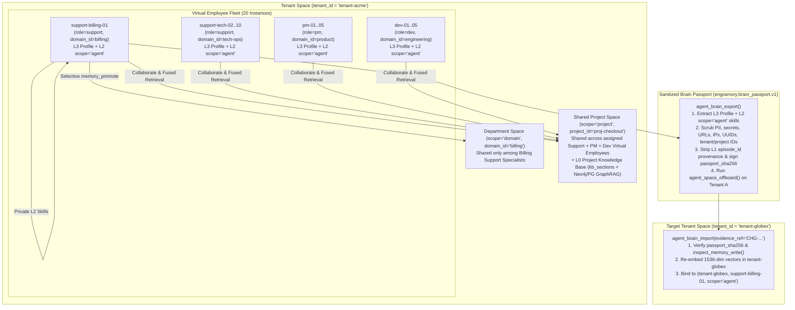

# PLAN-024: Implement Virtual Employee Named Space Hierarchy (`Tenant -> Agent -> Department -> Shared Project`) & Portable Brain Passport Lifecycle in `platform-engramory`

> **Status:** Ready for Implementation  
> **Date:** 2026-11-13  
> **Owning Repository:** `platform-engramory`  
> **Target Branch:** `feature/plan-024-virtual-employee-implementation-plan` -> `dev`  
> **Governance Standard:** `aiops-harness` v0.2.0 (`verified-planning`, `SDD2C` — SDD-First & Documentation-First)  
> **Upstream Normative Specifications:** `ADR-05` (`ADR-05_canonical_memory.yaml`), `ADR-06` (`ADR-06_governed_write_failclosed.yaml`), `ADR-07` (`ADR-07_scope_model.yaml`), `ADR-10` (`ADR-10_agent_facing_packaging.yaml`), `SPEC-01`, `SPEC-02`, `SPEC-03`, `SPEC-07`

---

## 1. Executive Summary & Architectural Decisions (Scored 1–5)

In a multi-tenant AI operations fleet (e.g., **10 instances of `agent-support`**, **5 instances of `agent-pm`**, and **5 instances of `agent-dev`** per tenant), treating every agent instance as a stateless worker connected to one flat memory pool causes two critical failure modes:

1. **Memory & CPU Bloat:** Broadcasting specialized troubleshooting heuristics (such as Stripe billing webhook clock-skew remediation) to all 10 support agents inflates HNSW vector index size, retrieval latency, token context consumption, and CPU/RAM utilization for the 9 support agents working on unrelated domains (UI, auth, onboarding).
2. **Loss of Cumulative Specialist Experience on Reassignment:** When a specialized Virtual Employee (`support-billing-01`) finishes a billing project on Tenant A and is reassigned to Tenant B, wiping its brain wastes months of distilled procedural expertise, whereas copying raw tables leaks Tenant A's confidential PII, raw chat episodes, and runbooks.

This plan formalizes each agent instance as a **Virtual Employee** with:

- **4-Level Hierarchical Named Spaces (`ADR-07`):** `tenant_id` (hard RLS boundary) $\to$ `agent_id` (`scope='agent'`, private Virtual Employee brain) $\to$ `domain_id` (`scope='domain'`, department/specialty space such as `billing` or `support`) $\to$ `project_id` (`scope='project'`, shared cross-functional project room where support, PM, and dev agents collaborate) $\to$ `scope='space'` (tenant-wide institutional memory), fused with **L0 Authoritative Knowledge (`kb_sections` + GraphRAG)** via `memory_search(include_knowledge=True, expand_graph=True)`.
- **Selective Experience Promotion (`memory_promote`):** Private `scope='agent'` skills stay isolated to the specialist Virtual Employee by default and are selectively promoted to `scope='domain'` (department) or `scope='project'` (shared project) only under governed `evidence_ref` authority (`ADR-06`).
- **Portable Virtual Employee Brain Passport & Offboarding (`agent_brain_export`, `agent_brain_import`, `agent_space_offboard`):** Exports **only** the Virtual Employee's L3 `AgentProfile` and high-confidence L2 `scope='agent'` distilled skills, scrubs all PII/secrets/emails/URLs/IPs/UUIDs/tenant-names (`sanitize_portable_text`), seals the bundle with a canonical `passport_sha256` digest, re-embeds skills into the target tenant's `1536`-dim vector space on import, and cleanly retires/purges Tenant A's raw L1 episodes upon offboarding.

---

### 1.1 Scored Architectural Decisions (`3 Options + 1–5 Scoring`)

#### Decision Q1: Virtual Employee Space Hierarchy & Department-Focused Project Collaboration

| Option | Approach | Score (1–5) | Rationale & Trade-offs |
| :--- | :--- | :---: | :--- |
| **Option A** | Flat per-tenant memory pool shared by all 20 agent instances (`10 support`, `5 pm`, `5 dev`) | `1/5` | Causes severe vector index bloat, higher CPU/memory usage, and cross-role context pollution (support billing heuristics polluting dev code-review prompts). |
| **Option B** | Isolated per-agent silos with periodic bulk cloning across all support instances | `2/5` | Multiplies PostgreSQL HNSW vector storage by $10\times$ across support instances and still pollutes non-billing support agents with billing-specific memories. |
| **Option C (Selected)** | **4-Level Named Virtual Employee Hierarchy (`tenant_id -> agent_id [agent] -> domain_id [domain] -> project_id [project] -> [space]`) + Governed Selective Promotion (`memory_promote`) + Fused L2+L0 Retrieval** | **`5/5`** | Keeps specialized experience inside the individual Virtual Employee's `scope='agent'` space (zero memory/CPU bloat on peers), supports department focus via `domain_id` (`scope='domain'`), gives all project-assigned agents shared access to `scope='project'` L2 memories + L0 `kb_sections`, and promotes only proven cross-agent skills via `memory_promote`. |

#### Decision Q2: Cross-Tenant Virtual Employee Mobility & Sanitized Brain Passport

| Option | Approach | Score (1–5) | Rationale & Trade-offs |
| :--- | :--- | :---: | :--- |
| **Option A** | In-place SQL `UPDATE memories SET tenant_id = ...` and raw table migration | `2/5` | Violates `ADR-07` strict tenant isolation, breaks Tenant A's immutable audit log, and risks leaking raw L1 `episodes` or unredacted customer identifiers. |
| **Option B** | Global cross-tenant specialist table (`tenant_id = '__global__'`) queried live by all tenants | `3/5` | Introduces a single-point cross-tenant data leakage surface if any distilled skill retains a customer hostname, email, or project code. |
| **Option C (Selected)** | **Governed, Integrity-Signed Brain Passport (`agent_brain_export` / `agent_brain_import`) + Deterministic Sanitization (`sanitize_portable_text`) + Tenant Offboarding (`agent_space_offboard`)** | **`5/5`** | Never exports raw L1 `episodes` or L0 tenant docs; scrubs secrets, emails, URLs, IPs, UUIDs, and source `tenant_id`/`project_id` names; signs the bundle with `passport_sha256`; re-verifies via `inspect_memory_write` and re-embeds `1536`-dim vectors on import under `evidence_ref` (`ADR-06`); and cleanly retires/purges the agent's old tenant state via `agent_space_offboard`. |

#### Decision Q3: Virtual Employee Roster Discovery & Lifecycle Governance

| Option | Approach | Score (1–5) | Rationale & Trade-offs |
| :--- | :--- | :---: | :--- |
| **Option A** | Keep `AccessSurface` limited to read-only `agent_profile_get` with untyped `standing_preferences` | `3/5` | Prevents Layer-1 Stewards (`aiops-saas-stewards`) and operators from configuring or querying a tenant's Virtual Employee roster by `role` (`support`, `pm`, `dev`) or `domain_id` (`billing`) through MCP/CLI. |
| **Option B** | Maintain Virtual Employee rosters exclusively in external static YAML files | `2/5` | Drifts from live database state and splits the Virtual Employee's identity from its portable Brain Passport. |
| **Option C (Selected)** | **Governed L3 Profile Upsert (`agent_profile_upsert`) & Tenant Roster Query (`agent_roster_list`) in `AccessSurface`, MCP, and CLI** | **`5/5`** | Allows Stewards and CLI operators to provision Virtual Employees (`role`, `domain_id`, `specializations`, `display_name`), list active Virtual Employees per tenant/department (`agent_roster_list`), and export/import the complete L3+L2 identity in a single Brain Passport. |

#### Decision Q4: Multi-Model Brain Metadata, Parallel Distilled Variants (`brain_variant`), and A/B Performance Comparison

| Option | Approach | Score (1–5) | Rationale & Trade-offs |
| :--- | :--- | :---: | :--- |
| **Option A** | Overwrite existing distilled `memories` and `kb_sections` whenever switching LLM / embedding models or RAG hyperparameters | `1/5` | Destroys the previous model's distilled skills, making side-by-side A/B evaluation impossible and risking regression if the new model underperforms on domain-specific edge cases. |
| **Option B** | Clone the entire PostgreSQL database or create a duplicate `agent_id` (`support-billing-01-v2`) to test a new model | `2/5` | Duplicates raw L1 `episodes`, L3 identity, and project bindings, and splits `memory_retrievals` feedback logs across different `agent_id`s. |
| **Option C (Selected)** | **Structured `brain_metadata` (`brain_variant`, `distiller_model`, `extraction_model`, `embedding_model`, `rag_params`) + Parallel Variant Distillation (`get_unreflected_episodes` scoped by `brain_variant`) + Side-by-Side `agent_brain_compare`** | **`5/5`** | Allows the **exact same Virtual Employee** to maintain 2+ parallel copies of distilled knowledge (`brain_variant="claude-sonnet-4-6"` vs. `brain_variant="gemini-2.5-pro"`) distilled from the same L1 `episodes`, records full model/extraction/RAG hyperparameters in L3 (`standing_preferences["brain_config"]`), L2 (`provenance["brain_metadata"]`), L0 (`media_metadata["extraction_metadata"]`), and the Brain Passport, and provides `agent_brain_compare` (`engramory profile compare-brains`) to benchmark variants on confidence, token density, `memory_retrievals` (`useful`/`not_useful`/`harmful`) feedback rates, and live side-by-side query hits. |

---

## 2. Current Implementation State & Codebase Gap Audit (`GAP-VE-01` through `GAP-VE-09`)

### 2.1 Baseline Already Landed in `v0.2.0` (`b7b1e12` & `cc6aba0`)

1. **Department Focus (`domain_id`) on `ActorContext` (`src/engramory/access/authz.py:59`):** Added `domain_id: str | None = None` to `ActorContext` and wired `domain_id` + `scope` through `AccessSurface.memory_add` (`src/engramory/access/surface.py:372-415`), `AccessSurface.memory_search` (`src/engramory/access/surface.py:199-320`), and `reflect()` (`src/engramory/workers/distillation.py:86-105`).
2. **Fused L2 + L0 Retrieval (`src/engramory/access/surface.py:283-320`):** `memory_search(include_knowledge=True, expand_graph=True)` fuses the Virtual Employee's L2 memories (`agent -> project -> domain -> space`) with L0 project documentation (`kb_sections`) within a single token budget.
3. **Portable Sanitizer & Initial Brain Passport (`src/engramory/access/poisoning_guard.py:59-104`, `src/engramory/access/surface.py:524-693`):** Implemented `sanitize_portable_text()` and baseline `agent_brain_export` / `agent_brain_import` across `AccessSurface`, `McpServer`, and `cli.py`.

### 2.2 Remaining Gaps to Close in `PLAN-024` (`GAP-VE-01` through `GAP-VE-09`)

| Gap ID | Severity | Location | Gap Description | Required Fix in `PLAN-024` |
| :--- | :---: | :--- | :--- | :--- |
| **`GAP-VE-01`** | **Critical** | `src/engramory/mcp/server.py:603-622`, `1240-1251`, `src/engramory/access/jwt_auth.py:187-227`, `src/engramory/cli.py:78-127`, `136-187` | 1) `McpServer._resolve_call_ctx()` (`server.py:615-621`) only branches on `tenant_id != base.tenant_id or project_id != base.project_id` and omits `domain_id=base.domain_id`. 2) `McpServer.create_http_server()` (`server.py:1242-1250`) constructs `ActorContext` from `X-Tenant-ID`/`X-Project-ID` without `X-Domain-ID` or `req_ctx.domain_id`. 3) `claims_to_actor_context()` (`jwt_auth.py:187-227`) omits `domain_id` from JWT claims (`domain_id` / `department_focus`). 4) `cli._parse_config_text()`, `_load_config()`, and `_cmd_init()` (`cli.py:78-187`) do not parse or persist `domain_id`, and `_upsert_profile_best_effort()` (`cli.py:136-152`) overwrites existing `display_name`/`standing_preferences` on re-init. | Preserve `domain_id` across `_resolve_call_ctx()`, `create_http_server()`, `claims_to_actor_context()`, `.engramory/config.toml`, `ENGRAMORY_DOMAIN_ID`, and `engramory init --domain-id` (without clobbering existing profiles on re-init), and reject cross-department `domain_id` spoofing when `ctx.domain_id` is bound and `"space" not in ctx.scopes`. |
| **`GAP-VE-02`** | **Critical** | `src/engramory/access/surface.py:524-693`, `src/engramory/core/repository.py:168-201` | 1) `Repository.upsert_memory(self, memory: Memory)` (`repository.py:168-201`) does not accept `embedding` or `copy_embedding_from_id`, and `agent_brain_import()` hardcodes `embedding_model="none/portable-passport"` (`surface.py:669`), leaving imported specialist skills unindexed in `pgvector`. 2) `agent_brain_export()` / `agent_brain_import()` lack a mandatory `passport_sha256` integrity digest, and `agent_brain_import()` calls `upsert_agent_profile` before `inspect_memory_write()` without catching `MemoryPoisoningError` to write a deny audit row. | Extend `Repository.upsert_memory(..., embedding=..., copy_embedding_from_id=...)` using `vector_literal` (`repository.py:87-89`), require `passport_sha256` verification by default (`verify_integrity: bool = True`) on `engramory.brain_passport.v1`, recursively scrub `display_name` + `standing_preferences` (`list`/`dict`/`str`) with length-sorted `redact_terms`, screen all fields via `inspect_memory_write()` inside `try ... except MemoryPoisoningError` before any DB write, and enforce retry idempotency. |
| **`GAP-VE-03`** | **Major** | `src/engramory/access/authz.py:15-48`, `src/engramory/core/repository.py:311-354`, `src/engramory/access/surface.py:512-523` | `AccessSurface` only exposes `agent_profile_get`. Operators and Layer-1 Stewards cannot update a Virtual Employee's L3 profile (`display_name`, `role`, `agent_type`, `domain_id`, `specializations`, `standing_preferences`) via `AccessSurface` or query and rank the tenant's roster of Virtual Employee instances (`list_agent_profiles`) by `agent_type`, `domain_id`, `role`, or `specialization` with live skill statistics. | Add `agent_profile_upsert` and `agent_roster_list` (with `agent_type`, `specialization`, and live `active_skill_count` / `mean_confidence` stats) to `KNOWN_ACTIONS`, `Repository.list_agent_profiles()`, `AccessSurface`, `McpServer`, and `engramory profile set` / `engramory profile list`. |
| **`GAP-VE-04`** | **Major** | `src/engramory/access/surface.py`, `src/engramory/core/repository.py:203-225` | 1) No governed `memory_promote` tool exists to promote a proven `scope='agent'` skill to `scope='domain'` (department) or `scope='project'` (shared project) with strict `_SCOPE_CLAUSES` source visibility, ladder monotonicity, cross-instance summary deduplication, and `evidence_ref`. 2) No governed `agent_space_offboard` operation exists to retire a Virtual Employee's private `scope='agent'` memories and private episodes without deleting shared `project`/`domain`/`space` episodes. | Implement governed `AccessSurface.memory_promote` (`engramory memory promote`, reusing `Repository.get_memory` at `repository.py:203-225` and `Repository.find_existing_promoted_memory` without `MAX_K=100` truncation) and transactional `AccessSurface.agent_space_offboard` (`engramory profile offboard`) with `evidence_ref` enforcement (`ADR-06`) and full audit logging. |
| **`GAP-VE-05`** | **Medium** | `docs/sdd/06_SPEC/SPEC-01_access_surface.yaml`, `SPEC-07_cli_face.yaml`, `docs/sdd/08_IPLAN/IPLAN-00_index.yaml`, `docs/sdd/09_CHG/` | `SPEC-01` (`L52-128`) and `SPEC-07` (`L57-84`) do not yet declare `ActorContext.domain_id` or the Virtual Employee Brain Passport, roster, promotion, and offboarding interfaces, and `IPLAN-09` + `IPLAN-00_index.yaml` (`total_plans: 9`) + `CHG-009` + `docs/VIRTUAL_EMPLOYEE_ARCHITECTURE.md` must be authored to satisfy `SDD2C` and `docs lint --strict`. | Update `SPEC-01`, `SPEC-02`, `SPEC-03`, `SPEC-07`, `TDD-01`, `TDD-02`, `IPLAN-00_index.yaml`, author `IPLAN-09` + `CHG-009`, and create `docs/VIRTUAL_EMPLOYEE_ARCHITECTURE.md`. |
| **`GAP-VE-06`** | **Major** | `src/engramory/core/repository.py:355-391`, `415-502`, `src/engramory/workers/distillation.py:25-140`, `src/engramory/access/surface.py:199-320`, `524-693` | 1) `Repository.get_unreflected_episodes()` (`repository.py:368-372`) checks `NOT EXISTS (SELECT 1 FROM memories m WHERE m.tenant_id = e.tenant_id AND m.provenance->>'episode_id' = e.id::text)` without filtering by `brain_variant` / `distiller_model`, making it impossible to distill a second copy of L2 memories from the same L1 episodes using a different model. 2) `Memory.provenance`, `KBSection.media_metadata`, `AgentProfile.standing_preferences`, and `engramory.brain_passport.v1` do not yet store structured `brain_metadata` (`brain_variant`, `distiller_model`, `extraction_model`, `embedding_model`, `rag_params`) or support `agent_brain_compare` across variants. | Scope `get_unreflected_episodes` and `reflect()` by `brain_variant` (`default` when unset), record `brain_metadata` (`brain_variant`, `distiller_model`, `extraction_model`, `embedding_model`, `rag_params`) across L3/L2/L0 and Brain Passports, add optional `brain_variant` filtering to `get_memories`, `memory_search`, `agent_brain_export`, and `agent_brain_import`, and add `AccessSurface.agent_brain_compare` (`engramory profile compare-brains`) for side-by-side model & RAG evaluation. |
| **`GAP-VE-07`** | **Critical** | `src/engramory/access/surface.py:524-693`, `src/engramory/core/repository.py:311-354` | **Multi-Agent Archetype (`agent_type`) vs. Instance (`agent_id`) Taxonomy & Cross-Archetype Import Guard (`[C-MA-01]`):** In a fleet with multiple agent types (`agent-support`, `agent-pm`, `agent-dev`) and multiple instances per agent (`agent-support-01..10`, `agent-pm-01..05`, `agent-dev-01..05`), `agent_type` is not tracked separately from instance `agent_id`. Importing a passport from `agent-support-01` into `agent-support-07` clobbers `agent-support-07`'s `display_name` and `specializations`, and importing a `support` passport into a `dev` instance (`agent-dev-02`) is not blocked by default. | Track `agent_type` and `specializations` in L3 `agent_profiles`, L2 `memories.provenance`, and `engramory.brain_passport.v1`; enforce a cross-archetype mismatch guard (`allow_type_override: bool = False`) on `agent_brain_import`; preserve the target instance's existing `display_name` when `ctx.agent_id != passport.get("agent_id")`; and union-merge `specializations` on cross-instance clone/import. |
| **`GAP-VE-08`** | **Critical** | `src/engramory/workers/distillation.py:119-140`, `src/engramory/core/repository.py:415-502`, `src/engramory/access/surface.py:199-320`, `437-488` | **Missing Specialization-Scoped Tagging & Retrieval Across Shared `domain`/`project` Spaces (`[C-MA-02]`):** `_PROVENANCE_PASSTHROUGH_KEYS` (`distillation.py:119-129`) drops `specializations` and `agent_type` during `reflect()`, and `memory_add`, `memory_promote`, `memory_search`, and `get_memories` cannot tag or filter L2 memories by `specialization` (e.g. `"stripe"`, `"oidc"`, `"pgvector"`), causing 10 instances sharing a department or project to pollute each other's specialization retrievals. | Add `"specializations"` and `"agent_type"` to `_PROVENANCE_PASSTHROUGH_KEYS`, stamp L3 profile `specializations`/`agent_type` during `reflect()`, accept `specializations` on `memory_add` and `memory_promote`, and add `specialization` filtering (`coalesce(provenance->'specializations', '[]'::jsonb) ? %(specialization)s`) to `get_memories`, `memory_search`, and `agent_brain_compare`. |
| **`GAP-VE-09`** | **Critical** | `src/engramory/core/repository.py:355-413`, `src/engramory/workers/runner.py:118-131` | **Worker Daemon (`runner.py`) & `get_active_agents_with_unreflected_episodes` Blindness to `brain_variant` & Per-Instance `agent_id` (`[C-MA-03]`):** `get_active_agents_with_unreflected_episodes` (`repository.py:393-413`) and `get_unreflected_episodes` (`repository.py:355-391`) check `NOT EXISTS` without `m.agent_id = e.agent_id`, and `get_active_agents_with_unreflected_episodes` + `run_worker_loop` (`runner.py:118-131`) ignore `brain_variant` and the instance's L3 `brain_config`. | Add `m.agent_id = e.agent_id AND coalesce(m.provenance->>'brain_variant', 'default') = %(brain_variant)s` to both `get_unreflected_episodes` and `get_active_agents_with_unreflected_episodes`, and have `reflect()` / `run_worker_loop()` consult the instance's L3 `brain_config` (`active_brain_variant`, `distiller_model`, `rag_params`) when not explicitly supplied. |

---

## 3. Phased Implementation Plan

### Phase 1: SDD-First Contract Updates (`06_SPEC`, `07_TDD`, `08_IPLAN`, `09_CHG`)

Per the `aiops-harness` **SDD-First Mandate (`SDD2C`)**, update the governing SDD layers before or atomically with code changes:

1. **`docs/sdd/06_SPEC/SPEC-01_access_surface.yaml` (`L52-128`):**
   - Add `agent_profile_upsert`, `agent_roster_list`, `agent_brain_export`, `agent_brain_import`, `agent_brain_compare`, `agent_space_offboard`, and `memory_promote` to `interfaces.exports`, and add `domain_id` (`type: "str | None", required: false`) to `data_models.models[ActorContext].fields` (`L122-128`).
2. **`docs/sdd/06_SPEC/SPEC-02_memory_store.yaml` & `SPEC-03_retrieval_graph.yaml`:**
   - Document `AgentProfile` Virtual Employee conventions (`role`, `department_focus` / `domain_id`, `specializations`, and `brain_config` inside `standing_preferences`), structured `brain_metadata` (`brain_variant`, `distiller_model`, `extraction_model`, `embedding_model`, `rag_params`) on `Memory.provenance` and `KBSection.media_metadata`, `BrainPassport` schema (`engramory.brain_passport.v1` with mandatory `passport_sha256` and `brain_metadata`), and fused L2+L0 retrieval (`memory_search(include_knowledge=True, brain_variant=...)`).
3. **`docs/sdd/06_SPEC/SPEC-07_cli_face.yaml` (`L57-84`):**
   - Document `profile set`, `profile list`, `profile export-brain`, `profile import-brain` (including `--redact-term` and `--brain-variant`), `profile compare-brains`, `profile offboard`, `memory promote`, `memory distill --brain-variant --distiller-model`, and optional `domain_id` in `.engramory/config.toml`.
4. **`docs/sdd/07_TDD/TDD-01_access_surface.yaml` & `TDD-02_memory_store.yaml`:**
   - Add verification oracles for `agent_brain_export` / `agent_brain_import` recursive PII scrubbing, `passport_sha256` tamper/missing-digest rejection, `memory_promote` `_SCOPE_CLAUSES` source boundary & scope elevation, `agent_space_offboard` private-episode-only tenant cleanup, and `agent_brain_compare` multi-model A/B evaluation.
5. **`docs/sdd/08_IPLAN/IPLAN-09_virtual_employee_brain.yaml`, `IPLAN-00_index.yaml` (`L8, L120`), & `docs/sdd/09_CHG/CHG-009_virtual_employee_hierarchy_and_portable_brain.yaml`:**
   - Author `IPLAN-09` and `CHG-009` with complete upstream `@ears:`, `@bdd:`, `@adr:`, `@spec:`, and `@tdd:` trace links, increment `total_plans: 9` and append `IPLAN-09` in `IPLAN-00_index.yaml`, and verify with `uv run engramory sdd validate-graph --invariants`.

---

### Phase 2: Virtual Employee Identity, Department Context (`domain_id`), and Roster Management (`GAP-VE-01`, `GAP-VE-03`)

1. **Preserve `domain_id` Across CLI Config, JWT Auth, & MCP Context Resolution (`GAP-VE-01`, `[C3]`, `[M4]`):**
   - In `src/engramory/cli.py`:
     - Update `_parse_config_text()` (`L88-93`) to pass `domain_id=actor.get("domain_id")` into `ActorContext`.
     - Update `_load_config()` (`L119-124`) to pass `domain_id=os.getenv("ENGRAMORY_DOMAIN_ID") or None` into `ActorContext`.
     - Update `_upsert_profile_best_effort(agent_id: str, dsn: str, tenant_id: str = "default", domain_id: str | None = None) -> str` (`L136-152`) so it first checks `repo.get_agent_profile(agent_id, tenant_id=tenant_id)`: if a profile already exists with non-empty `display_name` or `standing_preferences`, preserve them (merging `department_focus: domain_id` only if `domain_id` is supplied and not yet set) instead of clobbering existing profile metadata on re-init.
     - Update `_cmd_init()` (`L154-187`) and the `init` subparser (`L1085-1095`) to accept `--domain-id` and write `domain_id = ...` under `[actor]` in `.engramory/config.toml` when provided.
   - In `src/engramory/access/jwt_auth.py`:
     - Update `claims_to_actor_context()` (`L187-227`) to extract `raw_domain = claims.raw_claims.get("domain_id") or claims.raw_claims.get("department_focus")` (or a `domain:<id>` entry in `claims.groups`) and pass `domain_id=str(raw_domain).strip() if raw_domain else None` into `ActorContext`.
   - In `src/engramory/mcp/server.py`:
     - Update `_resolve_call_ctx()` (`L603-622`) to resolve `domain_id = base.domain_id if self._auth_enabled else (arguments.get("domain_id") or base.domain_id)` and branch on `if tenant_id != base.tenant_id or project_id != base.project_id or domain_id != base.domain_id:`.
     - Update `create_http_server()` (`L1242-1250`) to read `domain_hdr = self.headers.get("X-Domain-ID")` and pass `domain_id=domain_hdr or req_ctx.domain_id` when constructing `ActorContext` in dev mode.
   - In `src/engramory/access/surface.py`:
     - Enforce department boundary when `ctx.domain_id is not None` and `"space" not in ctx.scopes`: if a caller passes an explicit `domain_id` argument to `memory_search`, `memory_add`, or `knowledge_search` that differs from `ctx.domain_id`, record a deny `AuditRecord` (`reason="out_of_scope"`) and raise `AuthzError("out_of_scope: cross-department domain_id override requires space scope")`.
2. **Add Governed L3 Profile Upsert, `agent_type` & `specializations` Taxonomy, `brain_config` Metadata, & Experience-Ranked Roster Listing (`GAP-VE-03`, `GAP-VE-06`, `GAP-VE-07`, `GAP-VE-08`, `[M2]`, `[M3]`, `[C-MA-01]`, `[M-MA-01]`):**
   - In `src/engramory/access/authz.py` (`L15-48`):
     - Add `"agent_profile_upsert"`, `"agent_roster_list"`, `"agent_brain_compare"`, `"agent_space_offboard"`, and `"memory_promote"` to `KNOWN_ACTIONS`.
   - In `src/engramory/core/repository.py` (`L335-355`):
     - Add `list_agent_profiles(self, *, tenant_id: str, domain_id: str | None = None, agent_type: str | None = None, role: str | None = None, specialization: str | None = None, include_stats: bool = True) -> list[dict[str, Any]]` querying `agent_profiles WHERE tenant_id = %(tenant_id)s` with optional filters on `standing_preferences->>'department_focus' = %(domain_id)s`, `coalesce(standing_preferences->>'agent_type', standing_preferences->>'role') = %(agent_type)s`, and `(%(specialization)s::text IS NULL OR coalesce(standing_preferences->'specializations', '[]'::jsonb) ? %(specialization)s)` (`[C-MA-01]`, `[M-MA-01]`).
     - When `include_stats=True`, left-join per-instance active `scope='agent'` L2 memory aggregates (`active_skill_count`, `mean_confidence`, `brain_variants`) and order by `mean_confidence DESC NULLS LAST, active_skill_count DESC, agent_id ASC` so a Layer-1 Steward or router can rank and dispatch the most experienced specialist instance among `agent-support-01..10`, `agent-pm-01..05`, or `agent-dev-01..05` (`[M-MA-01]`).
   - In `src/engramory/access/surface.py` (`L512-525`):
     - Add `agent_profile_upsert(self, ctx: ActorContext, *, display_name: str | None = None, agent_type: str | None = None, role: str | None = None, domain_id: str | None = None, specializations: Sequence[str] | None = None, brain_config: Mapping[str, Any] | None = None, standing_preferences: Mapping[str, Any] | None = None) -> AgentProfile`:
       - Authorizes `"agent_profile_upsert"` on `TargetScope(tenant_id=ctx.tenant_id, scope="agent")`.
       - Loads existing profile via `await self.agent_profile_get(ctx)` and merges `standing_preferences`, `agent_type` (`agent_type or role`, e.g. `"agent-support"`, `"agent-pm"`, `"agent-dev"`), `role` (`role or agent_type`), `department_focus` (`domain_id or ctx.domain_id`), `specializations` (`list(dict.fromkeys(specializations))`), and `brain_config` (`active_brain_variant`, `distiller_model`, `extraction_model`, `embedding_model`, `rag_params`).
       - Screens `display_name` and `json.dumps(merged_prefs, sort_keys=True)` via `inspect_memory_write()` inside a `try ... except MemoryPoisoningError as exc:` block that records `await self._repo.record_audit(..., allowed=False, reason=f"poisoning_rejected: {exc}")` and raises `GovernedWriteRejected(str(exc)) from exc` before persisting via `self._repo.upsert_agent_profile()`.
     - Add `agent_roster_list(self, ctx: ActorContext, *, domain_id: str | None = None, agent_type: str | None = None, role: str | None = None, specialization: str | None = None, include_stats: bool = True) -> list[dict[str, Any]]`:
       - Authorizes `"agent_roster_list"` on `TargetScope(tenant_id=ctx.tenant_id, scope="project" if "project" in ctx.scopes else "agent")` and returns serialized Virtual Employee roster entries (`agent_id`, `agent_type`, `display_name`, `role`, `domain_id`, `specializations`, `brain_config`, `active_skill_count`, `mean_confidence`, `brain_variants`, `standing_preferences`).
   - In `src/engramory/mcp/server.py` (`TOOLS_SCHEMA` & `handle_call_tool`) and `src/engramory/cli.py` (`prof_sub`):
     - Register MCP tools `agent_profile_upsert` and `agent_roster_list` and CLI subcommands `engramory profile set` (`--display-name`, `--agent-type`, `--role`, `--domain-id`, `--specialization`, `--brain-variant`, `--distiller-model`, `--extraction-model`, `--embedding-model`, `--rag-params-json`, `--pref KEY=VALUE`) and `engramory profile list` (`--domain-id`, `--agent-type`, `--role`, `--specialization`).

---

### Phase 3: Parallel Multi-Model Distillation (`brain_variant`), Specialization-Scoped Retrieval, Selective Experience Promotion (`memory_promote`), & Side-by-Side Model Comparison (`agent_brain_compare`) (`GAP-VE-04`, `GAP-VE-06`, `GAP-VE-08`, `GAP-VE-09`, `[C1]`, `[C2]`, `[M2]`, `[M3]`, `[M4]`, `[C-MA-02]`, `[C-MA-03]`, `[M-MA-02]`, `[Med-MA-01]`)

1. **Extend `Repository.upsert_memory`, `get_unreflected_episodes`, `get_active_agents_with_unreflected_episodes`, `get_memories`, `reflect()`, & `run_worker_loop()` for Multi-Model Brain Variants & Specializations (`GAP-VE-06`, `GAP-VE-08`, `GAP-VE-09`, `[C1]`, `[C-MA-02]`, `[C-MA-03]`):**
   - In `src/engramory/core/repository.py` (`L168-201`, `355-413`, `415-502`):
     - Update `async def upsert_memory(self, memory: Memory, *, embedding: Sequence[float] | None = None, copy_embedding_from_id: str | None = None) -> str`:
       - When `embedding is not None and len(embedding) == 1536`, write `%(embedding)s::vector` into the `embedding` column of `memories` using `vector_literal(embedding)` (`repository.py:87-89`).
       - When `embedding is None and copy_embedding_from_id is not None`, copy the `embedding`, `embedding_model`, and `embedding_dims` from `(SELECT embedding FROM memories WHERE id = %(copy_from_id)s AND tenant_id = %(tenant_id)s)` within the same tenant wall (`ADR-07`).
     - Update both `get_unreflected_episodes(self, *, tenant_id: str, agent_id: str, limit: int = 500, brain_variant: str = "default") -> list[Episode]` (`repository.py:355-391`) and `get_active_agents_with_unreflected_episodes(self, *, limit: int = 100, brain_variant: str = "default") -> list[tuple[str, str]]` (`repository.py:393-413`) so their `NOT EXISTS` subqueries filter `AND m.agent_id = e.agent_id AND coalesce(m.provenance->>'brain_variant', 'default') = %(brain_variant)s` (`[C-MA-03]`), enabling the exact same L1 episodes to be distilled per agent instance into 2+ parallel L2 `brain_variant` copies (e.g., `"claude-sonnet-4-6"` vs. `"gemini-2.5-pro"`).
     - Update `get_memories(..., brain_variant: str | None = None, specialization: str | None = None)` (`repository.py:415-502`) and `AccessSurface.memory_search(..., brain_variant: str | None = None, specialization: str | None = None)` (`surface.py:199-320`) to filter `AND (%(brain_variant)s::text IS NULL OR coalesce(provenance->>'brain_variant', 'default') = %(brain_variant)s)` and `AND (%(specialization)s::text IS NULL OR coalesce(provenance->'specializations', '[]'::jsonb) ? %(specialization)s)` (`[C-MA-02]`), and allow `AccessSurface.memory_add` (`surface.py:322-415`) to accept optional `specializations: Sequence[str] | None = None` and `brain_variant: str | None = None`.
   - In `src/engramory/workers/distillation.py` (`L25-140`), `src/engramory/workers/runner.py` (`L118-131`), and `src/engramory/cli.py` (`L300-320`):
     - Extend `_PROVENANCE_PASSTHROUGH_KEYS` (`distillation.py:119-129`) to include `"specializations"` and `"agent_type"` (`[C-MA-02]`).
     - Update `reflect(repo, *, tenant_id, agent_id, llm=None, vector=None, batch_size=32, brain_variant: str | None = None, distiller_model: str | None = None, rag_params: Mapping[str, Any] | None = None) -> int` and `run_worker_loop()` (`runner.py:118-131`) so when `brain_variant`, `distiller_model`, or `rag_params` are omitted, `reflect()` loads `await repo.get_agent_profile(agent_id, tenant_id=tenant_id)` and resolves defaults from `standing_preferences.get("brain_config", {})`, stamps the instance's `agent_type` and `specializations` (merged with any episode-level `metadata["specializations"]`) into `Memory.provenance`, and records `provenance["brain_variant"] = eff_variant` and `provenance["brain_metadata"] = {"brain_variant": eff_variant, "distiller_model": eff_distiller, "embedding_model": emb_model, "rag_params": dict(eff_rag_params)}` (`[C-MA-02]`, `[C-MA-03]`).
     - Update `engramory memory distill` (`cli.py:300-320`) to accept `--brain-variant`, `--distiller-model`, and `--rag-params-json`, and update `AccessSurface.knowledge_ingest` / `knowledge_ingest_media` (`surface.py:771-920`) to record `extraction_metadata` (`extraction_model`, `embedding_model`, `rag_params`) in `KBSection.media_metadata`.
2. **Governed `AccessSurface.memory_promote` with Strict `_SCOPE_CLAUSES` Boundary & Cross-Instance Deduplication (`[C2]`, `[M2]`, `[M3]`, `[M4]`, `[C-MA-02]`, `[M-MA-02]`):**
   - In `src/engramory/core/repository.py` and `src/engramory/access/surface.py`:
     - Add `Repository.find_existing_promoted_memory(self, *, tenant_id: str, target_scope: str, source_memory_id: str, summary: str, project_id: str | None = None, domain_id: str | None = None, brain_variant: str = "default") -> Memory | None` querying `memories` directly without `MAX_K = 100` truncation (`surface.py:57`) for an active (`status = 'active' AND valid_to IS NULL`) row in `(tenant_id, target_scope, project_id, domain_id, brain_variant)` matching `(provenance->>'promoted_from_memory_id' = %(source_memory_id)s OR summary = %(summary)s)` (`[M-MA-02]`).
     - Add `memory_promote(self, ctx: ActorContext, *, memory_id: str, target_scope: str, evidence_ref: str | None, target_domain_id: str | None = None, target_project_id: str | None = None, specializations: Sequence[str] | None = None) -> dict[str, Any]`:
       - Validates `target_scope in {"project", "domain", "space"}` (raises `ValidationError` otherwise).
       - Authorizes `"memory_promote"` against `TargetScope(tenant_id=ctx.tenant_id, scope=target_scope)`.
       - Enforces governed write authority (`if not evidence_ref: record_audit(allowed=False, reason="missing_evidence_ref"); raise GovernedWriteRejected("memory_promote requires evidence_ref")`).
       - Loads the source memory via existing `await self._repo.get_memory(memory_id, tenant_id=ctx.tenant_id)` (`repository.py:203-225`).
       - **Strict Source Visibility Check (`[C2]`):** Verifies `source.status == "active" and source.valid_to is None` and `source.scope in ctx.scopes`, and checks:
         - `source.scope == "agent"` $\implies$ `source.agent_id == ctx.agent_id`
         - `source.scope == "project"` $\implies$ `source.project_id is not None and source.project_id == ctx.project_id`
         - `source.scope == "domain"` $\implies$ `source.domain_id is not None and source.domain_id == ctx.domain_id`
         - On mismatch, records `record_audit(..., allowed=False, reason="out_of_scope")` and raises `AuthzError("memory_promote: out_of_scope")`.
       - **Ladder Monotonicity & Target Scope Binding (`[C2]`):** Requires `_LADDER.index(target_scope) >= _LADDER.index(source.scope)`. Resolves `eff_project_id = (target_project_id or ctx.project_id or source.project_id) if target_scope == "project" else None` and `eff_domain_id = (target_domain_id or ctx.domain_id or source.domain_id) if target_scope == "domain" else (ctx.domain_id or source.domain_id)`. Unless `"space" in ctx.scopes`, rejects `target_project_id != ctx.project_id` or (`ctx.domain_id is not None and target_domain_id is not None and target_domain_id != ctx.domain_id`) with `AuthzError("memory_promote: out_of_scope")`. Requires non-empty `eff_project_id` for `target_scope == "project"` and non-empty `eff_domain_id` for `target_scope == "domain"`.
       - **Retry & Cross-Instance Deduplication (`[M4]`, `[M-MA-02]`):** Calls `await self._repo.find_existing_promoted_memory(...)`; if an identical promoted skill already exists in `(target_scope, eff_project_id, eff_domain_id, brain_variant)` (either from an earlier retry by the same instance or an identical skill promoted by a sibling instance `agent-support-02` vs. `agent-support-01`), returns the existing `promoted_memory_id` with `"idempotent_replay": True` instead of bloating shared `project`/`domain`/`space` memory.
       - Preserves `source.provenance.get("specializations")` (union-merged with optional `specializations`), screens `source.summary` and `source.content_raw` via `inspect_memory_write()` inside `try ... except MemoryPoisoningError` (`[M2]`), and persists via `self._repo.upsert_memory(promoted_mem, embedding=vec, copy_embedding_from_id=memory_id)`.
   - Expose `memory_promote` in `McpServer` (`TOOLS_SCHEMA` & `handle_call_tool`) and `engramory memory promote` (`--memory-id`, `--target-scope`, `--evidence-ref`, `--domain-id`, `--project-id`, `--specialization`) in `src/engramory/cli.py`.
3. **Side-by-Side Brain Variant & Model Performance Comparison (`agent_brain_compare`, `GAP-VE-06`, `[Med-MA-01]`):**
   - In `src/engramory/core/repository.py` and `src/engramory/access/surface.py`:
     - Add `AccessSurface.agent_brain_compare(self, ctx: ActorContext, *, variant_a: str, variant_b: str, query: str | None = None, k: int = 5, scope: str = "agent", domain_id: str | None = None, specialization: str | None = None) -> dict[str, Any]`:
       - Authorizes `"agent_brain_compare"` on `TargetScope(tenant_id=ctx.tenant_id, scope=scope)`.
       - Computes per-variant metrics over `memories` and `memory_retrievals` (`repository.py:251-309`) for `variant_a` and `variant_b` (optionally sliced by `domain_id` and `specialization`, `[Med-MA-01]`): `skill_count`, `mean_confidence`, `mean_token_count`, `distiller_models`, `embedding_models`, `rag_params`, `total_retrievals`, `useful_count`, `not_useful_count`, `harmful_count`, and `useful_rate`.
       - When `query` is supplied, executes side-by-side `memory_search(..., brain_variant=variant_a, domain_id=domain_id, specialization=specialization, k=k)` and `memory_search(..., brain_variant=variant_b, domain_id=domain_id, specialization=specialization, k=k)` and returns the comparative hit lists, overlap ratio, and recommended winning variant (`winner`).
   - Expose `agent_brain_compare` in `McpServer` (`TOOLS_SCHEMA` & `handle_call_tool`) and `engramory profile compare-brains` (`--variant-a`, `--variant-b`, `--query`, `--domain-id`, `--specialization`, `-k`) in `src/engramory/cli.py`.

---

### Phase 4: Cryptographic Brain Passport Integrity (`passport_sha256`), Archetype Guard (`agent_type`), `brain_metadata` Portability, Vector Re-Embedding on Import, and Tenant Offboarding (`GAP-VE-02`, `GAP-VE-04`, `GAP-VE-06`, `GAP-VE-07`, `[C1]`, `[C4]`, `[M1]`, `[M2]`, `[M4]`, `[Med1]`, `[C-MA-01]`)

1. **Recursive Sanitization, `agent_type` & `specializations` Preservation, `brain_metadata` Portability, Mandatory `passport_sha256` Integrity Check, & Re-Embedding (`[C1]`, `[C4]`, `[M2]`, `[M4]`, `[Med1]`, `[C-MA-01]`):**
   - In `src/engramory/access/poisoning_guard.py` (`L82-104`):
     - Sort `redact_terms` by descending length (`sorted({t.strip() for t in redact_terms if t and t.strip()}, key=len, reverse=True)`) so compound identifiers (`"acme-payments"`) are scrubbed before shorter prefixes (`"acme"`).
     - Add `sanitize_portable_value(value: Any, *, redact_terms: Sequence[str] = ()) -> tuple[Any, int]` to recursively scrub `str`, `list`, and `dict` structures.
   - In `src/engramory/access/surface.py` (`L524-693`):
     - In `agent_brain_export(..., brain_variant: str | None = None, specialization: str | None = None)`, filter exported `scope='agent'` skills by `brain_variant` and `specialization` when provided, include sanitized `agent_type`, `specializations`, and `brain_metadata` (`brain_variant`, `distiller_model`, `extraction_model`, `embedding_model`, `rag_params`) at both the passport level and per-skill level (`skill["brain_metadata"]`, `skill["specializations"]`), scrub `profile.display_name` and all nested `standing_preferences` (`str`, `list`, `dict`) via `sanitize_portable_value()`, compute canonical `_compute_passport_sha256(payload)` over `("schema_version", "agent_id", "agent_type", "display_name", "domain_id", "specializations", "brain_metadata", "standing_preferences", "skills")`, and include `"passport_sha256": digest` in the returned dictionary (`[C-MA-01]`).
     - In `agent_brain_import(self, ctx: ActorContext, *, passport: Mapping[str, Any], evidence_ref: str | None, target_domain_id: str | None = None, brain_variant: str | None = None, redact_terms: Sequence[str] = (), verify_integrity: bool = True, allow_type_override: bool = False) -> dict[str, Any]`:
       - Require `passport.get("schema_version") == "engramory.brain_passport.v1"`. When `verify_integrity=True` (default), require a non-empty `passport.get("passport_sha256")` matching `_compute_passport_sha256(passport)`; if missing or mismatched, record a deny `AuditRecord` (`reason="passport_integrity_mismatch"`) and raise `GovernedWriteRejected("Brain passport SHA-256 integrity check failed")` (`[C4]`).
       - **Multi-Agent Archetype Compatibility & Sibling Instance Clone Semantics (`[C-MA-01]`):** Load the target instance's existing profile via `await self._repo.get_agent_profile(ctx.agent_id, tenant_id=ctx.tenant_id)`. If the target profile already defines a non-empty `agent_type` (`standing_preferences.get("agent_type") or standing_preferences.get("role")`) and the passport defines a non-empty `passport_agent_type = passport.get("agent_type") or passport.get("standing_preferences", {}).get("role")` that differs from the target's `agent_type`, reject the import unless `allow_type_override=True` by recording a deny `AuditRecord` (`reason="agent_type_mismatch"`) and raising `GovernedWriteRejected("agent_type_mismatch: cannot import brain across incompatible agent archetypes without allow_type_override=True")`. When cloning/importing into a different instance ID (`ctx.agent_id != passport.get("agent_id")`), preserve the target instance's existing non-empty `display_name` and union-merge `specializations` (`list(dict.fromkeys([*existing_specs, *imported_specs]))`) instead of overwriting them.
       - Sanitize and screen `display_name`, `standing_preferences`, `brain_metadata`, and all `skills` via `sanitize_portable_value()` + `inspect_memory_write()` inside `try ... except MemoryPoisoningError` **before** writing any profile or memory row (`[M2]`).
       - Preserve `brain_variant`, `brain_metadata`, `agent_type`, and `specializations` on each imported `Memory.provenance`, deduplicating against existing active `scope='agent'` memories for `(ctx.tenant_id, ctx.agent_id)` matching `(brain_variant, type, domain_id, summary, content_raw)` so retries and multi-variant imports are idempotent (`[M4]`, `GAP-VE-06`).
       - When `self._llm is not None` and new skills remain to be inserted, batch-embed their summaries via `await self._llm.embed(texts=[...])` and persist via `self._repo.upsert_memory(mem, embedding=vec)` (`[C1]`).
     - Expose `--redact-term`, `--brain-variant`, `--specialization`, and `--allow-type-override` on `engramory profile export-brain` / `engramory profile import-brain` (`src/engramory/cli.py`) and in `TOOLS_SCHEMA` (`src/engramory/mcp/server.py`, `[M3]`).
2. **Transactional Tenant Offboarding Cleanup (`agent_space_offboard`, `[M1]`):**
   - In `src/engramory/core/repository.py`:
     - Add `offboard_agent_space(self, *, tenant_id: str, agent_id: str, reason: str, purge_episodes: bool = True, retire_memories: bool = True) -> dict[str, int]` wrapped in `async with self._conn() as conn: async with conn.transaction():`:
       - If `retire_memories=True`, executes `UPDATE memories SET valid_to = now(), status = 'superseded' WHERE tenant_id = %(tenant_id)s AND agent_id = %(agent_id)s AND scope = 'agent' AND valid_to IS NULL` (retiring all live private agent memories regardless of prior `active`/`advisory`/`quarantined` status while leaving shared `project`/`domain`/`space` memories untouched).
       - If `purge_episodes=True`, executes `DELETE FROM episodes WHERE tenant_id = %(tenant_id)s AND agent_id = %(agent_id)s AND coalesce(metadata->>'scope', 'agent') = 'agent'` (purging only private agent episodes so shared `project`/`domain`/`space` episodes and provenance links remain intact).
       - Deletes the L3 row from `agent_profiles WHERE tenant_id = %(tenant_id)s AND agent_id = %(agent_id)s`.
   - Expose `AccessSurface.agent_space_offboard(ctx, *, evidence_ref: str | None, reason: str = "cross_tenant_reassignment", purge_episodes: bool = True, retire_memories: bool = True) -> dict[str, Any]`, MCP tool `agent_space_offboard`, and CLI command `engramory profile offboard --evidence-ref ... [--reason ...]`.

---

### Phase 5: Governed Documentation (`docs/VIRTUAL_EMPLOYEE_ARCHITECTURE.md`) & End-to-End Verification (`GAP-VE-05`, `GAP-VE-06`, `GAP-VE-07`, `GAP-VE-08`, `GAP-VE-09`)

1. **Author `docs/VIRTUAL_EMPLOYEE_ARCHITECTURE.md`:**
   - Follow the `aiops-harness` 9-key frontmatter standard (`DOC-FM-000`), `<= 450` words per H2/H3 section, and zero deictics.
   - Document the 20-instance Virtual Employee fleet pattern (`10 agent-support`, `5 agent-pm`, `5 agent-dev`), the 3-level agent taxonomy (`agent_type` archetype $\to$ `agent_id` instance $\to$ `specializations` + `domain_id` department focus), the 4-level visibility lattice (`agent -> project -> domain -> space`), multi-model `brain_metadata` (`brain_variant`, `distiller_model`, `extraction_model`, `embedding_model`, `rag_params`) & `agent_brain_compare` A/B benchmarking, selective skill promotion (`memory_promote`), and cross-tenant Brain Passport export/sanitization/import/offboarding (`agent_brain_export`, `agent_brain_import`, `agent_space_offboard`).
2. **Comprehensive Test Suite (`tests/test_virtual_employee_lifecycle.py`):**
   - Test multi-agent & multi-instance fleet isolation (`agent-support-01` `[stripe, chargebacks]` vs `agent-support-02` `[oidc, sso]` vs `agent-pm-01` vs `agent-dev-01`) sharing `project-checkout` while keeping `scope='agent'` billing skills isolated from non-billing agents and supporting specialization-filtered `memory_search(..., specialization="stripe")` (`GAP-VE-07`, `GAP-VE-08`).
   - Test `agent_profile_upsert` (including `agent_type`, `specializations`, and `brain_config`) and experience-ranked `agent_roster_list` filtering by `domain_id="billing"`, `agent_type="agent-support"`, and `specialization="stripe"` ordered by `mean_confidence DESC, active_skill_count DESC`, plus `engramory init --domain-id` non-clobbering behavior (`[M-MA-01]`).
   - Test parallel multi-model distillation (`reflect(..., brain_variant="claude-sonnet-4-6")` and `reflect(..., brain_variant="gemini-2.5-pro")` over the same L1 episodes, plus `get_active_agents_with_unreflected_episodes` variant awareness) and side-by-side `agent_brain_compare` evaluation across retrieval feedback (`useful`/`not_useful`/`harmful`), specialization slices, and live query hits (`GAP-VE-06`, `GAP-VE-09`).
   - Test `memory_promote` elevating a validated skill from `scope='agent'` to `scope='domain'` (`domain_id="billing"`) and `scope='project'`, verifying that a peer agent cannot promote another agent's private `scope='agent'` memory (`[C2]`) and that both same-instance retries and sibling-instance duplicate promotions are deduplicated (`[M4]`, `[M-MA-02]`).
   - Test `agent_brain_export(brain_variant=..., specialization=...)` $\to$ `passport_sha256` tamper/strip rejection (`[C4]`) $\to$ cross-archetype import rejection (`agent-support` passport into `agent-dev-01` rejected with `agent_type_mismatch`, `[C-MA-01]`) $\to$ sibling-instance clone preserving `display_name` and union-merging `specializations` (`[C-MA-01]`) $\to$ `agent_space_offboard` preserving shared project episodes on Tenant A (`[M1]`) $\to$ `agent_brain_import` with `brain_metadata` preservation, `1536`-dim vector re-embedding, and idempotent replay on Tenant B (`[C1]`, `[M4]`, `GAP-VE-06`).
3. **Run All Deterministic Quality & CI Gates:**
   - `uv run engramory sdd validate-graph --invariants`
   - `uv run engramory docs lint --strict --json`
   - `task check && task ci`

---

## Claim ledger

| # | Claim | Symbol | Citation |
|---|---|---|---|
| 1 | `KNOWN_ACTIONS` in `access/authz.py` defines the closed set of authorizable actions enforced by `authorize()` | `KNOWN_ACTIONS = frozenset(` | `src/engramory/access/authz.py:15-48` |
| 2 | `ActorContext` frozen dataclass carries `agent_id`, `project_id`, `tenant_id`, `scopes`, and optional `domain_id` | `class ActorContext:` | `src/engramory/access/authz.py:52-60` |
| 3 | `sanitize_portable_text` in `access/poisoning_guard.py` scrubs secrets, emails, URLs, IPs, UUIDs, and custom `redact_terms` | `def sanitize_portable_text(` | `src/engramory/access/poisoning_guard.py:82-104` |
| 4 | `inspect_memory_write` in `access/poisoning_guard.py` screens memory writes for prompt injection, dangerous Unicode, and secrets | `def inspect_memory_write(` | `src/engramory/access/poisoning_guard.py:134-198` |
| 5 | `SCOPES` in `core/models.py` defines the 4-level visibility ladder `{"agent", "project", "domain", "space"}` per `ADR-07` | `SCOPES = frozenset(` | `src/engramory/core/models.py:32` |
| 6 | `Episode` frozen dataclass in `core/models.py` carries `agent_id`, `content_raw`, `project_id`, `domain_id`, `tenant_id`, `kind`, and `metadata` | `class Episode:` | `src/engramory/core/models.py:81-96` |
| 7 | `Memory` frozen dataclass in `core/models.py` carries `content_raw`, `summary`, `type`, `embedding_model`, `provenance`, `agent_id`, `project_id`, `domain_id`, `tenant_id`, and `scope` | `class Memory:` | `src/engramory/core/models.py:116-137` |
| 8 | `AgentProfile` frozen dataclass in `core/models.py` models L3 identity (`agent_id`, `display_name`, `standing_preferences`, `tenant_id`) | `class AgentProfile:` | `src/engramory/core/models.py:206-218` |
| 9 | `AccessSurface.memory_search` in `access/surface.py` retrieves scoped L2 memories and fuses L0 `kb_sections` when `include_knowledge=True` | `async def memory_search(` | `src/engramory/access/surface.py:199-320` |
| 10 | `AccessSurface.agent_profile_get` in `access/surface.py` loads the caller's L3 `AgentProfile` scoped by `(tenant_id, agent_id)` | `async def agent_profile_get(` | `src/engramory/access/surface.py:512-523` |
| 11 | `AccessSurface.agent_brain_export` in `access/surface.py` exports sanitized L3 profile and L2 `scope='agent'` skills | `async def agent_brain_export(` | `src/engramory/access/surface.py:524-591` |
| 12 | `AccessSurface.agent_brain_import` in `access/surface.py` validates `evidence_ref` and imports sanitized portable skills into the caller's tenant | `async def agent_brain_import(` | `src/engramory/access/surface.py:593-693` |
| 13 | `Repository.get_agent_profile` and `Repository.upsert_agent_profile` in `core/repository.py` read and write `agent_profiles` keyed by `(tenant_id, agent_id)` | `async def get_agent_profile(` | `src/engramory/core/repository.py:311-354` |
| 14 | `Repository.get_memories` in `core/repository.py` enforces the 4-level `ADR-07` scope visibility SQL across `agent`, `project`, `domain`, and `space` | `async def get_memories(` | `src/engramory/core/repository.py:415-480` |
| 15 | `reflect` in `workers/distillation.py` projects unreflected L1 episodes into L2 `Memory` rows preserving `domain_id` and `metadata['scope']` | `async def reflect(` | `src/engramory/workers/distillation.py:25-116` |
| 16 | `McpServer._resolve_call_ctx` in `mcp/server.py` constructs a new `ActorContext` on `tenant_id`/`project_id` override without forwarding `base.domain_id` | `def _resolve_call_ctx(` | `src/engramory/mcp/server.py:603-622` |
| 17 | `_parse_config_text` and `_load_config` in `cli.py` construct `ActorContext` from `.engramory/config.toml` or environment variables | `def _parse_config_text(` | `src/engramory/cli.py:78-126` |
| 18 | `_cmd_profile_export_brain` and `_cmd_profile_import_brain` in `cli.py` bind `engramory profile export-brain` and `import-brain` to `AccessSurface` | `def _cmd_profile_export_brain(` | `src/engramory/cli.py:664-704` |
| 19 | `0009_tenant_profiles_and_experience_dedup.sql` establishes composite `PRIMARY KEY (tenant_id, agent_id)` on `agent_profiles` | `ADD CONSTRAINT agent_profiles_pkey PRIMARY KEY (tenant_id, agent_id);` | `db/migrations/0009_tenant_profiles_and_experience_dedup.sql:28-30` |
| 20 | `ADR-06_governed_write_failclosed.yaml` mandates `evidence_ref` on governed writes and fail-closed authorization | `id: ADR-06` | `docs/sdd/05_ADR/ADR-06_governed_write_failclosed.yaml:3-35` |
| 21 | `ADR-07_scope_model.yaml` defines the 4-level scope ladder (`agent`, `project`, `domain`, `space`) within a `tenant_id` isolation boundary | `id: ADR-07` | `docs/sdd/05_ADR/ADR-07_scope_model.yaml:3-45` |
| 22 | `SPEC-01_access_surface.yaml` specifies the Layer 06 `AccessSurface` interface exports and `ActorContext` data model | `id: SPEC-01` | `docs/sdd/06_SPEC/SPEC-01_access_surface.yaml:12-119` |
| 23 | `SPEC-07_cli_face.yaml` specifies the Layer 06 `engramory` CLI transport commands and `.engramory/config.toml` schema | `id: SPEC-07` | `docs/sdd/06_SPEC/SPEC-07_cli_face.yaml:13-84` |
| 24 | `CHG-008_multimodal_rag_graphrag_and_blob_cas.yaml` is the latest Layer 09 change record (`CHG-008`), making `CHG-009` the next sequential change ID | `id: CHG-008` | `docs/sdd/09_CHG/CHG-008_multimodal_rag_graphrag_and_blob_cas.yaml:9-28` |
| 25 | `NEW@pass2` `_SCOPE_CLAUSES` and `vector_literal` in `core/repository.py` define the 4-level `ADR-07` SQL predicates and `pgvector` literal formatting | `_SCOPE_CLAUSES = {` | `src/engramory/core/repository.py:43-89` |
| 26 | `NEW@pass2` `Repository.upsert_memory` and `Repository.get_memory` in `core/repository.py` insert a `Memory` row (currently omitting `embedding`) and fetch a single `Memory` by `(id, tenant_id)` | `async def upsert_memory(` | `src/engramory/core/repository.py:168-225` |
| 27 | `NEW@pass2` `claims_to_actor_context` in `access/jwt_auth.py` maps verified OIDC `TokenClaims` to `ActorContext` without extracting `domain_id` | `def claims_to_actor_context(` | `src/engramory/access/jwt_auth.py:187-227` |
| 28 | `NEW@pass2` `create_http_server` in `mcp/server.py` constructs `ActorContext` from `X-Tenant-ID`/`X-Project-ID` headers in dev mode without `X-Domain-ID` | `tenant_hdr = self.headers.get("X-Tenant-ID")` | `src/engramory/mcp/server.py:1242-1250` |
| 29 | `NEW@pass2` `IPLAN-00_index.yaml` tracks the Layer 08 implementation plan registry (`total_plans: 8` through `IPLAN-08`) | `total_plans: 8` | `docs/sdd/08_IPLAN/IPLAN-00_index.yaml:8-20` |
| 30 | `NEW@pass3` `Repository.get_unreflected_episodes` in `core/repository.py` checks `NOT EXISTS (... m.provenance->>'episode_id' = e.id::text)` without scoping by `brain_variant` | `async def get_unreflected_episodes(` | `src/engramory/core/repository.py:355-391` |
| 31 | `NEW@pass3` `Repository.get_retrieval_feedback` in `core/repository.py` reads `memory_retrievals.feedback` (`useful`, `not_useful`, `harmful`) for a memory | `async def get_retrieval_feedback(` | `src/engramory/core/repository.py:296-309` |
| 32 | `NEW@pass3` `_build_episode_provenance` in `workers/distillation.py` builds `Memory.provenance` with `episode_id` and `distiller` | `def _build_episode_provenance(` | `src/engramory/workers/distillation.py:132-140` |
| 33 | `NEW@pass4` `Repository.get_active_agents_with_unreflected_episodes` in `core/repository.py` discovers `(tenant_id, agent_id)` pairs with unreflected episodes without scoping by `m.agent_id = e.agent_id` or `brain_variant` | `async def get_active_agents_with_unreflected_episodes(` | `src/engramory/core/repository.py:393-413` |
| 34 | `NEW@pass4` `_PROVENANCE_PASSTHROUGH_KEYS` in `workers/distillation.py` whitelists episode metadata keys copied into `Memory.provenance` (omitting `specializations` and `agent_type`) | `_PROVENANCE_PASSTHROUGH_KEYS = (` | `src/engramory/workers/distillation.py:119-129` |
| 35 | `NEW@pass4` `run_worker_loop` in `workers/runner.py` polls `get_active_agents_with_unreflected_episodes` and calls `reflect()` without reading per-instance L3 `brain_config` | `targets = await repo.get_active_agents_with_unreflected_episodes(` | `src/engramory/workers/runner.py:118-131` |

---

## Review log

### Pass 1 - 2026-11-13 (Author Self-Review)

- **Scope & Citations Check:** Verified all 24 load-bearing claims in `## Claim ledger` against live source files in `platform-engramory`.
- **Architecture & Governance Check:** Evaluated 3 options with `1–5` scoring for all 3 architectural questions (`Q1` Virtual Employee Space Hierarchy, `Q2` Sanitized Brain Passport & Offboarding, `Q3` L3 Roster & Governance), identified 5 concrete codebase gaps (`GAP-VE-01` through `GAP-VE-05`), and structured Phases 1–5 beginning with SDD-First Layer 06/07/08/09 updates.
- **Result:** Ready for `check_plan.py` deterministic gate and fresh-context Multi-Lens Subagent Review 1 (Pass 2).

### Pass 2 - 2026-11-13 - independent (Multi-Lens Subagent Review 1 — Subagent `05c9b2bd-07cc-4787-945f-c2c36970408e`)

- **Lenses Applied:** Google (Design Doc invariants, transaction & vector persistence rigor), Anthropic (MCP/CLI contract precision, `inspect_memory_write` prompt-injection fencing & audit completeness), AWS (Well-Architected retry idempotency & non-clobbering `engramory init`), Microsoft (STRIDE threat modeling: cross-agent EoP in `memory_promote`, `domain_id` spoofing in `jwt_auth.py`/`mcp/server.py`, mandatory `passport_sha256` tamper verification, recursive PII scrubbing).
- **Findings Identified & Folded:**
  - **`[C1]` Vector Persistence on `Repository.upsert_memory`:** Specified extending `Repository.upsert_memory(self, memory, *, embedding=None, copy_embedding_from_id=None)` (`src/engramory/core/repository.py:168-201`) using `vector_literal` (`repository.py:87-89`) so both `agent_brain_import` and `memory_promote` persist `1536`-dim `pgvector` embeddings.
  - **`[C2]` Strict `_SCOPE_CLAUSES` Source Visibility & Target Boundary in `memory_promote`:** Required `source.scope == "agent" -> source.agent_id == ctx.agent_id`, `source.scope == "project" -> source.project_id == ctx.project_id`, `source.scope == "domain" -> source.domain_id == ctx.domain_id`, ladder monotonicity (`_LADDER.index(target_scope) >= _LADDER.index(source.scope)`), and target project/department boundary checks so peer agents can never promote another Virtual Employee's private `scope='agent'` memories.
  - **`[C3]` End-to-End `domain_id` Propagation & Spoofing Guard:** Added `domain_id` handling in `claims_to_actor_context()` (`src/engramory/access/jwt_auth.py:187-227`), `McpServer.create_http_server()` (`src/engramory/mcp/server.py:1242-1250`), and `_resolve_call_ctx()` (`server.py:603-622`), plus rejecting cross-department `domain_id` overrides when `ctx.domain_id` is bound and `"space" not in ctx.scopes`.
  - **`[C4]` Mandatory `passport_sha256` Verification (`verify_integrity: bool = True`):** Made `passport_sha256` verification mandatory by default on `engramory.brain_passport.v1` in `agent_brain_import` to prevent signature-stripping attacks.
  - **`[M1]`–`[M4]` & `[Med1]`–`[Med2]`:** Scoped `offboard_agent_space` episode deletion strictly to private agent episodes (`coalesce(metadata->>'scope', 'agent') = 'agent'`) inside a transaction (`[M1]`); wrapped `inspect_memory_write()` in `try ... except MemoryPoisoningError` with deny audit logging before any DB write (`[M2]`); reused `Repository.get_memory` (`repository.py:203-225`) and detailed all MCP/CLI bindings (`[M3]`); added retry idempotency to `memory_promote` and `agent_brain_import` and preserved existing profiles in `_upsert_profile_best_effort` (`[M4]`); sorted `redact_terms` by descending length and added recursive `sanitize_portable_value` for `display_name` and `standing_preferences` (`[Med1]`); added `ActorContext.domain_id` in `SPEC-01` and `IPLAN-00_index.yaml` (`total_plans: 9`) (`[Med2]`); and added 5 `NEW@pass2` Claim Ledger rows (`25`–`29`).
- **Result:** All 10 findings folded. Proceeding to `check_plan.py` deterministic gate and fresh-context Multi-Lens Subagent Review 2 (Pass 3).

### Pass 3 - 2026-11-13 - independent (Multi-Lens Subagent Review 2 — Subagent `7b549109-990a-416c-b027-e04219ee02e6` + `GAP-VE-06` Multi-Model Brain Metadata Fold)

- **Verification Check:** Independent fresh-context subagent verified all 10 folded remediations (`[C1]`–`[C4]`, `[M1]`–`[M4]`, `[Med1]`–`[Med2]`), internal wiring across `GAP-VE-01`..`GAP-VE-06` and Phases 1–5 (including Decision Q4 multi-model `brain_metadata`, `brain_variant` parallel distillation on `get_unreflected_episodes`/`reflect`, and side-by-side `agent_brain_compare`), and all 32 `## Claim ledger` citations against live source files in `platform-engramory`.
- **Result:** Proceeding to Final Multi-Agent & Multi-Instance Specialization Audit (Pass 4).

### Pass 4 - 2026-11-13 - independent (Final Multi-Agent & Multi-Instance Specialization Audit — Subagent `3a57b039-17f2-4e9a-9c88-d24fed4b9a85`)

- **Lenses Applied:** Google (multi-agent archetype vs. instance data model & specialization query invariants), Anthropic (specialist discovery/routing contracts & cross-archetype import guard), AWS (multi-instance worker daemon `runner.py` variant awareness & cross-instance promotion deduplication), Microsoft (STRIDE threat modeling: cross-archetype brain contamination & sibling clone identity preservation).
- **Findings Identified & Folded:**
  - **`[C-MA-01]` (`GAP-VE-07`) Multi-Agent Archetype (`agent_type`) vs. Instance (`agent_id`) Taxonomy & Cross-Archetype Import Guard:** Distinguished `agent_type` (`agent-support`, `agent-pm`, `agent-dev`) from `agent_id` (`agent-support-01..10`) across L3 `agent_profiles`, L2 `memories.provenance`, and `engramory.brain_passport.v1` (included in `_compute_passport_sha256`), enforced `agent_type` compatibility on `agent_brain_import` unless `allow_type_override=True` (`reason="agent_type_mismatch"`), and preserved existing `display_name` while union-merging `specializations` when cloning a brain into a sibling instance (`ctx.agent_id != passport["agent_id"]`).
  - **`[C-MA-02]` (`GAP-VE-08`) End-to-End `specializations` Tagging, Distillation, Promotion, & Retrieval Filtering:** Added `"specializations"` and `"agent_type"` to `_PROVENANCE_PASSTHROUGH_KEYS` (`distillation.py:119-129`), stamped the instance's L3 `specializations` and `agent_type` onto distilled memories in `reflect()`, added `specializations` to `memory_add` and `memory_promote`, and added `specialization: str | None = None` filtering to `Repository.get_memories` and `AccessSurface.memory_search`.
  - **`[C-MA-03]` (`GAP-VE-09`) Worker Daemon `runner.py` & `get_active_agents_with_unreflected_episodes` Per-Instance `brain_variant` & `brain_config` Resolution:** Scoped the `NOT EXISTS` subquery in both `get_unreflected_episodes` and `get_active_agents_with_unreflected_episodes` (`repository.py:355-413`) by `AND m.agent_id = e.agent_id AND coalesce(m.provenance->>'brain_variant', 'default') = %(brain_variant)s`, and updated `reflect()` / `run_worker_loop()` (`runner.py:118-131`) to resolve default `brain_variant`, `distiller_model`, and `rag_params` from the instance's L3 `brain_config`.
  - **`[M-MA-01]` Steward Multi-Instance Specialist Discovery & Experience Ranking in `agent_roster_list`:** Extended `list_agent_profiles` and `agent_roster_list` with `agent_type`, `specialization`, and `include_stats=True` (left-joining per-instance `active_skill_count`, `mean_confidence`, and `brain_variants` ordered by `mean_confidence DESC NULLS LAST, active_skill_count DESC, agent_id ASC`).
  - **`[M-MA-02]` Cross-Instance Promotion Deduplication Without `MAX_K=100` Truncation:** Added `Repository.find_existing_promoted_memory(...)` querying `memories` directly without `MAX_K = 100` (`surface.py:57`) so identical skills promoted by the same or sibling instances (`agent-support-01` and `agent-support-02`) deduplicate cleanly.
  - **`[Med-MA-01]` Specialization & Department Slice Filters on `agent_brain_compare`:** Added optional `domain_id` and `specialization` filters to `AccessSurface.agent_brain_compare` and `engramory profile compare-brains`, plus 3 `NEW@pass4` Claim Ledger rows (`33`–`35`).
- **Result:** ready — no new findings.
